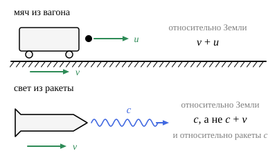

В обычной жизни скорости складываются просто: идёшь по вагону — твоя скорость относительно земли равна скорости поезда плюс твоя. Но со светом так не получается. Эйнштейн разобрался, почему, и создал специальную теорию относительности (СТО). На ЕГЭ она встречается в задаче 16 и в задаче 18.

СТО проходят только в 11 классе, поэтому все шаги здесь — уровня 11 класса. Пригодятся темы «Основы кинематики» (системы отсчёта, сложение скоростей), «Механическая энергия» и «Электромагнитные волны» (скорость света).

## Шаг 1. Принцип относительности (11 класс)

**Принцип относительности**: все физические законы одинаковы во всех инерциальных системах отсчёта. Никаким опытом внутри равномерно движущегося поезда без окон нельзя узнать, едет он или стоит.

Галилей говорил это про механику. Эйнштейн распространил принцип на все законы, включая электромагнетизм и свет.

## Шаг 2. Скорость света одинакова для всех (11 класс)

**Постоянство скорости света**: скорость света в вакууме одинакова во всех инерциальных системах отсчёта и не зависит от скорости источника и приёмника:

$$
c = 3 \cdot 10^8\ \text{м/с}.
$$

Фонарик на ракете, летящей со скоростью $0{,}5c$, светит вперёд — и свет относительно Земли идёт со скоростью $c$, а не $1{,}5c$. Классическое сложение скоростей для света не работает.

Отсюда следует: никакое тело и никакой сигнал не может двигаться быстрее света. Скорость света — предельная скорость передачи взаимодействий.

<pp-task id="ks-sr-01"></pp-task>

## Шаг 3. Энергия покоя (11 класс)

Главная формула СТО связывает массу и энергию. Любое тело массой $m$, даже покоящееся, обладает **энергией покоя**:

$$
E_0 = m c^2.
$$

- $m$ — масса тела, кг;
- $c$ — скорость света, м/с;
- $E_0$ — энергия покоя, Дж.

Энергия покоя огромна: $c^2 = 9 \cdot 10^{16}\ \text{м}^2/\text{с}^2$, и в одном грамме вещества — $9 \cdot 10^{13}\ \text{Дж}$, как при сгорании тысяч тонн бензина.

<pp-task id="ks-sr-02"></pp-task>

## Шаг 4. Энергия и масса меняются вместе (11 класс)

Если энергия покоящейся системы изменяется на $\Delta E$, её масса меняется на

$$
\Delta m = \frac{\Delta E}{c^2}.
$$

Нагретый чайник чуть-чуть тяжелее холодного, сжатая пружина — тяжелее несжатой. В быту это изменение ничтожно. Но оно объясняет энергию ядерных реакций: масса продуктов меньше массы исходных ядер, а разница выделяется в виде энергии.

<pp-task id="ks-sr-03"></pp-task>

## Шаг 5. Энергия в мегаэлектронвольтах (11 класс)

Для частиц джоули неудобны. Энергию покоя частиц выражают в мегаэлектронвольтах:

$$
1\ \text{эВ} = 1{,}6 \cdot 10^{-19}\ \text{Дж}, \qquad 1\ \text{МэВ} = 1{,}6 \cdot 10^{-13}\ \text{Дж}.
$$

Энергия покоя электрона около $0{,}51\ \text{МэВ}$, протона — около $938\ \text{МэВ}$.

<pp-task id="ks-sr-04"></pp-task>

## Шаг 6. Полная энергия свободной частицы (11 класс)

Энергия движущейся частицы больше энергии покоя:

$$
E = \frac{m c^2}{\sqrt{1 - \dfrac{v^2}{c^2}}}.
$$

Кинетическая энергия — разность: $E_{\text{к}} = E - mc^2$. При малых скоростях ($v \ll c$) она совпадает с привычной $mv^2/2$. При $v \to c$ энергия неограниченно растёт — поэтому разогнать тело до скорости света нельзя.

Полезное число: при $v = 0{,}6c$ корень равен $\sqrt{1 - 0{,}36} = 0{,}8$, и $E = 1{,}25\,mc^2$.

<pp-task id="ks-sr-05"></pp-task>

## Шаг 7. Частицы без массы (11 класс)

Для частиц без массы покоя (фотонов) энергия и импульс связаны просто:

$$
E = p c.
$$

Они всегда движутся со скоростью $c$ и не могут покоиться. Подробнее — в теме «Фотоны».

<pp-task id="ks-sr-06"></pp-task>

## Частые ловушки

- **Складывают скорость света со скоростью источника.** Скорость света в вакууме всегда $c$.
- **Забывают возвести $c$ в квадрат.** $c^2 = 9 \cdot 10^{16}\ \text{м}^2/\text{с}^2$.
- **Путают энергию покоя и кинетическую.** У покоящегося тела кинетическая энергия нулевая, а энергия покоя — $mc^2$.
- **Переводят МэВ в джоули неправильно.** $1\ \text{МэВ} = 1{,}6 \cdot 10^{-13}\ \text{Дж}$.

## Как это выглядит на ЕГЭ

*Чему равна энергия покоя электрона? Масса электрона $9{,}1 \cdot 10^{-31}\ \text{кг}$. Ответ дай в МэВ.*

$$
E_0 = m c^2 = 9{,}1 \cdot 10^{-31} \cdot 9 \cdot 10^{16} \approx 8{,}2 \cdot 10^{-14}\ \text{Дж}.
$$

Переводим в электронвольты: делим на $1{,}6 \cdot 10^{-19}$:

$$
E_0 \approx 5{,}1 \cdot 10^5\ \text{эВ} \approx 0{,}51\ \text{МэВ}.
$$

Это число стоит запомнить: энергия покоя электрона около полумегаэлектронвольта.

## Коротко

- Законы физики одинаковы во всех ИСО.
- Скорость света в вакууме $c$ одинакова во всех ИСО; быстрее $c$ двигаться нельзя.
- $E_0 = mc^2$; $\Delta m = \Delta E/c^2$.
- $E = mc^2/\sqrt{1 - v^2/c^2}$; при $v \ll c$ $E_{\text{к}} \approx mv^2/2$.
- Фотон: $E = pc$.
