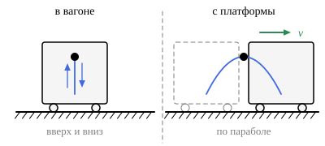

В самолёте на высоте десять километров, при скорости ${900\ \text{км/ч},}$ стюардесса наливает чай. Струя падает точно в чашку, как на кухне. Мяч, подброшенный в вагоне ровно идущего поезда, возвращается прямо в руку, а не отстаёт к хвосту вагона. Почему движение самолёта и поезда никак не мешает?

## Корабль Галилея

Ещё Галилей предлагал опыт. Запритесь в каюте корабля без окон. Пусть летают мухи, капает вода из кувшина в узкое горлышко, вы прыгаете и бросаете мяч. Пока корабль стоит, всё идёт привычно. Теперь пусть он плывёт **равномерно и прямолинейно**, без качки. Ни в одном опыте вы не заметите разницы: капли падают в то же горлышко, прыжок в сторону носа и в сторону кормы одинаково длинный.

Такие системы отсчёта мы уже встречали — это **инерциальные** системы (урок 5.3 из механики). В них тело, на которое ничего не действует, сохраняет скорость. Земля — инерциальная система; вагон, корабль, самолёт, движущиеся относительно неё равномерно и прямолинейно, — тоже. Вагон, который тормозит или поворачивает, — нет: там мяч «сам» катится по полу, и движение сразу заметно.

## Законы одни, движения разные

Посмотрим на мяч из вагона двумя глазами. Пассажир подбросил его вертикально вверх.

- **В вагоне** мяч летит вверх и вниз по вертикали и через время ${2v_0/g}$ возвращается в руку.
- **С платформы** у мяча есть ещё и скорость вагона. Он летит по параболе, как камень, брошенный под углом, и падает в ту же руку: рука уехала вперёд вместе с ним.

Траектории разные, скорости разные (их пересчитывают по закону сложения скоростей, урок 1.6 из механики). Но **законы одни и те же**: и пассажир, и человек на платформе объясняют полёт одним вторым законом Ньютона с одним ускорением $g.$ Время полёта у обоих одно.

## Принцип относительности

**Принцип относительности**: все законы физики одинаковы во всех инерциальных системах отсчёта.

Отсюда следствие: **никаким опытом внутри** инерциальной системы нельзя узнать, движется она равномерно или покоится. Нет «настоящего» покоя: Земля летит вокруг Солнца со скоростью ${30\ \text{км/с},}$ а опыты в лаборатории этого не чувствуют.

Галилей говорил это о механике. В 1905 году Эйнштейн распространил принцип на **все** законы — и электричества, и магнетизма, и света. Это **первый постулат** специальной теории относительности. «Специальной» — потому что речь только об инерциальных системах.

**Пример.** В каюте корабля, который плывёт равномерно со скоростью ${12\ \text{м/с},}$ уронили ключи с высоты ${0{,}45\ \text{м}.}$ Сколько они падают? Ровно столько же, сколько на неподвижной земле:

$$
t = \sqrt{\frac{2h}{g}} = \sqrt{\frac{2 \cdot 0{,}45}{10}} = 0{,}3\ \text{с}.
$$

Скорость корабля в ответ не входит.

<pp-task id="ks-sr-07"></pp-task>

## Почему это важно для света

Скорость электромагнитной волны ${c = 3 \cdot 10^8\ \text{м/с}}$ следует из законов электромагнетизма (урок 13.3 из электродинамики). Если эти законы одинаковы во всех инерциальных системах, то и скорость $c$ во всех одинакова — как бы ни двигались источник и наблюдатель. Это расходится с привычным сложением скоростей. Дальше разберёмся, как так.

Проверь себя: поезд резко тормозит. Можно ли теперь по опытам в вагоне без окон узнать, что он движется не равномерно?

Можно: чай в стакане наклоняется к стенке, мяч катится вперёд по полу. Тормозящий поезд — неинерциальная система, принцип относительности о нём ничего не говорит.

## Частые ловушки

- **Думают, что в движущемся вагоне всё одинаково, включая скорости.** Одинаковы законы. Скорость и траектория тела зависят от системы отсчёта.
- **Применяют принцип к разгоняющемуся или поворачивающему вагону.** Только к инерциальным системам: движение равномерное и прямолинейное.
- **Считают, что Земля «на самом деле» покоится.** Абсолютного покоя нет: Земля — одна из инерциальных систем.

## Коротко

- Инерциальные системы — Земля и всё, что движется относительно неё равномерно и прямолинейно.
- Принцип относительности: законы физики одинаковы во всех инерциальных системах.
- Опытами внутри такой системы нельзя узнать, движется она или покоится.
- Эйнштейн распространил принцип на все законы, включая электромагнетизм: это первый постулат СТО.
