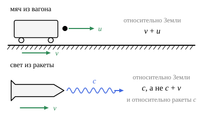

Поезд едет со скоростью $v,$ с него бросают мяч вперёд со скоростью $u.$ Относительно земли мяч летит со скоростью ${v + u}$ (урок 1.6 из механики). А если с поезда светит фонарь? По той же логике свет должен лететь со скоростью ${c + v.}$ Опыт говорит: нет.

## Что показали опыты

Земля летит вокруг Солнца со скоростью ${30\ \text{км/с}.}$ В 1887 году Майкельсон и Морли сравнивали скорость света вдоль этого движения и поперёк. Прибор заметил бы разницу в десятки раз меньше ожидаемой, но никакой разницы не нашёл.

Ещё нагляднее опыт 1964 года в ЦЕРНе. Частицы, летевшие почти со скоростью света, ${0{,}99975c,}$ распадались и испускали вспышки излучения вперёд. По классике скорость вспышек относительно лаборатории была бы почти $2c.$ Измерили $c$ — с точностью до сотых долей процента.

## Второй постулат

**Постулат постоянства скорости света**: скорость света в вакууме одинакова во всех инерциальных системах отсчёта и не зависит от скорости источника и приёмника.

$$
c = 3 \cdot 10^8\ \text{м/с}.
$$

Точнее, ${c = 299\,792\,458\ \text{м/с},}$ но в задачах берут ${3 \cdot 10^8\ \text{м/с}.}$ Это та самая скорость электромагнитной волны (урок 13.3 из электродинамики). Догоняй свет, лети ему навстречу — всё равно измеришь $c.$

Вместе с принципом относительности (урок 1.1) это два постулата СТО. На них держится вся теория.

**Пример.** Ракета летит от Земли со скоростью ${0{,}3c}$ и включает фонарь, направленный назад, к Земле. С какой скоростью свет фонаря идёт относительно Земли? По классике было бы ${c - 0{,}3c = 0{,}7c.}$ На деле — ровно $c.$ Сколько свет будет лететь до Земли, зависит только от расстояния в момент вспышки: ${t = s/c.}$

<pp-task id="ks-sr-01"></pp-task>

## Классика — частный случай

Значит, закон сложения скоростей неверен? Он **приближённый**. Пока скорости много меньше ${c,}$ его ошибка ничтожна: у поезда и самолёта она меньше миллионной доли процента. Поэтому в механике скорости смело складывают.

Близко к $c$ закон ломается. Пусть два корабля летят навстречу друг другу, каждый со скоростью ${0{,}7c}$ относительно Земли. По классике один движется относительно другого со скоростью ${1{,}4c.}$ СТО даёт ${0{,}94c}$ — меньше скорости света. Формулу для этого в ЕГЭ не спрашивают, важен вывод.

## Быстрее света нельзя

Из постулатов следует: **никакое тело и никакой сигнал не может двигаться быстрее света в вакууме**. Скорость $c$ — предельная скорость передачи любых взаимодействий. Почему тело нельзя даже разогнать до $c,$ станет ясно в уроке 1.5.

<pp-task id="ks-sr-08"></pp-task>

Проверь себя: космонавт на ракете, летящей очень быстро, догоняет световой импульс. Какую скорость света относительно ракеты он измерит?

Ту же $c.$ Скорость света в вакууме одна во всех инерциальных системах, как бы быстро ни летела ракета.

## Частые ловушки

- **Складывают скорость света со скоростью источника.** Свет из ракеты идёт со скоростью ${c,}$ а не ${c + v}$ и не ${c - v.}$
- **Считают классическое сложение скоростей ошибкой.** Для скоростей, малых по сравнению с ${c,}$ оно верно с огромной точностью.
- **Забывают слова «в вакууме».** В стекле и в воде свет идёт медленнее (урок 13.7 из электродинамики); постулат говорит о вакууме.

## Коротко

- Скорость света в вакууме одна во всех инерциальных системах: ${c = 3 \cdot 10^8\ \text{м/с}.}$
- Она не зависит от скорости источника и приёмника.
- Сложение скоростей ${v + u}$ работает только при скоростях, малых по сравнению с ${c.}$
- Быстрее $c$ не движется ни тело, ни сигнал.
