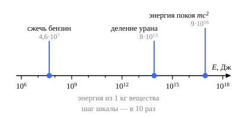

Солнце светит уже четыре с половиной миллиарда лет. Если бы оно горело, как уголь в печке, его хватило бы на несколько тысяч лет. Откуда в веществе такой запас энергии?

## Формула Эйнштейна

Из постулатов СТО Эйнштейн вывел: у тела массой $m$ есть энергия, даже если оно покоится и никуда не поднято. Это **энергия покоя**:

$$
E_0 = mc^2.
$$

- $m$ — масса тела, кг;
- $c = 3 \cdot 10^8\ \text{м/с}$ — скорость света;
- $E_0$ — энергия покоя, Дж.

Масса оказывается мерой энергии, запасённой в теле. Кинетической энергии у покоящегося тела нет (урок 12.2 из механики), а энергия покоя есть.

## Насколько это много

Скорость света в квадрате — огромное число:

$$
c^2 = (3 \cdot 10^8)^2 = 9 \cdot 10^{16}\ \text{м}^2/\text{с}^2.
$$

**Пример.** Энергия покоя ${1\ \text{кг}}$ вещества

$$
E_0 = 1 \cdot 9 \cdot 10^{16} = 9 \cdot 10^{16}\ \text{Дж}.
$$

Сгорание килограмма бензина даёт ${4{,}6 \cdot 10^7\ \text{Дж}.}$ Чтобы получить ${9 \cdot 10^{16}\ \text{Дж},}$ пришлось бы сжечь

$$
\frac{9 \cdot 10^{16}}{4{,}6 \cdot 10^7} \approx 2 \cdot 10^9\ \text{кг},
$$

два миллиона тонн бензина.

Обычно выделяется лишь крохотная доля энергии покоя. При горении — меньше миллиардной. Даже при делении урана в атомном реакторе — около одной тысячной. Солнце живёт так долго потому, что в его недрах идут ядерные реакции: подробнее — в разделе «Квантовая физика».

<pp-task id="ks-sr-02"></pp-task>

Формулу можно читать и обратно: по энергии покоя найти массу, ${m = E_0/c^2.}$

<pp-task id="ks-sr-09"></pp-task>

## Энергия частиц в мегаэлектронвольтах

Для отдельных частиц джоули неудобны: числа выходят с огромными отрицательными степенями. Энергию частиц мерят в **электронвольтах** (урок 2.8 из электродинамики): ${1\ \text{эВ}}$ — энергия, которую получает электрон, пройдя напряжение ${1\ \text{В}.}$ Для энергии покоя берут единицу в миллион раз больше — **мегаэлектронвольт**:

$$
\begin{aligned}
1\ \text{эВ} &= 1{,}6 \cdot 10^{-19}\ \text{Дж}, \\
1\ \text{МэВ} &= 10^6\ \text{эВ} = 1{,}6 \cdot 10^{-13}\ \text{Дж}.
\end{aligned}
$$

Из джоулей в мегаэлектронвольты — **делим** на ${1{,}6 \cdot 10^{-13},}$ обратно — умножаем.

**Пример.** Масса электрона ${9{,}1 \cdot 10^{-31}\ \text{кг}.}$ Его энергия покоя

$$
E_0 = mc^2 = 9{,}1 \cdot 10^{-31} \cdot 9 \cdot 10^{16} \approx 8{,}2 \cdot 10^{-14}\ \text{Дж}.
$$

В мегаэлектронвольтах:

$$
E_0 \approx \frac{8{,}2 \cdot 10^{-14}}{1{,}6 \cdot 10^{-13}} \approx 0{,}51\ \text{МэВ}.
$$

Это число стоит помнить: энергия покоя электрона — около полумегаэлектронвольта. В таблицах массы частиц часто так и дают — энергией покоя в мегаэлектронвольтах.

<pp-task id="ks-sr-04"></pp-task>

<pp-task id="ks-sr-10"></pp-task>

Проверь себя: камень лежит на земле. Есть ли у него энергия покоя? А кинетическая?

Энергия покоя есть: ${E_0 = mc^2,}$ у любого тела с массой. Кинетической нет: камень не движется.

## Частые ловушки

- **Забывают возвести $c$ в квадрат.** ${c^2 = 9 \cdot 10^{16}\ \text{м}^2/\text{с}^2.}$
- **Пишут ${mc^2/2}$ по привычке к ${mv^2/2}.$** Двойки в энергии покоя нет.
- **Подставляют массу в граммах.** В формулу — килограммы.
- **Путают, на что делить.** Джоули в МэВ — делить на ${1{,}6 \cdot 10^{-13};}$ на ${1{,}6 \cdot 10^{-19}}$ получатся электронвольты.

## Коротко

- Энергия покоя ${E_0 = mc^2}$ есть у любого тела с массой.
- В ${1\ \text{кг}}$ вещества ${9 \cdot 10^{16}\ \text{Дж}.}$
- ${1\ \text{МэВ} = 1{,}6 \cdot 10^{-13}\ \text{Дж}.}$
- Энергия покоя электрона около ${0{,}51\ \text{МэВ}.}$
