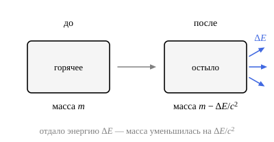

Если в теле запасена энергия ${mc^2,}$ то что будет с массой, когда энергия тела изменится? Тело остыло, отдав тепло воздуху. Стало ли оно легче?

## Масса уходит вместе с энергией

Стало. Из ${E_0 = mc^2}$ (урок 1.3) следует: если энергия покоящегося тела изменилась на ${\Delta E,}$ его масса изменилась на

$$
\Delta m = \frac{\Delta E}{c^2}.
$$

- ${\Delta E}$ — сколько энергии тело получило или отдало, Дж;
- ${\Delta m}$ — на сколько выросла или уменьшилась масса, кг.

Получило энергию — масса выросла. Отдало — уменьшилась. Неважно, в каком виде энергия: тепло, свет, энергия деформации, химическая энергия.

Отсюда примеры, которые звучат странно, но верны:

- нагретый чайник тяжелее холодного;
- сжатая пружина тяжелее несжатой — в ней запасена энергия упругости (урок 12.5 из механики);
- заряженный аккумулятор тяжелее разряженного.

## Почему в быту этого не видно

Делим на ${c^2 = 9 \cdot 10^{16}.}$ Любые бытовые энергии дают ничтожную разницу масс.

**Пример.** При сгорании ${1\ \text{кг}}$ бензина выделяется ${4{,}6 \cdot 10^7\ \text{Дж}.}$ На сколько масса дыма и паров меньше массы бензина и кислорода, которые сгорели?

$$
\Delta m = \frac{4{,}6 \cdot 10^7}{9 \cdot 10^{16}} \approx 5{,}1 \cdot 10^{-10}\ \text{кг}.
$$

Это около половины микрограмма. Никакие весы такого не замечают. Поэтому в химии и считают, что масса сохраняется.

<pp-task id="ks-sr-03"></pp-task>

## Где это заметно

Там, где энергии огромны.

**Солнце** излучает каждую секунду ${3{,}8 \cdot 10^{26}\ \text{Дж}.}$ Значит, за секунду оно теряет

$$
\Delta m = \frac{3{,}8 \cdot 10^{26}}{9 \cdot 10^{16}} \approx 4{,}2 \cdot 10^9\ \text{кг},
$$

больше четырёх миллионов тонн. За миллиарды лет это меньше тысячной доли его массы.

**Ядерные реакции.** Масса ядер после реакции меньше, чем до неё, на заметную долю. Эта разница и выделяется энергией: ${\Delta E = \Delta m\, c^2.}$ Подробнее — в темах «Атомное ядро» и «Ядерные реакции».

<pp-task id="ks-sr-11"></pp-task>

<pp-task id="ks-sr-12"></pp-task>

Проверь себя: телефон зарядили. Его масса выросла, уменьшилась или не изменилась?

Выросла: аккумулятор получил энергию, а с ней и массу ${\Delta E/c^2.}$ Разница — меньше миллиардной доли грамма, на весах её не увидеть.

## Частые ловушки

- **Делят на $c,$ а не на $c^2.$** ${\Delta m = \Delta E/c^2.}$
- **Думают, что масса меняется только в ядерных реакциях.** Она меняется при любой передаче энергии, просто обычно ничтожно.
- **Говорят, что масса «превращается» в энергию и исчезает.** Энергия уносит с собой массу: что потеряло тело, то унесли тепло и излучение.
- **Путают знак.** Получило энергию — масса выросла; отдало — уменьшилась.

## Коротко

- ${\Delta m = \Delta E/c^2}$: изменилась энергия — изменилась масса.
- Нагрели, сжали, зарядили — масса выросла.
- В быту изменение ничтожно; в ядерных реакциях и звёздах — заметно.
