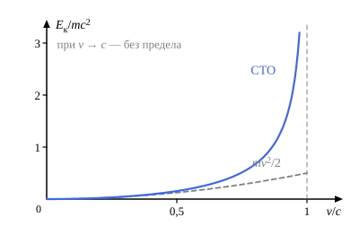

В 1964 году электроны разгоняли до энергий от половины мегаэлектронвольта до полутора десятков и засекали, за какое время они пролетают несколько метров. По формуле ${mv^2/2}$ электрону с кинетической энергией всего ${0{,}26\ \text{МэВ}}$ уже полагалась бы скорость света, а с ${4{,}5\ \text{МэВ}}$ — вчетверо больше. Но все электроны летели медленнее света, а чем больше была энергия, тем меньше прибавлялось скорости. Где ошибается привычная формула?

## Полная энергия

СТО даёт энергию свободной частицы, движущейся со скоростью $v$:

$$
E = \frac{mc^2}{\sqrt{1 - \dfrac{v^2}{c^2}}}.
$$

Это **полная энергия**. Покоящаяся частица ${(v = 0)}$ имеет ${E = mc^2}$ — энергию покоя (урок 1.3). Движущаяся — больше: знаменатель меньше единицы.

Множитель

$$
\gamma = \frac{1}{\sqrt{1 - v^2/c^2}}
$$

показывает, во сколько раз полная энергия больше энергии покоя: ${E = \gamma mc^2.}$ Вот как он растёт:

| ${v}$ | ${0{,}1c}$ | ${0{,}3c}$ | ${0{,}9c}$ | ${0{,}99c}$ |
|---|---|---|---|---|
| ${\gamma}$ | ${1{,}005}$ | ${1{,}048}$ | ${2{,}29}$ | ${7{,}09}$ |

## Кинетическая энергия

Кинетическая энергия — то, что движение добавило к энергии покоя:

$$
E_{\text{к}} = E - mc^2.
$$

При малых скоростях она совпадает с привычной ${mv^2/2}$ (урок 12.2 из механики). При ${v = 0{,}01c}$ две формулы расходятся меньше чем на сотую долю процента, при скорости ракеты — на ничтожно малую. Так что механика Ньютона — частный случай СТО для медленных тел.

Близко к $c$ всё иначе. Знаменатель ${\sqrt{1 - v^2/c^2}}$ стремится к нулю, и энергия растёт **без предела**.

## Почему нельзя догнать свет

Чтобы разогнать тело до ${v = c,}$ понадобилась бы бесконечная энергия. Поэтому частицы с массой всегда медленнее света. Ускоритель может сообщать электрону всё больше энергии, но его скорость лишь приближается к $c.$ Этим и объясняется опыт с электронами: энергия росла, а скорость упиралась в предел.

**Пример.** Частица летит со скоростью ${0{,}96c.}$ Во сколько раз её полная энергия больше энергии покоя?

$$
\sqrt{1 - 0{,}96^2} = \sqrt{1 - 0{,}9216} = \sqrt{0{,}0784} = 0{,}28,
$$

$$
\frac{E}{mc^2} = \frac{1}{0{,}28} \approx 3{,}57.
$$

Кинетическая энергия ${E_{\text{к}} \approx 2{,}57\,mc^2}$ — у электрона это около ${1{,}3\ \text{МэВ}.}$ А классическая формула дала бы ${mv^2/2 \approx 0{,}46\,mc^2}$ — в пять с лишним раз меньше.

<pp-task id="ks-sr-05"></pp-task>

## Попробуй сам

Двигай скорость. Точка на сплошной кривой — кинетическая энергия по СТО, полая точка на пунктире — по классической формуле. Столбик справа — полная энергия: энергия покоя внизу и кинетическая сверху. Таблица считает $\gamma,$ энергии в единицах ${mc^2}$ и для электрона в мегаэлектронвольтах.

<pp-relativity>Модель энергии быстрой частицы: ползунок скорости от 0 до 0,99 скорости света, график кинетической энергии по СТО и по классической формуле, столбик полной энергии и таблица множителя γ, полной и кинетической энергии в единицах mc² и для электрона в мегаэлектронвольтах.</pp-relativity>

Посмотри, что выходит:

- до ${0{,}3c}$ две кривые почти сливаются;
- после ${0{,}9c}$ каждая следующая сотая скорости даёт всё больше энергии;
- при ${0{,}99c}$ кинетическая энергия уже в двенадцать с лишним раз больше классической.

<pp-task id="ks-sr-13"></pp-task>

<pp-task id="ks-sr-14"></pp-task>

Проверь себя: можно ли, долго действуя на электрон силой, разогнать его до скорости света?

Нельзя. Энергия электрона растёт без предела при ${v \to c,}$ а скорость только приближается к $c.$ Бесконечной энергии не сообщишь.

## Частые ловушки

- **Умножают на корень вместо деления.** Полная энергия больше энергии покоя: ${E = mc^2/\sqrt{1 - v^2/c^2}.}$
- **Забывают корень** и делят на ${1 - v^2/c^2.}$
- **Путают полную и кинетическую энергию.** ${E_{\text{к}} = E - mc^2.}$
- **Считают ${mv^2/2}$ для быстрых частиц.** Близко к $c$ она сильно занижает энергию.

## Коротко

- Полная энергия ${E = mc^2/\sqrt{1 - v^2/c^2};}$ кинетическая ${E_{\text{к}} = E - mc^2.}$
- При скоростях, малых по сравнению с ${c,}$ ${E_{\text{к}} \approx mv^2/2.}$
- При ${v \to c}$ энергия растёт без предела: тело с массой не разогнать до скорости света.
