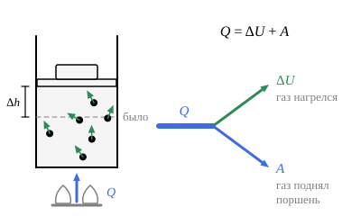

Первый закон термодинамики — это закон сохранения энергии для тепловых процессов. Без него не решается почти ни одна задача 8, 9, 10 и 24 по термодинамике.

Что энергия не исчезает, а переходит из механической во внутреннюю и обратно, говорят ещё в 8 классе. Формулу закона и его применение к изопроцессам разбирают в 10. Пригодятся темы «Количество теплоты», «Внутренняя энергия и работа газа» и «Уравнение состояния и изопроцессы».

## Шаг 1. Энергия не исчезает (8 класс)

Мяч упал и остановился — механическая энергия не пропала, она перешла во внутреннюю: мяч и пол чуть нагрелись. Пар в турбине толкает лопатки — внутренняя энергия пара переходит в механическую.

**Закон сохранения и превращения энергии**: энергия не возникает из ничего и не исчезает, она только переходит из одного вида в другой и от одного тела к другому. Для тепловых процессов этот закон и называют первым законом термодинамики.

## Шаг 2. Формулировка (10 класс)

Представь газ в цилиндре под поршнем. Ты подводишь к нему теплоту горелкой. Куда девается энергия? Часть идёт на нагрев газа (растёт внутренняя энергия), часть — на работу: газ расширяется и поднимает поршень.

$$
Q = \Delta U + A_{\text{г}}.
$$

- $Q$ — количество теплоты, полученное газом, Дж ($Q < 0$, если газ отдаёт теплоту);
- $\Delta U$ — изменение внутренней энергии газа, Дж;
- $A_{\text{г}}$ — работа, совершённая газом, Дж.

<pp-task id="ks-first-01"></pp-task>

## Шаг 3. Через работу внешних сил (10 класс)

Та же запись через работу внешних сил: так как $A_{\text{внеш}} = -A_{\text{г}}$,

$$
\Delta U = Q + A_{\text{внеш}}.
$$

Внутренняя энергия растёт, если газ получает теплоту и если над ним совершают работу. Обе формы верны, главное — не перепутать знаки. «Газ сжали, совершив работу $100\ \text{Дж}$» — значит, $A_{\text{внеш}} = 100\ \text{Дж}$, $A_{\text{г}} = -100\ \text{Дж}$. «Газ отдал $50\ \text{Дж}$ теплоты» — значит, $Q = -50\ \text{Дж}$.

<pp-task id="ks-first-02"></pp-task>

## Шаг 4. Изохорный процесс (10 класс)

Дальше — одноатомный идеальный газ и изопроцессы из темы «Уравнение состояния».

**Изохорный** ($V = \text{const}$). Газ не расширяется — работы нет: $A = 0$. Вся теплота идёт на изменение внутренней энергии:

$$
Q = \Delta U = \frac{3}{2} \nu R \Delta T.
$$

<pp-task id="ks-first-03"></pp-task>

## Шаг 5. Изобарный процесс (10 класс)

**Изобарный** ($p = \text{const}$). Работа $A = p\Delta V = \nu R \Delta T$, а $\Delta U = \frac{3}{2}\nu R\Delta T$. Тогда

$$
Q = \frac{5}{2} \nu R \Delta T = \frac{5}{2} p \Delta V.
$$

Удобная пропорция для одноатомного газа при изобарном процессе: $Q : \Delta U : A = 5 : 3 : 2$.

<pp-task id="ks-first-04"></pp-task>

## Шаг 6. Изотермический процесс (10 класс)

**Изотермический** ($T = \text{const}$). Внутренняя энергия не меняется: $\Delta U = 0$. Вся теплота идёт на работу:

$$
Q = A_{\text{г}}.
$$

Газ расширяется при постоянной температуре — он обязательно получает теплоту. Газ сжимают — отдаёт.

<pp-task id="ks-first-05"></pp-task>

## Шаг 7. Адиабатный процесс (10 класс)

**Адиабатный** — без теплообмена: $Q = 0$. Тогда

$$
A_{\text{г}} = -\Delta U.
$$

Газ расширяется — совершает работу за счёт своей внутренней энергии и **охлаждается**. Газ быстро сжимают — он **нагревается**. Так поджигают топливо в дизельном двигателе. Быстрые процессы (теплота не успевает перейти) почти адиабатные.

<pp-task id="ks-first-06"></pp-task>

## Шаг 8. Первый закон на графике (10 класс)

В задачах 9–10 процесс часто показан на графике $p$–$V$. Порядок рассуждения всегда один и тот же:

1. **Работа.** Объём растёт — газ совершает положительную работу, равную площади под графиком. Объём не меняется — работы нет.
2. **Внутренняя энергия.** Для одноатомного идеального газа $U = \frac{3}{2}pV$. Если произведение $pV$ выросло, температура и внутренняя энергия выросли.
3. **Теплота.** Сложи: $Q = \Delta U + A$.

Если и $\Delta U > 0$, и $A > 0$, газ точно **получает** теплоту. Если оба меньше нуля, газ **отдаёт** теплоту.

Например, газ переходит из состояния ($p$, $V$) в состояние ($p/2$, $2V$). Произведение $pV$ не изменилось — температура та же, $\Delta U = 0$. Объём вырос — работа положительна. Значит, газ получил теплоту, хотя давление упало.

<pp-task id="ks-first-07"></pp-task>

## Частые ловушки

- **Путают работу газа и работу над газом.** «Газ сжали, совершив работу $100\ \text{Дж}$» — значит, $A_{\text{г}} = -100\ \text{Дж}$.
- **В изотермическом процессе считают $Q = 0$.** Нет, $\Delta U = 0$, а теплота есть и равна работе.
- **В адиабатном процессе считают $\Delta T = 0$.** Нет, $Q = 0$, а температура меняется.
- **Используют $\frac{5}{2}$ для изохорного процесса.** Для изохорного $Q = \frac{3}{2}\nu R\Delta T$; $\frac{5}{2}$ — только для изобарного (одноатомный газ).

## Как это выглядит на ЕГЭ

*Одноатомному идеальному газу при постоянном давлении сообщили $500\ \text{Дж}$ теплоты. Какую работу совершил газ?*

При изобарном процессе для одноатомного газа $Q = \frac{5}{2}\nu R\Delta T$, а $A = \nu R \Delta T$. Значит,

$$
A = \frac{2}{5} Q = \frac{2}{5} \cdot 500 = 200\ \text{Дж}.
$$

Остальные $300\ \text{Дж}$ пошли на увеличение внутренней энергии. Проверка: $200 + 300 = 500$.

## Коротко

- $Q = \Delta U + A_{\text{г}}$; то же: $\Delta U = Q + A_{\text{внеш}}$.
- Изохора: $A = 0$, $Q = \Delta U$.
- Изобара (одноатомный): $Q : \Delta U : A = 5 : 3 : 2$.
- Изотерма: $\Delta U = 0$, $Q = A$.
- Адиабата: $Q = 0$; расширение — охлаждение, сжатие — нагрев.
