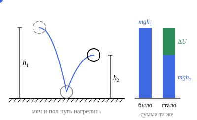

В механике мы видели: если нет трения, механическая энергия сохраняется (урок 12.3 из механики). А если трение есть, механическая энергия убывает. Но тело при этом нагревается — значит, энергия куда-то перешла. В этом уроке — общий закон, который это объясняет.

## Куда делась энергия мяча

Отпусти мяч с высоты $h_1$. Он ударится о пол и подпрыгнет, но ниже — на высоту $h_2$. Потом ещё ниже, и наконец остановится. Механическая энергия мяча уменьшилась с ${mgh_1}$ до ${mgh_2}$, а потом до нуля.

Пропала ли она? Нет. При каждом ударе мяч и пол немного деформируются и чуть-чуть нагреваются. В уроке 6.1 мы выяснили, что это значит: выросла **внутренняя энергия** мяча и пола. Механическая энергия, которую мяч потерял, перешла во внутреннюю:

$$
\Delta U = mgh_1 - mgh_2.
$$

Так же в уроке 12.7 из механики санки тормозили трением, а полозья и снег нагревались: ${Q = E_1 - E_2}$.

**Пример.** Санки массой $7\ \text{кг}$ съехали с горки высотой $4\ \text{м}$, а внизу их скорость была $6\ \text{м/с}$. Наверху энергия ${mgh = 7 \cdot 10 \cdot 4 = 280\ \text{Дж}}$, внизу ${\frac{mv^2}{2} = \frac{7 \cdot 36}{2} = 126\ \text{Дж}}$. Остальные ${280 - 126 = 154\ \text{Дж}}$ стали внутренней энергией санок и снега.

<pp-task id="ks-first-08"></pp-task>

## Закон сохранения и превращения энергии

Этот пример — частный случай одного из главных законов природы.

**Закон сохранения и превращения энергии**: энергия не возникает из ничего и не исчезает, она только переходит из одного вида в другой и от одного тела к другому.

Примеры вокруг нас:

- **механическая → внутренняя**: удар, трение, торможение — тела нагреваются;
- **внутренняя → механическая**: горячий пар толкает лопатки турбины, газы после вспышки топлива толкают поршень двигателя;
- **внутренняя одного тела → внутренняя другого**: горячий чай греет ложку (теплопередача из урока 5.1).

Для тепловых процессов, где энергия переходит в виде работы и теплоты, этот закон называют **первым законом термодинамики**. Его точную формулу для газа мы запишем в уроке 7.2.

Проверь себя: может ли отпущенный мяч подпрыгнуть выше, чем высота, с которой он упал?

Нет. Тогда его механическая энергия выросла бы, а взять её мячу неоткуда: ни один вид энергии не возникает из ничего. Подпрыгнуть выше мяч может, только если его бросили вниз — тогда в начале у него была ещё и кинетическая энергия.

<pp-task id="ks-first-09"></pp-task>

## Вечный двигатель невозможен

Сотни лет изобретатели пытались построить **вечный двигатель** — машину, которая совершает работу, ничего не потребляя: без топлива, без ветра, без падающей воды. Колёса с грузами, магниты, хитрые насосы — ни один не заработал. Закон сохранения энергии объясняет почему: работа — это переданная энергия, и если машина ниоткуда энергию не получает, то и отдать ей нечего. А из-за трения любая настоящая машина ещё и теряет часть энергии на нагрев.

## Частые ловушки

- **«Энергия пропала».** При трении и ударе механическая энергия не исчезает, а становится внутренней.
- **«Сохраняется механическая энергия».** Только без трения и ударов. Полная энергия — механическая плюс внутренняя — сохраняется всегда.
- **Граммы вместо килограммов.** В ${mgh}$ и ${\frac{mv^2}{2}}$ масса — в килограммах.

## Коротко

- Энергия не возникает и не исчезает, а только переходит из одного вида в другой и от тела к телу.
- Потерянная механическая энергия становится внутренней: ${\Delta U = E_1 - E_2}$.
- Вечный двигатель невозможен.
- Для тепловых процессов этот закон — первый закон термодинамики.

Дальше — урок 7.2: газ получает теплоту. Куда она идёт?
