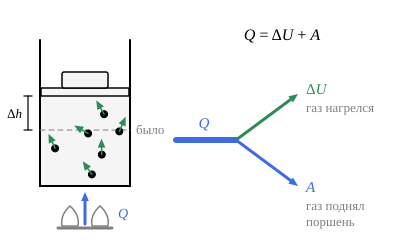

В уроке 6.2 мы узнали два способа изменить внутреннюю энергию газа: передать ему теплоту или совершить работу. А в уроке 6.7 газ за цикл совершал работу, хотя его внутренняя энергия в итоге не менялась, и мы спросили: откуда взялась энергия? В этом уроке — закон, который связывает теплоту, работу и внутреннюю энергию.

## Куда идёт теплота

Поставь цилиндр с газом под поршнем на горелку. Газ получает теплоту $Q$. Что с ней происходит?

- Газ нагревается: молекулы движутся быстрее, растёт **внутренняя энергия** (урок 6.3).
- Газ расширяется и поднимает поршень с грузом — совершает **работу** (урок 6.5).

Энергия не исчезает и не возникает из ничего (урок 7.1). Значит, вся полученная теплота делится на эти две части:

$$
Q = \Delta U + A.
$$

- $Q$ — количество теплоты, полученное газом, Дж;
- $\Delta U$ — изменение внутренней энергии газа, Дж;
- $A$ — работа, которую совершил **сам газ**, Дж (как в уроке 6.5).

Это и есть **первый закон термодинамики**: количество теплоты, переданное газу, идёт на изменение его внутренней энергии и на совершение газом работы.

**Пример.** Газ получил $520\ \text{Дж}$ теплоты и, расширяясь, совершил работу $130\ \text{Дж}$. Его внутренняя энергия выросла на

$$
\Delta U = Q - A = 520 - 130 = 390\ \text{Дж}.
$$

<pp-task id="ks-first-01"></pp-task>

## Знаки решают

Формула ${Q = \Delta U + A}$ верна всегда, но каждая величина в ней может быть и отрицательной:

- ${Q < 0}$ — газ не получает, а **отдаёт** теплоту;
- ${\Delta U < 0}$ — внутренняя энергия уменьшается, газ остывает;
- ${A < 0}$ — газ не расширяется, а его **сжимают** (урок 6.5).

Подробнее про знаки — в уроке 7.3. А пока важный случай: газ может совершить работу **больше**, чем получил теплоты. Тогда недостающую энергию он берёт из своего запаса — внутренней энергии.

**Пример.** Газ получил $90\ \text{Дж}$ теплоты и совершил работу $160\ \text{Дж}$:

$$
\Delta U = 90 - 160 = -70\ \text{Дж}.
$$

Внутренняя энергия уменьшилась на $70\ \text{Дж}$: газ остыл, хотя его грели.

Проверь себя: газ получил теплоту, а его температура не изменилась. Совершил ли он работу?

Совершил. Внутренняя энергия идеального газа зависит только от температуры (урок 6.3), значит, ${\Delta U = 0}$, и ${A = Q > 0}$: вся теплота пошла на работу. Газ расширился.

<pp-task id="ks-first-10"></pp-task>

## Теплота и работа — не запасы

Обрати внимание: в формуле стоит изменение внутренней энергии ${\Delta U}$, но не «изменение теплоты» или «изменение работы». Внутренняя энергия — запас газа, она зависит только от его состояния (урок 6.4). А теплота и работа — способы передать энергию (уроки 6.1 и 6.6), и сколько их будет, зависит от процесса. Первый закон говорит, как эти два способа вместе меняют запас.

## Частые ловушки

- **Складывают теплоту и работу.** ${\Delta U = Q - A}$: работа газа уносит часть полученной теплоты.
- **Думают, что газ, который греют, обязательно нагревается.** Если работа газа больше полученной теплоты, ${\Delta U < 0}$.
- **Путают, чья работа.** В ${Q = \Delta U + A}$ — работа самого газа.

## Коротко

- Первый закон термодинамики: ${Q = \Delta U + A}$.
- $Q$ — полученная газом теплота, ${\Delta U}$ — изменение его внутренней энергии, $A$ — работа газа.
- Все три величины могут быть отрицательными.
- Работа больше теплоты — внутренняя энергия уменьшается.

Дальше — урок 7.3: как не запутаться в знаках и как записать закон через работу внешних сил.
