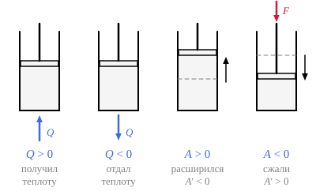

В задачах редко пишут «$Q = -30\ \text{Дж}$». Пишут «газ отдал $30\ \text{Дж}$ теплоты», «газ сжали», «над газом совершили работу». Главная трудность первого закона — перевести эти слова в знаки. В этом уроке — как это делать и вторая, очень удобная форма закона.

## Четыре случая

- Газ **получил** теплоту — ${Q > 0}$; **отдал** — ${Q < 0}$.
- Газ **расширился** — его работа ${A > 0}$; газ **сжали** — ${A < 0}$ (урок 6.5).
- Объём не изменился — ${A = 0}$.

Работа **внешних сил** над газом (груза, руки, атмосферы) равна работе газа с обратным знаком: ${A' = -A}$ (урок 6.5). Газ сжали — внешние силы совершили положительную работу.

## Вторая форма закона

Подставим ${A = -A'}$ в ${Q = \Delta U + A}$ и выразим ${\Delta U}$:

$$
\Delta U = Q + A'.
$$

Так закон читается как ответ на вопрос урока 6.2: внутренняя энергия газа растёт, когда он **получает теплоту** и когда **над ним совершают работу**. Обе формы — одно и то же; бери ту, в которой меньше минусов. Если в задаче сказано «над газом совершили работу», удобна вторая.

**Пример.** Газ сжали, совершив над ним работу $80\ \text{Дж}$, и при этом он отдал $30\ \text{Дж}$ теплоты. Переводим слова в знаки: ${A' = +80\ \text{Дж}}$, ${Q = -30\ \text{Дж}}$. Тогда

$$
\Delta U = Q + A' = -30 + 80 = 50\ \text{Дж}.
$$

То же через работу газа: ${A = -80\ \text{Дж}}$, ${\Delta U = Q - A = -30 + 80 = 50\ \text{Дж}}$. Ответ один.

<pp-task id="ks-first-02"></pp-task>

Проверь себя: газ получил теплоту, а его внутренняя энергия уменьшилась. Газ расширялся или его сжимали?

Расширялся. ${A = Q - \Delta U}$: теплота положительна, ${\Delta U}$ отрицательно, значит, ${A > 0}$ — и даже больше полученной теплоты.

## Как читать условие

| В условии | Знак |
|---|---|
| газ получил, ему сообщили, передали теплоту | ${Q > 0}$ |
| газ отдал теплоту окружающей среде | ${Q < 0}$ |
| газ расширился, совершил работу | ${A > 0}$, ${A' < 0}$ |
| газ сжали, над газом совершили работу | ${A < 0}$, ${A' > 0}$ |
| внутренняя энергия уменьшилась, газ остыл | ${\Delta U < 0}$ |

Если спрашивают «какое количество теплоты получил газ», а он теплоту отдал, ответ — отрицательное число.

<pp-task id="ks-first-11"></pp-task>

## Частые ловушки

- **Путают работу газа и работу над газом.** «Газ сжали, совершив работу $80\ \text{Дж}$» — это ${A' = 80\ \text{Дж}}$, а ${A = -80\ \text{Дж}}$.
- **Смешивают формы.** В ${Q = \Delta U + A}$ — работа газа, в ${\Delta U = Q + A'}$ — работа внешних сил.
- **Теряют знак у отданной теплоты.** «Отдал» — значит, ${Q < 0}$.

## Коротко

- Получил теплоту — ${Q > 0}$, отдал — ${Q < 0}$.
- Расширился — ${A > 0}$, сжали — ${A < 0}$; работа внешних сил ${A' = -A}$.
- Две формы закона: ${Q = \Delta U + A}$ и ${\Delta U = Q + A'}$.

Дальше — урок 7.4: первый закон при нагревании при постоянном объёме и при постоянном давлении.
