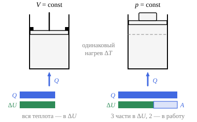

Нагреем один и тот же газ на одни и те же $10$ градусов двумя способами: в закрытом жёстком баллоне и под свободным поршнем. Где понадобится больше теплоты? Первый закон отвечает на это сразу. В этом уроке — изохорный и изобарный процессы одноатомного идеального газа.

## Постоянный объём

В закрытом баллоне или под закреплённым поршнем объём не меняется, и газ **работы не совершает**: ${A = 0}$ (урок 6.5). Первый закон ${Q = \Delta U + A}$ превращается в

$$
Q = \Delta U = \frac{3}{2}\,\nu R\,\Delta T.
$$

Вся теплота идёт на нагрев газа. Если вместо температуры дано давление, удобна форма из урока 6.4: ${Q = \frac{3}{2}V\Delta p}$.

**Пример.** Неон в жёстком баллоне объёмом $5\ \text{л}$ нагрели, и давление выросло на $60\ \text{кПа}$. Газ получил ${Q = 1{,}5 \cdot 5 \cdot 60 = 450\ \text{Дж}}$ (кПа · л $=$ Дж, урок 6.3).

При изохорном **охлаждении** всё наоборот: ${\Delta U < 0}$, и газ отдаёт ровно столько теплоты, на сколько уменьшилась его внутренняя энергия.

<pp-task id="ks-first-03"></pp-task>

## Постоянное давление

Под поршнем с грузом давление постоянно (урок 3.4). Нагретый газ расширяется и совершает работу ${A = p\Delta V}$. По уравнению ${pV = \nu RT}$ при постоянном давлении ${p\Delta V = \nu R\Delta T}$, поэтому

$$
A = \nu R\,\Delta T, \qquad \Delta U = \frac{3}{2}\,\nu R\,\Delta T.
$$

Складываем:

$$
Q = \frac{5}{2}\,\nu R\,\Delta T = \frac{5}{2}\,p\,\Delta V.
$$

Получается удобная пропорция для одноатомного газа при постоянном давлении:

$$
Q : \Delta U : A = 5 : 3 : 2.
$$

Из пяти частей полученной теплоты три идут на нагрев, две — на работу. Поэтому, чтобы нагреть газ на те же градусы, при постоянном давлении нужно в ${5/3}$ раза больше теплоты, чем при постоянном объёме: изменение внутренней энергии то же, но ещё надо оплатить работу.

**Пример.** $3\ \text{моль}$ гелия нагрели на $20\ \text{К}$ при постоянном давлении. ${\nu R\Delta T = 3 \cdot 8{,}31 \cdot 20 = 498{,}6\ \text{Дж}}$ — это работа газа. Изменение внутренней энергии в полтора раза больше: ${747{,}9\ \text{Дж}}$. Теплота ${Q = 2{,}5 \cdot 498{,}6 = 1246{,}5\ \text{Дж}}$.

<pp-task id="ks-first-04"></pp-task>

Проверь себя: при изобарном охлаждении одноатомный газ отдал 50 Дж теплоты. Какую работу он совершил?

${Q = -50\ \text{Дж}}$, а работа — две пятых теплоты: ${A = \frac{2}{5} \cdot (-50) = -20\ \text{Дж}}$. Газ сжался, внутренняя энергия уменьшилась на $30\ \text{Дж}$.

<pp-task id="ks-first-12"></pp-task>

## Попробуй сам

Газ одноатомный, в точке A он занимает $1\ \text{л}$ при $100\ \text{кПа}$ и $250\ \text{К}$, как в уроках 6.5–6.7. Теперь полос три: количество теплоты $Q$, изменение внутренней энергии ${\Delta U}$ и работа газа $A$, все с точки A. Стрелка $Q$ у цилиндра показывает, куда идёт теплота: внутрь газа или наружу.

<pp-iso process="p" work="q">Модель: газ под поршнем с грузом. Ползунок меняет температуру; на графике давления от объёма закрашена работа газа, а полосы показывают количество теплоты, изменение внутренней энергии и работу газа.</pp-iso>

- Нагрей газ при постоянном давлении до $370\ \text{К}$: ${Q = +120\ \text{Дж}}$, ${\Delta U = +72\ \text{Дж}}$, ${A = +48\ \text{Дж}}$ — ровно ${5 : 3 : 2}$.
- Нажми «Заново», выбери ${V = \text{const}}$ и снова нагрей до $370\ \text{К}$. Работы нет, и теплоты нужно меньше: ${Q = \Delta U = +72\ \text{Дж}}$.
- Охлади газ ниже $250\ \text{К}$: стрелка $Q$ повернётся наружу — газ отдаёт теплоту.

## Частые ловушки

- **Берут ${\frac{5}{2}}$ для изохорного процесса.** При постоянном объёме ${Q = \frac{3}{2}\nu R\Delta T}$; ${\frac{5}{2}}$ — только при постоянном давлении.
- **Применяют ${5 : 3 : 2}$ к любому газу и процессу.** Пропорция верна только для одноатомного идеального газа при постоянном давлении.
- **Подставляют конечный объём вместо изменения.** В ${\frac{5}{2}p\Delta V}$ — именно ${\Delta V}$.

## Коротко

- ${V = \text{const}}$: ${A = 0}$, ${Q = \Delta U = \frac{3}{2}\nu R\Delta T = \frac{3}{2}V\Delta p}$.
- ${p = \text{const}}$: ${A = \nu R\Delta T}$, ${Q = \frac{5}{2}\nu R\Delta T = \frac{5}{2}p\Delta V}$.
- Одноатомный газ, ${p = \text{const}}$: ${Q : \Delta U : A = 5 : 3 : 2}$.

Дальше — урок 7.5: газ расширяется, а его температура не меняется.
