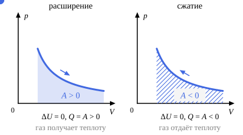

В уроке 6.5 мы расширяли газ в модели при постоянной температуре: работа была, а внутренняя энергия не менялась. И спросили: откуда же газ взял энергию на работу? Теперь у нас есть первый закон — ответим.

## Вся теплота — на работу

Температура постоянна, а внутренняя энергия идеального газа зависит только от температуры (урок 6.3). Значит, ${\Delta U = 0}$, и первый закон ${Q = \Delta U + A}$ даёт

$$
Q = A.
$$

Вот и ответ на вопрос урока 6.5. Газ в воде расширяется и совершает работу, а энергию на неё получает **от воды**, теплотой. Чуть-чуть остыв при расширении, он тут же получает теплоту от окружающей воды, и его температура остаётся той же. Сколько работы газ совершил, столько теплоты и получил.

**Пример.** При изотермическом расширении газ совершил работу $85\ \text{Дж}$. Значит, он получил ${Q = A = 85\ \text{Дж}}$ теплоты, а его внутренняя энергия не изменилась.

<pp-task id="ks-first-05"></pp-task>

## Сжатие: теплота уходит

Теперь медленно сожмём газ, оставив его в воде. Над газом совершают работу (${A' > 0}$, ${A < 0}$), а температура не растёт. Куда девается энергия? Газ отдаёт её воде теплотой: ${Q = A < 0}$. Сколько работы совершили над газом, столько теплоты он и отдал.

Важно слово «медленно»: теплота успевает перейти, и температура газа почти не отличается от температуры воды. Если сжимать быстро, газ нагреется — это уже другой процесс, о нём урок 7.6.

Проверь себя: газ медленно сжимают при постоянной температуре. Почему он не нагревается, хотя над ним совершают работу?

Потому что он тут же отдаёт эту энергию окружающим телам теплотой. ${\Delta U = 0}$, и ${Q = A < 0}$: газ отдаёт ровно столько теплоты, сколько работы над ним совершили.

<pp-task id="ks-first-13"></pp-task>

## Постоянная температура — не значит без теплоты

Слово «изотермический» сбивает с толку: кажется, раз температура не меняется, то и теплообмена нет. Наоборот: при изотермическом расширении газ получает теплоту, и как раз поэтому не остывает. А процесс, где теплообмена действительно нет, — адиабатный, и в нём температура меняется. Не перепутай: при изотермическом ноль — ${\Delta U}$, при адиабатном ноль — $Q$.

## Частые ловушки

- **Считают ${Q = 0}$ при постоянной температуре.** Ноль здесь ${\Delta U}$, а теплота равна работе.
- **Теряют знак при сжатии.** Газ сжимают — ${A < 0}$ и ${Q < 0}$: газ отдаёт теплоту.
- **Применяют к реальным быстрым процессам.** Изотермический процесс — медленный, теплота должна успевать переходить.

## Коротко

- ${T = \text{const}}$: ${\Delta U = 0}$, ${Q = A}$.
- Расширение — газ получает теплоту и всю её превращает в работу.
- Сжатие — газ отдаёт столько теплоты, сколько работы над ним совершили.

Дальше — урок 7.6: процесс без теплообмена.
