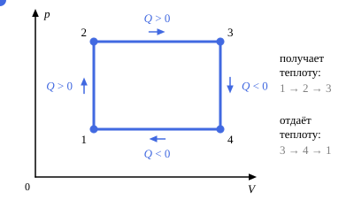

В задачах 9 и 10 процесс часто нарисован на графике $p\text{–}V$, и спрашивают: получал газ теплоту или отдавал, на каком участке, сколько. В этом уроке — порядок рассуждения, который работает всегда.

## Три шага

1. **Работа.** Объём растёт — работа газа положительна и равна площади под графиком; уменьшается — отрицательна; не меняется — работы нет (уроки 6.5 и 6.6).
2. **Внутренняя энергия.** Для одноатомного газа ${U = \frac{3}{2}pV}$ (урок 6.3). Произведение $pV$ выросло — выросли температура и внутренняя энергия: ${\Delta U = \frac{3}{2}\Delta(pV)}$ (урок 6.4).
3. **Теплота.** Сложи: ${Q = \Delta U + A}$.

Если ${\Delta U > 0}$ и ${A > 0}$, газ точно **получает** теплоту. Если оба меньше нуля — точно **отдаёт**. Если знаки разные, надо считать.

Например, газ переходит из состояния ($p$, $V$) в состояние (${p/2}$, ${2V}$). Произведение $pV$ не изменилось — температура та же, ${\Delta U = 0}$. Объём вырос — работа положительна. Значит, газ получил теплоту, хотя давление упало.

**Пример.** Давление газа равномерно падает от $230$ до $150\ \text{кПа}$, а объём растёт от $1$ до $3\ \text{л}$. Работа — площадь трапеции: ${A = \frac{230 + 150}{2} \cdot 2 = 380\ \text{Дж}}$. Произведение $pV$ выросло с $230$ до ${450\ \text{Дж}}$, поэтому ${\Delta U = 1{,}5 \cdot 220 = 330\ \text{Дж}}$. Газ получил

$$
Q = 330 + 380 = 710\ \text{Дж}.
$$

<pp-task id="ks-first-07"></pp-task>

## Теплота на участках цикла

Возьмём прямоугольный цикл из урока 6.7 и пройдём три шага на каждой стороне:

- **1 → 2**, объём постоянен, давление растёт: ${A = 0}$, $pV$ растёт — ${\Delta U > 0}$. Газ **получает** теплоту.
- **2 → 3**, расширение при постоянном давлении: ${A > 0}$ и ${\Delta U > 0}$. Газ **получает** теплоту.
- **3 → 4**, объём постоянен, давление падает: ${A = 0}$, ${\Delta U < 0}$. Газ **отдаёт** теплоту.
- **4 → 1**, сжатие при постоянном давлении: ${A < 0}$ и ${\Delta U < 0}$. Газ **отдаёт** теплоту.

За весь цикл ${\Delta U = 0}$ (урок 6.7), и первый закон даёт: **теплота, полученная газом за цикл, равна работе газа за цикл**. При обходе по часовой стрелке работа положительна — значит, газ получает теплоты больше, чем отдаёт, и разницу превращает в работу. Это и есть ответ на вопрос урока 6.7: энергию на работу газ берёт у нагревателя. Как это устроено в двигателях и какую долю теплоты удаётся превратить в работу — в следующей теме.

Проверь себя: на участке графика давление растёт, а объём уменьшается так, что произведение pV не меняется. Получает газ теплоту или отдаёт?

Отдаёт. ${pV}$ не меняется — температура та же, ${\Delta U = 0}$. Объём уменьшается — ${A < 0}$. Значит, ${Q = A < 0}$: это изотермическое сжатие из урока 7.5.

<pp-task id="ks-first-15"></pp-task>

## Попробуй сам

Пройдём цикл из урока 6.7, теперь с теплотой. Стрелка $Q$ у цилиндра показывает, куда идёт теплота на каждом шаге.

<pp-iso process="V" work="q">Модель: газ под поршнем. Можно выбрать процесс — постоянная температура, давление или объём, или без теплообмена — и ползунком менять свободную величину; полосы показывают количество теплоты, изменение внутренней энергии и работу газа с точки A.</pp-iso>

- При постоянном объёме нагрей газ до $500\ \text{К}$, выбери ${T = \text{const}}$ и расширь до $2\ \text{л}$, выбери ${p = \text{const}}$ и охлади до $250\ \text{К}$. На первых двух участках стрелка $Q$ смотрит внутрь, на последнем — наружу.
- В точке A полоса ${\Delta U}$ пропала, а полосы $Q$ и $A$ одинаковые: за цикл газ получил теплоты больше, чем отдал, и разница — его работа.

## Частые ловушки

- **Судят по одному давлению или объёму.** Давление упало — ещё не значит, что газ отдаёт теплоту: проверь $A$ и ${\Delta U}$.
- **Забывают работу на участке с изменением объёма.** Теплота — сумма ${\Delta U}$ и $A$, а не одно ${\Delta U}$.
- **Считают, что за цикл ${Q = 0}$.** За цикл ноль — ${\Delta U}$, а теплота равна работе.

## Коротко

- Работа — площадь под графиком со знаком, ${\Delta U = \frac{3}{2}\Delta(pV)}$, ${Q = \Delta U + A}$.
- ${\Delta U > 0}$ и ${A > 0}$ — газ получает теплоту; оба меньше нуля — отдаёт.
- За цикл ${\Delta U = 0}$ и ${Q = A}$.

Это последний урок темы. Дальше — тема «Тепловые машины и КПД»: как газ, получая теплоту от нагревателя и отдавая часть холодильнику, совершает полезную работу.
