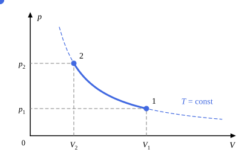

Уравнение Клапейрона связывает сразу три величины. На практике часто одна из них не меняется: газ медленно сжимают, и он успевает остыть до комнатной температуры; газ греют в жёстком баллоне; газ греют под поршнем с грузом. Такие процессы называют **изопроцессами** («изос» по-гречески — «равный»). В каждом из них масса газа постоянна и постоянна ещё одна величина: температура, давление или объём. Начнём с температуры.

## Закон Бойля — Мариотта

Процесс при постоянной температуре называют **изотермическим**. В уравнении Клапейрона $\dfrac{p_1V_1}{T_1} = \dfrac{p_2V_2}{T_2}$ температуры одинаковые и сокращаются:

$$
p_1 V_1 = p_2 V_2, \qquad pV = \text{const}.
$$

Это **закон Бойля — Мариотта**: при постоянной температуре давление газа обратно пропорционально его объёму. Объём уменьшили в $6$ раз — давление выросло в $6$ раз. Объём увеличили вдвое — давление упало вдвое.

Почему так, видно из урока 2.6: $p = nkT$. Температура та же, а концентрация молекул выросла во столько раз, во сколько уменьшился объём. Во столько же раз выросло и давление.

**Пример.** Воздух объёмом $9\ \text{л}$ при давлении $100\ \text{кПа}$ медленно сжали до $6\ \text{л}$. Температура не изменилась.

$$
p_2 = p_1 \frac{V_1}{V_2} = 100 \cdot \frac{9}{6} = 150\ \text{кПа}.
$$

Литры здесь можно не переводить: в отношении $V_1/V_2$ они сокращаются.

<pp-task id="ks-laws-03"></pp-task>

## Изотерма

Как выглядит закон $pV = \text{const}$ на графике в осях $p\text{–}V$? Когда объём растёт, давление падает, но никогда не доходит до нуля; когда объём уменьшается, давление неограниченно растёт. Такая кривая называется **гиперболой**. График изотермического процесса называют **изотермой**.

Для любых двух точек изотермы произведения $p_1V_1$ и $p_2V_2$ одинаковы.

## Попробуй сам

В модели газ в цилиндре под поршнем, цилиндр стоит в воде, поэтому температура не меняется. Двигай ползунок объёма. Красная стрелка у стенки — давление газа. Справа и снизу — три графика состояния газа: $p\text{–}V$, $p\text{–}T$ и $V\text{–}T$. Пунктир — вся линия процесса, сплошная — пройденная часть.

<pp-iso process="T">Модель: газ под поршнем при постоянной температуре. Ползунок меняет объём; давление и графики состояния газа в осях p–V, p–T и V–T меняются вместе с ним.</pp-iso>

- Сожми газ вдвое: давление вдвое больше. Строка под моделью покажет, во сколько раз изменились объём и давление: их произведение не меняется.
- На графике $p\text{–}V$ точка бежит по гиперболе.
- На графиках $p\text{–}T$ и $V\text{–}T$ процесс — отрезок вертикальной прямой: температура одна и та же, меняются только давление и объём.

## Пузырёк со дна

Давление в воде растёт с глубиной: $p = p_{\text{атм}} + \rho g h$ (урок 9.2 из механики). Пузырёк воздуха, всплывая, попадает туда, где давление меньше, и по закону Бойля — Мариотта растёт. Вода всюду одной температуры — процесс изотермический.

<pp-task id="ks-laws-11"></pp-task>

Проверь себя: газ изотермически расширили так, что его давление уменьшилось в 5 раз. Как изменился объём?

Увеличился в $5$ раз: $pV = \text{const}$, давление и объём меняются в обратных отношениях.

## Частые ловушки

- **Думают, что давление и объём меняются в одну сторону.** При $T = \text{const}$ объём уменьшили — давление выросло.
- **Применяют закон, когда температура меняется.** Бойль — Мариотт — только при $T = \text{const}$. Быстро сжатый газ нагревается, и закон уже неточен.
- **Забывают атмосферное давление в задачах про глубину.** На глубине $h$ давление $p_{\text{атм}} + \rho g h$, а не $\rho g h$.
- **Изотерму рисуют прямой.** В осях $p\text{–}V$ это гипербола; прямая она только в осях $p\text{–}T$ или $V\text{–}T$ (вертикальная).

## Коротко

- Изопроцесс: масса постоянна и постоянна ещё одна величина.
- Изотермический процесс ($T = \text{const}$): $pV = \text{const}$, $p_1V_1 = p_2V_2$.
- Изотерма в осях $p\text{–}V$ — гипербола.

Дальше — урок 3.4: газ нагревают при постоянном давлении.
