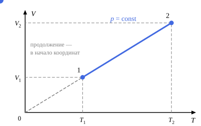

В уроке 3.1 мы нагревали газ под поршнем с грузом: поршень поднимался, а давление оставалось прежним — его держит груз. Теперь узнаем, насколько именно поднимается поршень.

## Закон Гей-Люссака

Процесс при постоянном давлении называют **изобарным** («барос» — «тяжесть», отсюда и «барометр»). В уравнении Клапейрона сокращаются давления:

$$
\frac{V_1}{T_1} = \frac{V_2}{T_2}, \qquad \frac{V}{T} = \text{const}.
$$

Это **закон Гей-Люссака**: при постоянном давлении объём газа пропорционален его абсолютной температуре. Абсолютная температура выросла в $1{,}5$ раза — объём тоже вырос в $1{,}5$ раза.

Почему так? Чтобы давление $p = nkT$ осталось прежним, когда $T$ растёт, концентрация $n$ должна во столько же раз уменьшиться. Молекулы те же — значит, во столько же раз вырос объём.

**Пример.** Газ под поршнем занимает $5\ \text{л}$ при $17\ ^\circ\text{C}$. Его нагрели до $133\ ^\circ\text{C}$, давление не менялось. ${T_1 = 290\ \text{К}}$, ${T_2 = 406\ \text{К}}$:

$$
V_2 = V_1 \frac{T_2}{T_1} = 5 \cdot \frac{406}{290} = 5 \cdot 1{,}4 = 7\ \text{л}.
$$

Если бы мы взяли отношение градусов Цельсия, $133/17$, газ «вырос» бы почти в $8$ раз — до $39\ \text{л}$. Отношение температур — только в кельвинах (урок 2.3).

<pp-task id="ks-laws-04"></pp-task>

## Изобара

График изобарного процесса называют **изобарой**. В осях $V\text{–}T$ это прямая: $V = \text{const} \cdot T$. Если продолжить её к низким температурам, она придёт в начало координат — к нулю кельвинов.

Продолжение нарисовано пунктиром не случайно. Задолго до абсолютного нуля любой газ превратится в жидкость, и закон перестанет работать. Но если бы газ остался идеальным, его объём при $0\ \text{К}$ стал бы нулевым. Именно так в XIX веке и нашли абсолютный ноль: продолжили прямую $V(t)$ и увидели, что она пересекает ось температур около $-273\ ^\circ\text{C}$.

В осях $p\text{–}V$ изобара — горизонтальная прямая: давление одно и то же, объём растёт. В осях $p\text{–}T$ — тоже горизонтальная.

## Попробуй сам

Теперь поршень свободен, и на нём лежит груз — давление постоянно. Двигай ползунок температуры.

<pp-iso process="p">Модель: газ под поршнем с грузом, давление постоянно. Ползунок меняет температуру; объём и графики состояния газа в осях p–V, p–T и V–T меняются вместе с ней.</pp-iso>

- Нагрей газ — поршень поднимается, объём растёт во столько же раз, во сколько абсолютная температура. Красная стрелка давления не меняется.
- На графике $V\text{–}T$ пунктир идёт из начала координат: объём пропорционален абсолютной температуре.
- Охлади газ до $100\ \text{К}$ — объём уменьшится, но до нуля не дойдёт: модель, как и настоящий газ, не опускается к абсолютному нулю.

## Изменение температуры

В задачах часто спрашивают не конечную температуру, а «на сколько» её изменили. Тогда сначала найди $T_2$ в кельвинах, потом вычти $T_1$. Разность в кельвинах равна разности в градусах Цельсия (урок 2.3).

<pp-task id="ks-laws-12"></pp-task>

Проверь себя: газ изобарно охладили, его абсолютная температура уменьшилась вдвое. Что стало с объёмом и с давлением?

Объём уменьшился вдвое, давление не изменилось — процесс изобарный.

## Частые ловушки

- **Подставляют градусы Цельсия.** $V/T = \text{const}$ — только в кельвинах.
- **Думают, что изобара в осях $V$–$t$ (по Цельсию) проходит через начало.** Через начало она проходит только в осях $V\text{–}T$; в осях $V$–$t$ она пересекает ось при $-273\ ^\circ\text{C}$.
- **Рисуют изобару в осях $p\text{–}T$ наклонной.** Давление постоянно — это горизонтальная прямая.
- **Отвечают конечной температурой, когда спрашивают изменение.** «На сколько» — это $T_2 - T_1$.

## Коротко

- Изобарный процесс ($p = \text{const}$): $\dfrac{V}{T} = \text{const}$, $\dfrac{V_1}{T_1} = \dfrac{V_2}{T_2}$.
- Изобара в осях $V\text{–}T$ — прямая, продолжение которой проходит через начало координат; в осях $p\text{–}V$ и $p\text{–}T$ — горизонтальная прямая.
- Так ведёт себя газ под свободным поршнем.

Дальше — урок 3.5: газ нагревают в закрытом сосуде.
