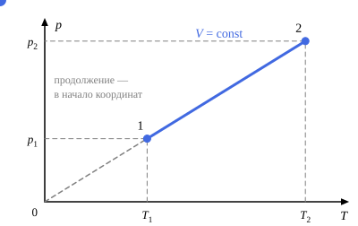

Закрытая банка в костре, газовый баллон на солнце, шина летом на горячем асфальте. Объём у них почти не меняется, а температура растёт. Что будет с давлением?

## Закон Шарля

Процесс при постоянном объёме называют **изохорным** («хорема» — «вместимость»). В уравнении Клапейрона сокращаются объёмы:

$$
\frac{p_1}{T_1} = \frac{p_2}{T_2}, \qquad \frac{p}{T} = \text{const}.
$$

Это **закон Шарля**: при постоянном объёме давление газа пропорционально его абсолютной температуре. Здесь проще всего увидеть причину: в $p = nkT$ концентрация $n$ не меняется, ведь ни молекул, ни места у них не прибавилось. Остаётся $p \propto T$ — ровно то, что мы видели в модели урока 2.6.

**Пример.** Колбу лампы накаливания заполняют газом так, чтобы при $17\ ^\circ\text{C}$ давление в ней было около $50\ \text{кПа}$. В работающей лампе газ нагревается примерно до $307\ ^\circ\text{C}$. ${T_1 = 290\ \text{К}}$, ${T_2 = 580\ \text{К}}$:

$$
p_2 = p_1 \frac{T_2}{T_1} = 50 \cdot \frac{580}{290} = 100\ \text{кПа}.
$$

Горячая лампа оказывается под давлением, близким к атмосферному, и стекло почти не нагружено. Подставив градусы Цельсия, получили бы $50 \cdot 307 / 17 \approx 900\ \text{кПа}$ — колба бы лопнула.

<pp-task id="ks-laws-05"></pp-task>

## Изохора

График изохорного процесса — **изохора**. В осях $p\text{–}T$ это прямая, продолжение которой проходит через начало координат, как у изобары в осях $V\text{–}T$.

В осях $p\text{–}V$ изохора — вертикальная прямая: объём один и тот же, меняется давление. В осях $V\text{–}T$ — горизонтальная.

## Попробуй сам

Поршень закреплён — объём постоянен. Двигай ползунок температуры.

<pp-iso process="V">Модель: газ под закреплённым поршнем, объём постоянен. Ползунок меняет температуру; давление и графики состояния газа в осях p–V, p–T и V–T меняются вместе с ней.</pp-iso>

- Нагрей газ — поршень стоит, а красная стрелка давления растёт. Молекулы летают быстрее.
- Давление растёт во столько же раз, во сколько абсолютная температура: это видно в строке под моделью.
- На графике $p\text{–}T$ пунктир идёт из начала координат, на графике $p\text{–}V$ точка движется по вертикали.

## Сколько выдержит баллон

Баллоны рассчитаны на наибольшее давление. Отсюда задача: до какой температуры баллон можно нагреть? Найди $T_2$ из закона Шарля, а потом, если просят, переведи в градусы Цельсия.

<pp-task id="ks-laws-13"></pp-task>

Проверь себя: газ в закрытом баллоне охладили от 177 °C до −48 °C. Во сколько раз уменьшилось давление?

В кельвинах это $450\ \text{К} \to 225\ \text{К}$ — вдвое меньше, и давление уменьшилось вдвое. А по Цельсию «отношение» $177/(-48)$ вообще отрицательное — ещё одна причина считать только в кельвинах.

## Частые ловушки

- **Подставляют градусы Цельсия.** $p/T = \text{const}$ — только в кельвинах.
- **Отвечают в кельвинах, когда просят градусы Цельсия.** Проверь, в каких единицах нужен ответ.
- **Считают изохорным процесс в шарике или под свободным поршнем.** Там растёт объём. Изохорный процесс — в жёстком закрытом сосуде.
- **Рисуют изохору в осях $p\text{–}V$ наклонной.** Объём постоянен — это вертикальная прямая.

## Коротко

- Изохорный процесс ($V = \text{const}$): $\dfrac{p}{T} = \text{const}$, $\dfrac{p_1}{T_1} = \dfrac{p_2}{T_2}$.
- Изохора в осях $p\text{–}T$ — прямая через начало координат; в осях $p\text{–}V$ — вертикальная, в осях $V\text{–}T$ — горизонтальная.
- Так ведёт себя газ в закрытом жёстком сосуде.

Дальше — урок 3.6: как читать графики процессов.
