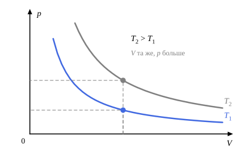
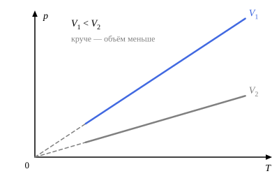

В задачах 9 и 10 ЕГЭ процесс часто дают не словами, а графиком: «газ перевели из состояния 1 в состояние 2, как показано на рисунке». Нужно узнать по графику, какой это процесс, и сказать, что стало с давлением, объёмом и температурой. Соберём то, что мы знаем из уроков 3.3–3.5, в одну таблицу.

## Три процесса в трёх парах осей

| Процесс | $p$–$V$ | $p$–$T$ | $V$–$T$ |
|---|---|---|---|
| изотерма, $T = \text{const}$ | гипербола | вертикальная прямая | вертикальная прямая |
| изобара, $p = \text{const}$ | горизонтальная прямая | горизонтальная прямая | прямая через начало |
| изохора, $V = \text{const}$ | вертикальная прямая | прямая через начало | горизонтальная прямая |

Запоминать таблицу не нужно. Постоянная величина на своей оси даёт прямую, перпендикулярную этой оси. А прямая через начало координат — это пропорциональность: $p \propto T$ при постоянном объёме и $V \propto T$ при постоянном давлении.

## Какая изотерма горячее

На графике $p$–$V$ можно нарисовать много изотерм одного газа — по одной для каждой температуры. Какая из них горячее? Проведём вертикальную прямую: объём на ней одинаковый. На верхней изотерме давление больше, а при том же объёме больше давление — значит, больше температура ($p = \nu RT/V$).

**Чем выше изотерма, тем больше температура.**

## Какая изохора — с большим объёмом

В осях $p$–$T$ изохоры одного газа — прямые из начала координат с разным наклоном. Наклон — это $p/T = \nu R/V$. Объём стоит в знаменателе: чем меньше объём, тем больше наклон.

**Чем круче изохора, тем меньше объём.** Так же для изобар в осях $V$–$T$: наклон $V/T = \nu R/p$, и чем круче изобара, тем меньше давление.

<pp-task id="ks-laws-15"></pp-task>

## Температура по графику $p$–$V$

В осях $p$–$V$ температуры нет. Но при постоянной массе $pV/T = \text{const}$, поэтому **произведение $pV$ пропорционально абсолютной температуре**. Сравни $pV$ в двух точках — и узнаешь, во сколько раз изменилась температура.

**Пример.** В состоянии 1 давление $4p_0$, объём $V_0$; в состоянии 2 давление $p_0$, объём $6V_0$. Тогда $p_1V_1 = 4p_0V_0$, $p_2V_2 = 6p_0V_0$, и

$$
\frac{T_2}{T_1} = \frac{6p_0V_0}{4p_0V_0} = 1{,}5.
$$

Давление упало, но температура выросла: объём вырос сильнее.

<pp-task id="ks-laws-14"></pp-task>

## Попробуй сам

Здесь можно собрать процесс из кусков. Выбери, что постоянно, подвинь ползунок, потом выбери другую величину — новый кусок начнётся из той точки, где закончился прошлый. Прошлые куски остаются на графиках.

<pp-iso process="T">Модель: газ под поршнем. Можно выбрать, что постоянно — температура, давление или объём, и ползунком менять свободную величину; на графиках в осях p–V, p–T и V–T строится процесс из нескольких кусков.</pp-iso>

- Нагрей газ при постоянном давлении, потом сожми при постоянной температуре, потом охлади при постоянном объёме. Посмотри, как один и тот же процесс выглядит в трёх парах осей.
- Попробуй вернуться в точку A — получится замкнутый цикл. Циклы понадобятся в теме «Тепловые машины и КПД».
- Найди на графике $p$–$T$ две изохоры разного объёма и проверь: круче та, у которой объём меньше.

## Частые ловушки

- **Путают оси.** Прямая через начало в осях $p$–$T$ — изохора, а в осях $V$–$T$ — изобара. Сначала прочитай подписи осей.
- **Думают, что круче изохора — больше объём.** Наоборот: наклон $p/T = \nu R/V$, объём в знаменателе.
- **Решают, что если давление упало, то и температура упала.** Смотри на произведение $pV$, а не на одну величину.
- **Ищут гиперболу в осях $p$–$T$.** Гипербола — только изотерма в осях $p$–$V$.

## Коротко

- Постоянная величина на своей оси — прямая, перпендикулярная этой оси.
- Прямая через начало: в осях $p$–$T$ — изохора, в осях $V$–$T$ — изобара.
- Чем выше изотерма в осях $p$–$V$, тем больше температура; чем круче изохора в осях $p$–$T$, тем меньше объём.
- $T \propto pV$: температуры двух точек на графике $p$–$V$ относятся как произведения $pV$.

Дальше — урок 3.7: смеси газов и газ, который утекает.
