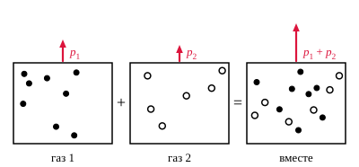

До сих пор в сосуде был один газ, и он никуда не девался. Но воздух — это смесь азота, кислорода и других газов. А газ из баллона выпускают, шину подкачивают. В этом уроке — оба случая.

## Закон Дальтона

В сосуде смесь двух газов. Молекулы идеального газа друг с другом почти не взаимодействуют (урок 2.5), поэтому каждый газ бьёт по стенкам так, будто других нет. Давление, которое создавал бы один газ, если бы занимал весь сосуд один, называют **парциальным** («частичным»). Удары молекул разных газов просто складываются:

$$
p = p_1 + p_2 + \dots
$$

Это **закон Дальтона**: давление смеси равно сумме парциальных давлений её газов.

**Пример.** В воздухе около $21\ \%$ молекул — кислород. При атмосферном давлении $101\ \text{кПа}$ парциальное давление кислорода около $0{,}21 \cdot 101 \approx 21\ \text{кПа}$. Высоко в горах давление воздуха вдвое меньше — вдвое меньше и парциальное давление кислорода, поэтому там трудно дышать.

Для смеси идеальных газов в одном сосуде можно не искать давления по отдельности, а сразу сложить количества вещества: $p = p_1 + p_2 = \dfrac{\nu_1 RT}{V} + \dfrac{\nu_2 RT}{V}$, то есть

$$
pV = (\nu_1 + \nu_2 + \dots)\,RT.
$$

<pp-task id="ks-laws-06"></pp-task>

## Сосуды соединили

Частая задача: два сосуда с газами соединяют трубкой. Каждый газ расширяется на оба сосуда. Температура та же, поэтому для каждого газа отдельно работает закон Бойля — Мариотта (урок 3.3): найди его новое парциальное давление, а потом сложи.

<pp-task id="ks-laws-16"></pp-task>

## Когда масса газа меняется

Газ выпускают из баллона или подкачивают в шину — масса меняется. Уравнение Клапейрона $\dfrac{p_1V_1}{T_1} = \dfrac{p_2V_2}{T_2}$ выведено для постоянной массы (урок 3.2) и здесь неверно. Пиши уравнение Менделеева — Клапейрона для каждого состояния отдельно:

$$
p_1 V_1 = \frac{m_1}{M} R T_1, \qquad p_2 V_2 = \frac{m_2}{M} R T_2.
$$

Подели одно на другое — $M$ и $R$ сократятся:

$$
\frac{p_2 V_2}{p_1 V_1} = \frac{m_2 T_2}{m_1 T_1}.
$$

Объём баллона обычно не меняется, и он тоже сокращается: $\dfrac{p_2}{p_1} = \dfrac{m_2}{m_1} \cdot \dfrac{T_2}{T_1}$. Давление пропорционально и массе газа, и абсолютной температуре — это снова $p = nkT$ из урока 2.6: меньше газа — меньше концентрация.

**Пример.** Из баллона выпустили треть газа, температура не изменилась. Осталось $m_2/m_1 = 2/3$ газа, и давление упало до $2/3$ прежнего: например, с $1{,}2\ \text{МПа}$ до $0{,}8\ \text{МПа}$.

<pp-task id="ks-laws-07"></pp-task>

Проверь себя: в шину подкачали воздух, масса воздуха в ней выросла на 10 %, а температура и объём не изменились. Как изменилось давление?

Тоже выросло на $10\ \%$: при постоянных $V$ и $T$ давление пропорционально массе газа.

## Частые ловушки

- **Учитывают только один газ смеси.** Давление смеси — сумма парциальных давлений всех газов.
- **Складывают начальные давления газов из разных сосудов.** После соединения каждый газ занимает общий объём, и его давление меньше начального. Сначала найди парциальные давления, потом складывай.
- **Применяют уравнение Клапейрона к газу, который утекает.** Если масса меняется, пиши уравнение Менделеева — Клапейрона для каждого состояния.
- **Переворачивают отношение температур.** Газ остыл — давление от этого уменьшается, а не растёт.

## Коротко

- Закон Дальтона: $p = p_1 + p_2 + \dots$; для смеси в одном сосуде $pV = (\nu_1 + \nu_2 + \dots)RT$.
- Сосуды соединили: для каждого газа $p_1V_1 = p_2V_2$, потом сложи парциальные давления.
- Масса меняется: $\dfrac{p_2V_2}{p_1V_1} = \dfrac{m_2T_2}{m_1T_1}$.

Это последний урок темы. Дальше — тема «Насыщенный пар и влажность»: там газ — водяной пар — может превращаться в жидкость, и уравнение $pV = \nu RT$ придётся применять осторожно.
