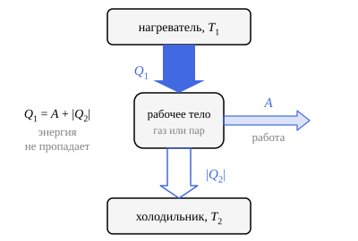

Двигатель автомобиля, турбина электростанции, паровоз — всё это тепловые машины. Они превращают теплоту в механическую работу, но никогда не целиком. Тема нужна в задаче 8, в задачах 9–10 и в задаче 24.

## Как устроена тепловая машина

Любая тепловая машина состоит из трёх частей:

1. **Нагреватель** — даёт рабочему телу теплоту $Q_1$ (сгорающее топливо).
2. **Рабочее тело** — газ или пар, который расширяется и совершает работу.
3. **Холодильник** — получает от рабочего тела теплоту $Q_2$ (окружающий воздух, вода для охлаждения).

Машина работает циклами: рабочее тело возвращается в исходное состояние. За цикл внутренняя энергия рабочего тела не меняется, поэтому по первому закону термодинамики работа за цикл

$$
A = Q_1 - |Q_2|.
$$

## КПД

**Коэффициент полезного действия** — какая доля полученной теплоты превратилась в работу:

$$
\eta = \frac{A}{Q_1} = \frac{Q_1 - |Q_2|}{Q_1}.
$$

- $Q_1$ — теплота, полученная от нагревателя за цикл, Дж;
- $|Q_2|$ — теплота, отданная холодильнику, Дж;
- $A$ — работа за цикл, Дж.

КПД тепловой машины всегда меньше $1$ (меньше $100\,\%$): часть теплоты обязательно уходит холодильнику. Это следствие **второго закона термодинамики**: теплота сама собой не переходит от холодного тела к горячему, и невозможно циклически превращать в работу всю теплоту, взятую у нагревателя.

## Цикл Карно

Какой КПД наибольший при данных температурах нагревателя $T_1$ и холодильника $T_2$? Ответ дал Сади Карно:

$$
\eta_{\max} = \frac{T_1 - T_2}{T_1}.
$$

Температуры — **только в кельвинах**. Чем горячее нагреватель и холоднее холодильник, тем выше предельный КПД. Реальная машина с теми же температурами имеет КПД меньше.

## КПД цикла по графику

В задачах часто дают цикл на графике $p$–$V$. План:

1. Работа за цикл — площадь фигуры.
2. Найди участки, где газ **получает** теплоту ($Q > 0$). Обычно это участки, где растёт температура или газ расширяется при постоянной температуре.
3. Сложи теплоту только на этих участках — это $Q_1$.
4. $\eta = A / Q_1$.

## Холодильник и тепловой насос

Бытовой холодильник — тепловая машина «наоборот»: за счёт работы компрессора он забирает теплоту из камеры и отдаёт её в комнату. Поэтому решётка сзади холодильника тёплая.

## Частые ловушки

- **Подставляют градусы Цельсия в формулу Карно.** Нагреватель $227\ ^\circ\text{C}$, холодильник $27\ ^\circ\text{C}$: правильно $\eta = (500 - 300)/500 = 40\,\%$, а не $(227 - 27)/227 \approx 88\,\%$.
- **В КПД цикла делят на всю теплоту**, включая отданную. В знаменателе — только полученная от нагревателя.
- **Думают, что идеальная машина может иметь КПД $100\,\%$.** Для этого холодильник должен быть при абсолютном нуле.

## Как это выглядит на ЕГЭ

*Тепловая машина за цикл получает от нагревателя $800\ \text{Дж}$ и отдаёт холодильнику $600\ \text{Дж}$. Найди КПД машины.*

Работа за цикл: $A = 800 - 600 = 200\ \text{Дж}$.

$$
\eta = \frac{A}{Q_1} = \frac{200}{800} = 0{,}25 = 25\,\%.
$$

Можно ли сделать такую машину при температурах $400\ \text{К}$ и $300\ \text{К}$? Предел Карно: $(400 - 300)/400 = 25\,\%$. Ровно на пределе — это была бы идеальная машина, реальная немного не дотянет.

## Коротко

- Нагреватель → рабочее тело → холодильник; $A = Q_1 - |Q_2|$.
- $\eta = A/Q_1 < 1$.
- Карно: $\eta_{\max} = (T_1 - T_2)/T_1$, температуры в кельвинах.
- Второй закон: теплота сама не идёт от холодного к горячему.
