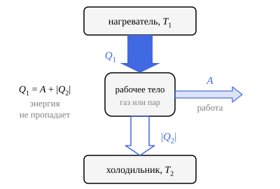

В уроке 7.7 газ шёл по циклу, получал теплоты больше, чем отдавал, и разницу превращал в работу. Так и работает любой тепловой двигатель — от паровоза до реактивного самолёта. В этом уроке — из каких частей он состоит и куда девается теплота, которая не стала работой.

## Теплота превращается в работу

Сожги топливо — выделится теплота (урок 5.3). Но теплотой не сдвинешь поезд и не повернёшь колесо: для этого нужна работа. Устройства, которые превращают часть теплоты в механическую работу, называют **тепловыми машинами** или тепловыми двигателями.

- **Двигатель внутреннего сгорания** (автомобиль, мотоцикл): бензин вспыхивает прямо в цилиндре, горячие газы расширяются и толкают поршень — внутренняя энергия становится механической, как в уроке 7.1.
- **Паровая турбина** (электростанция): в котле вода превращается в горячий пар, пар бьёт в лопатки и вращает турбину, а турбина — генератор.
- **Реактивный двигатель** (самолёт, ракета): горячие газы вырываются из сопла и толкают двигатель вперёд.

## Нагреватель, рабочее тело, холодильник

У любой тепловой машины три части:

1. **Нагреватель** — горячее тело с температурой $T_1$. Он отдаёт теплоту $Q_1$.
2. **Рабочее тело** — газ или пар. Получив теплоту, оно расширяется и совершает работу $A$.
3. **Холодильник** — тело с более низкой температурой $T_2$. Ему рабочее тело отдаёт оставшуюся теплоту $|Q_2|$.

В двигателе автомобиля нагреватель — сгорающее в цилиндре топливо, рабочее тело — горячие газы, холодильник — атмосфера, куда уходят выхлопные газы, и воздух, который обдувает радиатор. На электростанции нагреватель — котёл с топкой, рабочее тело — пар, холодильник — вода из реки или градирни, в которой пар после турбины остывает и снова становится водой.

Холодильник тепловой машины — это не кухонный холодильник, а просто окружающая среда, которая холоднее рабочего тела.

## Зачем нужен холодильник

Машина должна работать долго, поэтому рабочее тело ходит по **циклу**: поршень опускается и снова поднимается, газ возвращается в начальное состояние (урок 6.7). Расширяясь, газ совершает работу. Но потом его надо сжать обратно, а на сжатие тоже нужна работа.

Если сжимать газ горячим, таким же, каким он расширялся, сжатие отнимет ровно ту работу, которую дало расширение: за цикл ничего не останется. Поэтому газ сначала охлаждают — он отдаёт теплоту холодильнику, — и сжимают холодным, при меньшем давлении. На сжатие уходит меньше работы, чем дало расширение, и разница остаётся — это и есть полезная работа машины.

Вот почему выхлопные газы автомобиля горячие, а у электростанций стоят огромные градирни: часть теплоты машина отдаёт холодильнику неизбежно.

Проверь себя: зачем у автомобиля радиатор, через который всё время продувается воздух?

Двигатель — тепловая машина, и часть теплоты сгоревшего топлива он обязательно отдаёт холодильнику. Холодильник здесь — окружающий воздух: часть теплоты уходит с выхлопными газами, часть через радиатор. Без этого двигатель перегрелся бы.

## Энергия не пропадает

Теплота нагревателя $Q_1$ делится на две части: работу $A$ и теплоту $|Q_2|$, отданную холодильнику. Ничего не пропадает (урок 7.1), поэтому

$$
Q_1 = A + |Q_2|, \qquad A = Q_1 - |Q_2|.
$$

На рисунке ширина стрелки $Q_1$ как раз равна сумме ширин стрелок $A$ и $|Q_2|$. Модуль у $Q_2$ стоит потому, что это теплота, которую рабочее тело **отдаёт**, — подробнее в уроке 8.3.

**Пример.** За один цикл газ в цилиндре двигателя получил $900\ \text{Дж}$ теплоты и совершил работу $252\ \text{Дж}$. Холодильнику он отдал ${900 - 252 = 648\ \text{Дж}}$ — больше, чем превратил в работу.

<pp-task id="ks-engine-02"></pp-task>

<pp-task id="ks-engine-07"></pp-task>

## Частые ловушки

- **Путают холодильник машины с бытовым холодильником.** Холодильник двигателя — окружающий воздух или вода.
- **Складывают теплоты.** Работа — разность: ${A = Q_1 - |Q_2|}$.
- **Думают, что вся теплота нагревателя становится работой.** Часть всегда уходит холодильнику.

## Коротко

- Тепловая машина: нагреватель → рабочее тело → холодильник.
- Рабочее тело ходит по циклу; чтобы вернуть его в начало, нужен холодильник.
- ${Q_1 = A + |Q_2|}$, работа ${A = Q_1 - |Q_2|}$.

Дальше — урок 8.2: какую долю энергии топлива двигатель превращает в работу.
