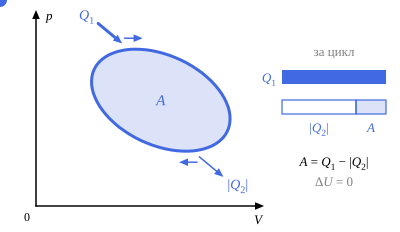

В уроке 8.1 мы сказали, что ${A = Q_1 - |Q_2|}$, потому что энергия не пропадает. Теперь выведем это из первого закона термодинамики и получим формулу КПД, в которой нет топлива — только теплоты нагревателя и холодильника. Так КПД считают в задачах 10 класса.

## Работа за цикл

Рабочее тело ходит по циклу и возвращается в начальное состояние, поэтому за цикл ${\Delta U = 0}$ (урок 6.7). Первый закон ${Q = \Delta U + A}$ даёт: работа за цикл равна теплоте, полученной за цикл (урок 7.7).

На одних участках цикла газ получает теплоту — всего $Q_1$, на других отдаёт — всего $|Q_2|$. Теплота за цикл — это ${Q_1 - |Q_2|}$, значит,

$$
A = Q_1 - |Q_2|.
$$

В знаках первого закона отданная теплота отрицательна: ${Q_2 < 0}$. Поэтому в формулах тепловых машин пишут её модуль $|Q_2|$ — так видно, что её вычитают.

## КПД через теплоты

Затраченная энергия — теплота $Q_1$, полученная от нагревателя. Подставим работу в определение КПД из урока 8.2:

$$
\eta = \frac{A}{Q_1} = \frac{Q_1 - |Q_2|}{Q_1} = 1 - \frac{|Q_2|}{Q_1}.
$$

- $Q_1$ — теплота, полученная от нагревателя за цикл;
- $|Q_2|$ — теплота, отданная холодильнику за цикл;
- $A$ — работа за цикл.

В знаменателе — **только** теплота от нагревателя. Отданная теплота — не затраты, а потери.

**Пример.** За цикл рабочее тело получает от нагревателя $850\ \text{Дж}$ и отдаёт холодильнику $629\ \text{Дж}$. Работа за цикл ${A = 850 - 629 = 221\ \text{Дж}}$, КПД

$$
\eta = \frac{221}{850} = 0{,}26 = 26\,\%.
$$

<pp-task id="ks-engine-03"></pp-task>

## Какая доля уходит холодильнику

Из ${\eta = 1 - |Q_2|/Q_1}$ следует: холодильнику уходит доля ${1 - \eta}$ полученной теплоты,

$$
|Q_2| = (1 - \eta)\,Q_1, \qquad A = \eta\,Q_1.
$$

Если известны КПД и одна из теплот, сначала найди $Q_1$, а потом всё остальное.

<pp-task id="ks-engine-10"></pp-task>

Проверь себя: машина отдаёт холодильнику две трети теплоты, полученной от нагревателя. Каков её КПД?

${|Q_2|/Q_1 = 2/3}$, поэтому ${\eta = 1 - 2/3 = 1/3 \approx 33\,\%}$: работой становится оставшаяся треть.

<pp-task id="ks-engine-11"></pp-task>

## Частые ловушки

- **Делят на теплоту холодильника или на сумму теплот.** В знаменателе — только $Q_1$.
- **Ставят знак у $Q_2$ дважды.** Если отданная теплота дана со знаком минус, в ${A = Q_1 - |Q_2|}$ подставляют её модуль.
- **Путают $\eta$ и ${1 - \eta}$.** $\eta$ — доля работы, ${1 - \eta}$ — доля, ушедшая холодильнику.

## Коротко

- За цикл ${\Delta U = 0}$, поэтому ${A = Q_1 - |Q_2|}$.
- ${\eta = A/Q_1 = 1 - |Q_2|/Q_1}$, в знаменателе только теплота от нагревателя.
- ${A = \eta Q_1}$, ${|Q_2| = (1 - \eta)\,Q_1}$.

Дальше — урок 8.4: почему без холодильника нельзя и каким может быть наибольший КПД.
