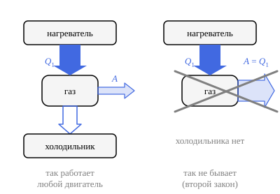

Первый закон термодинамики запрещает машину, которая совершает работу из ничего (урок 7.1). Но он не запрещает машину, которая всю полученную теплоту превращает в работу: энергия бы сохранялась. Почему же у любого двигателя есть холодильник и КПД меньше $100\,\%$? Это уже другой закон природы.

## Второй закон термодинамики

Мы давно знаем: теплота сама собой идёт от горячего тела к холодному, а не наоборот (уроки 2.2 и 5.1). Чай в комнате остывает, но никогда сам не закипает, забрав теплоту у воздуха. Это и есть **второй закон термодинамики**:

- теплота **сама собой** не переходит от холодного тела к горячему;
- невозможна машина, которая циклически превращает в работу **всю** теплоту, взятую у нагревателя: часть теплоты обязательно уходит холодильнику.

Обе формулировки говорят об одном. Если бы второй двигатель на рисунке существовал, он мог бы брать теплоту у прохладного тела, а своей работой нагревать трением горячее тело. В итоге теплота сама собой переходила бы от холодного к горячему.

Поэтому корабль не может плыть, забирая теплоту у океанской воды и превращая её в работу: холодильника холоднее океана у него нет. Такую машину называют вечным двигателем второго рода. Первый закон её не запрещает, а второй — запрещает.

## Предел КПД: цикл Карно

Каким может быть наибольший КПД, если нагреватель имеет температуру $T_1$, а холодильник $T_2$? Ответ нашёл французский инженер Сади Карно. Наибольший КПД у идеальной машины, рабочее тело которой ходит по **циклу Карно** из двух изотерм и двух адиабат (уроки 7.5 и 7.6): теплоту оно получает только при температуре нагревателя, а отдаёт только при температуре холодильника. Её КПД

$$
\eta_{\max} = \frac{T_1 - T_2}{T_1} = 1 - \frac{T_2}{T_1}.
$$

Температуры — **только в кельвинах** (урок 2.3). Реальная машина с теми же нагревателем и холодильником имеет КПД меньше: у неё есть трение, потери теплоты и цикл не Карно.

**Пример.** В турбину электростанции идёт пар при $550\ ^\circ\text{C}$, а после турбины его охлаждают до $30\ ^\circ\text{C}$. Переведём: ${T_1 = 823\ \text{К}}$, ${T_2 = 303\ \text{К}}$.

$$
\eta_{\max} = 1 - \frac{303}{823} \approx 0{,}63 = 63\,\%.
$$

Настоящие турбины до этого предела не дотягивают, но формула объясняет, почему пар делают всё горячее.

<pp-task id="ks-engine-04"></pp-task>

## Как поднять КПД

Из формулы видно: КПД тем больше, чем горячее нагреватель и холоднее холодильник. Холодильник — обычно окружающий воздух или вода, их температуру не выберешь. Поэтому инженеры повышают температуру нагревателя. Дизель из урока 7.6 сжимает воздух сильнее бензинового двигателя, топливо в нём горит горячее, и КПД у него выше.

КПД $100\,\%$ получился бы только при ${T_2 = 0\ \text{К}}$, а абсолютного нуля достичь нельзя. Так что КПД меньше единицы даже у идеальной машины.

<pp-task id="ks-engine-12"></pp-task>

Проверь себя: изобретатель утверждает, что его двигатель с нагревателем 600 К и холодильником 390 К имеет КПД 38 %. Возможно ли это?

Нет. Предел Карно: ${\eta_{\max} = 1 - 390/600 = 0{,}35 = 35\,\%}$. У реального двигателя КПД ещё меньше, а $38\,\%$ — больше предела.

<pp-task id="ks-engine-13"></pp-task>

## Частые ловушки

- **Подставляют градусы Цельсия.** Нагреватель $327\ ^\circ\text{C}$, холодильник $27\ ^\circ\text{C}$: правильно ${\eta_{\max} = (600 - 300)/600 = 50\,\%}$, а не ${(327 - 27)/327 \approx 92\,\%}$.
- **Применяют формулу Карно к любому циклу.** Она даёт только предел; КПД конкретного цикла, например прямоугольного, считают через теплоты (урок 8.5).
- **Думают, что идеальная машина имеет КПД $100\,\%$.** Для этого холодильник должен быть при абсолютном нуле.

## Коротко

- Второй закон: теплота сама не идёт от холодного к горячему; без холодильника двигатель невозможен.
- Предел КПД (цикл Карно): ${\eta_{\max} = 1 - T_2/T_1}$, температуры в кельвинах.
- Реальная машина с теми же температурами имеет меньший КПД.

Дальше — урок 8.5: как найти КПД цикла, нарисованного на графике $p\text{–}V$.
