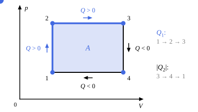

В задачах 24 и 10 цикл часто нарисован на графике $p\text{–}V$: «найдите КПД цикла». Формула та же, ${\eta = A/Q_1}$, но $A$ и $Q_1$ надо достать из графика. В этом уроке — план, который собирает вместе уроки 6.7, 7.4 и 7.7.

## План

1. **Работа за цикл** — площадь внутри цикла (урок 6.7). Для прямоугольника ${A = \Delta p\,\Delta V}$.
2. **Где газ получает теплоту.** На каждом участке пройди три шага урока 7.7: работа, ${\Delta U}$, ${Q = \Delta U + A}$. Газ получает теплоту там, где ${Q > 0}$: обычно это нагрев при постоянном объёме и расширение при постоянном давлении.
3. **Теплота от нагревателя** $Q_1$ — сумма теплот только на этих участках. Для одноатомного газа на изохоре ${Q = \frac{3}{2}V\Delta p}$, на изобаре ${Q = \frac{5}{2}p\Delta V}$ (урок 7.4).
4. **КПД** ${\eta = A/Q_1}$.

Теплоту за весь цикл в знаменатель ставить нельзя: она равна работе (урок 7.7), и вышло бы $100\,\%$. Сумму всех теплот, полученных и отданных, — тоже.

**Пример.** Одноатомный газ проходит прямоугольный цикл: при объёме $1\ \text{л}$ давление растёт от $110$ до $170\ \text{кПа}$, при $170\ \text{кПа}$ газ расширяется до $3\ \text{л}$, при $3\ \text{л}$ давление падает до $110\ \text{кПа}$, при $110\ \text{кПа}$ газ сжимается обратно.

1. Работа — площадь прямоугольника: ${A = (170 - 110) \cdot (3 - 1) = 120\ \text{Дж}}$.
2. Теплоту газ получает при нагреве на изохоре и при расширении на изобаре.
3. ${Q_{\text{изох}} = 1{,}5 \cdot 1 \cdot 60 = 90\ \text{Дж}}$, ${Q_{\text{изоб}} = 2{,}5 \cdot 170 \cdot 2 = 850\ \text{Дж}}$, всего ${Q_1 = 940\ \text{Дж}}$.
4. КПД:

$$
\eta = \frac{120}{940} \approx 0{,}128 = 12{,}8\,\%.
$$

Проверка: на двух других сторонах газ отдаёт ${1{,}5 \cdot 3 \cdot 60 = 270}$ и ${2{,}5 \cdot 110 \cdot 2 = 550\ \text{Дж}}$, всего $820\ \text{Дж}$, и ${940 - 820 = 120\ \text{Дж}}$ — как раз работа.

<pp-task id="ks-engine-05"></pp-task>

Проверь себя: в цикле из примера наибольшая температура газа в 4,6 раза выше наименьшей. Почему КПД цикла не равен 1 − 1/4,6 ≈ 78 %?

Формула Карно даёт только предел для машины с такими нагревателем и холодильником (урок 8.4). Прямоугольный цикл — не цикл Карно: газ получает теплоту при разных температурах, а не только при наибольшей. Его КПД намного меньше предела.

<pp-task id="ks-engine-14"></pp-task>

## Попробуй сам

Пройдём цикл из уроков 6.7 и 7.7 и посчитаем его КПД. Полоса теплоты теперь двойная: вправо растёт теплота $Q_1$, полученная с точки A, влево — отданная $|Q_2|$.

<pp-iso process="V" work="eta">Модель: газ под поршнем. Можно выбрать процесс — постоянная температура, давление или объём, или без теплообмена — и ползунком менять свободную величину; полосы показывают полученную и отданную теплоту, изменение внутренней энергии и работу газа с точки A, а когда газ возвращается в A, модель считает КПД цикла.</pp-iso>

- При постоянном объёме нагрей газ до $500\ \text{К}$, выбери ${T = \text{const}}$ и расширь до $2\ \text{л}$, выбери ${p = \text{const}}$ и охлади до $250\ \text{К}$. Газ получил теплоту на первых двух участках и отдал на последнем. В точке A модель покажет КПД — около $13\,\%$.
- Сравни с ловушкой: если поделить работу на все теплоты, полученные и отданные, выйдет вдвое меньше.
- Нажми «Заново» и пройди тот же цикл против часовой стрелки: работа за цикл отрицательна, и КПД модель не покажет. Это уже не двигатель, а холодильник — урок 8.6.
- Подвигай ползунок туда и обратно: $Q_1$ и $|Q_2|$ растут обе, а работа не меняется. Лишние «туда-обратно» только снижают КПД.

## Частые ловушки

- **Делят на всю теплоту, полученную и отданную.** В знаменателе — только полученная.
- **Делят на теплоту за цикл.** Она равна работе, и КПД вышел бы $100\,\%$.
- **Учитывают только один участок с ${Q > 0}$.** Сложи все участки, где газ получает теплоту.
- **Подставляют в формулу Карно наибольшую и наименьшую температуры цикла.** Для цикла, который не цикл Карно, так нельзя.

## Коротко

- $A$ — площадь цикла на графике $p\text{–}V$.
- $Q_1$ — сумма теплот на участках, где ${Q = \Delta U + A > 0}$.
- ${\eta = A/Q_1}$; на изохоре ${Q = \frac{3}{2}V\Delta p}$, на изобаре ${Q = \frac{5}{2}p\Delta V}$.

Дальше — урок 8.6: что будет, если пустить цикл в обратную сторону.
