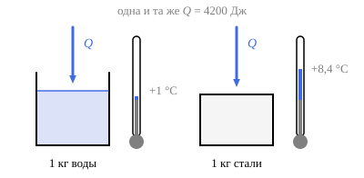

Поставь на одинаковые конфорки кастрюлю с литром воды и пустую стальную сковородку той же массы. Через минуту сковородка обжигает, а вода едва тёплая. Огонь одинаковый, масса одинаковая — почему вода нагревается так медленно? В этом уроке — от чего зависит, сколько теплоты нужно для нагрева.

## От чего зависит теплота нагрева

Чтобы вскипятить полный чайник, нужно больше времени, чем для половины: **чем больше масса**, тем больше теплоты. Чтобы нагреть воду до кипения, нужно больше, чем до тёплой: **чем больше изменение температуры**, тем больше теплоты. Опыты показывают, что теплота пропорциональна и тому, и другому:

$$
Q = cm\,(t_2 - t_1).
$$

- $m$ — масса тела, кг;
- $t_2 - t_1 = \Delta t$ — изменение температуры. В градусах Цельсия и в кельвинах оно одно и то же (урок 2.3);
- $c$ — **удельная теплоёмкость** вещества, $\text{Дж/(кг} \cdot ^\circ\text{C)}$: сколько джоулей нужно, чтобы нагреть $1\ \text{кг}$ этого вещества на $1\ ^\circ\text{C}$.

Удельная теплоёмкость — свойство вещества, её берут из таблицы:

| Вещество | $c$, $\text{Дж/(кг} \cdot ^\circ\text{C)}$ |
|---|---|
| вода | $4200$ |
| лёд | $2100$ |
| подсолнечное масло | $1700$ |
| кирпич | $880$ |
| сталь | $500$ |
| медь | $400$ |
| свинец | $140$ |

Заметь: у льда теплоёмкость вдвое меньше, чем у воды, хотя молекулы те же. Теплоёмкость зависит не только от молекул, но и от того, как они связаны (урок 1.3).

**Пример.** Сколько теплоты нужно, чтобы нагреть $3\ \text{кг}$ воды от $10$ до $60\ ^\circ\text{C}$?

$$
Q = cm\Delta t = 4200 \cdot 3 \cdot 50 = 630\,000\ \text{Дж} = 630\ \text{кДж}.
$$

<pp-task id="ks-heat-01"></pp-task>

## Вода нагревается медленно

Дадим одинаковую теплоту, $4200\ \text{Дж}$, килограмму воды и килограмму стали. Вода нагреется на ${1\ ^\circ\text{C}}$, сталь — на ${4200/500 = 8{,}4\ ^\circ\text{C}}$. Вот почему сковородка раскаляется, пока вода едва тёплая.

У воды одна из самых больших теплоёмкостей среди привычных веществ. Поэтому она долго греется и долго остывает. Море летом прогревается медленно, а осенью медленно остывает и греет берег — у моря климат мягче, чем в глубине материка. Поэтому же в батареях отопления течёт вода, а в грелку наливают горячую воду, а не песок.

Если неизвестно не $Q$, а температура, теплоёмкость или масса, их выражают из той же формулы. Например, на сколько нагреется тело:

$$
\Delta t = \frac{Q}{cm}.
$$

<pp-task id="ks-heat-09"></pp-task>

## Остывание

Остывая, тело отдаёт теплоту. Её считают по той же формуле: сколько тело получило бы при нагреве на эти градусы, столько оно отдаёт при остывании на них.

**Пример.** Стальная сковородка массой $1\ \text{кг}$ остыла от $200$ до $20\ ^\circ\text{C}$. Она отдала кухне

$$
Q = cm\,(t_1 - t_2) = 500 \cdot 1 \cdot 180 = 90\,000\ \text{Дж} = 90\ \text{кДж}.
$$

Если подставить в ${Q = cm(t_2 - t_1)}$ конечную температуру меньше начальной, $Q$ выйдет отрицательным: минус значит «тело отдало». В задачах обычно пишут положительное число и словами говорят, получено оно или отдано.

Формула ${Q = cm\Delta t}$ работает, пока вещество не меняет состояние: лёд остаётся льдом, вода — водой. Что происходит, когда лёд тает или вода кипит, — в уроке 5.4.

Проверь себя: сколько теплоты отдаст 1 кг подсолнечного масла, остывая на 20 °C? А 1 кг воды?

Масло: $1700 \cdot 1 \cdot 20 = 34\,000\ \text{Дж}$. Вода: $4200 \cdot 1 \cdot 20 = 84\,000\ \text{Дж}$ — почти в $2{,}5$ раза больше. Поэтому масло на сковородке остывает быстрее воды в кастрюле.

## Частые ловушки

- **Подставляют конечную температуру вместо разности.** В формулу идёт $\Delta t = t_2 - t_1$, а не $t_2$.
- **Забывают перевести граммы в килограммы.** Теплоёмкость дана на килограмм.
- **Путают кДж и Дж.** Посмотри, в чём просят ответ: ${1\ \text{кДж} = 1000\ \text{Дж}}$.
- **Берут теплоёмкость воды для льда.** У льда ${c = 2100\ \text{Дж/(кг} \cdot ^\circ\text{C)}}$, вдвое меньше.

## Коротко

- Нагрев или остывание без смены состояния: ${Q = cm\Delta t}$.
- $c$ — удельная теплоёмкость: теплота на $1\ \text{кг}$ и $1\ ^\circ\text{C}$, из таблицы.
- У воды ${c = 4200\ \text{Дж/(кг} \cdot ^\circ\text{C)}}$ — очень много: вода медленно греется и медленно остывает.
- Остывая на $\Delta t$, тело отдаёт ${cm\Delta t}$.

Дальше — урок 5.3: откуда берётся теплота для нагрева.
