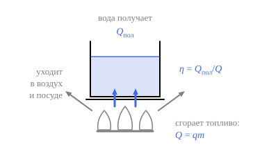

Чтобы нагреть воду, нужна теплота. Откуда её взять? Сжечь дрова, газ или бензин — или включить электрический чайник. В этом уроке — сколько теплоты дают топливо и нагреватель и почему вода получает не всю.

## Сгорание топлива

Когда топливо горит, его молекулы соединяются с кислородом воздуха, и выделяется энергия. Чем больше топлива сгорело, тем больше теплоты:

$$
Q = qm.
$$

$q$ — **удельная теплота сгорания**, Дж/кг: сколько теплоты выделяется при полном сгорании $1\ \text{кг}$ топлива. Её берут из таблицы:

| Топливо | $q$, Дж/кг |
|---|---|
| сухие дрова | $1{,}0 \cdot 10^7$ |
| каменный уголь | $2{,}7 \cdot 10^7$ |
| спирт | $2{,}7 \cdot 10^7$ |
| природный газ | $4{,}4 \cdot 10^7$ |
| бензин, керосин | $4{,}6 \cdot 10^7$ |

Числа огромные: килограмм бензина даёт ${4{,}6 \cdot 10^7\ \text{Дж}}$ — столько же, сколько нужно, чтобы нагреть больше $100$ кг воды от комнатной температуры до кипения.

**Пример.** В печке сгорело $100\ \text{г}$ сухих дров. Выделилось

$$
Q = qm = 1{,}0 \cdot 10^7 \cdot 0{,}1 = 10^6\ \text{Дж} = 1\ \text{МДж}.
$$

<pp-task id="ks-heat-02"></pp-task>

## Электрический нагреватель

Электрический чайник, кипятильник или плитка превращают в теплоту энергию электрического тока. Мощность $N$ показывает, сколько джоулей нагреватель выделяет каждую секунду (урок 11.2 из механики: мощность — энергия за секунду). За время $\tau$ он выделит

$$
Q = N\tau.
$$

Время здесь обозначено $\tau$ («тау»), чтобы не путать его с температурой $t$.

**Пример.** Кипятильник мощностью $500\ \text{Вт}$ за $2$ минуты выделяет ${Q = 500 \cdot 120 = 60\,000\ \text{Дж}}$. Минуты переводим в секунды: ватт — это джоуль в секунду.

## Не вся теплота идёт в дело

Пламя греет не только воду, но и кастрюлю, и воздух вокруг, и плиту. Воде достаётся только часть теплоты. Эту часть называют полезной, $Q_{\text{пол}}$, а её долю — **коэффициентом полезного действия**:

$$
\eta = \frac{Q_{\text{пол}}}{Q}.
$$

КПД всегда меньше единицы, его часто дают в процентах. У газовой плиты он около $40\,\%$, у электрочайника — больше $80\,\%$: его спираль сидит прямо в воде.

**Пример.** На газовой плите сгорело $20\ \text{г}$ газа, а $2\ \text{кг}$ воды нагрелись от $10$ до $50\ ^\circ\text{C}$. Газ выделил ${Q = 4{,}4 \cdot 10^7 \cdot 0{,}02 = 880\,000\ \text{Дж}}$, вода получила ${Q_{\text{пол}} = 4200 \cdot 2 \cdot 40 = 336\,000\ \text{Дж}}$ (урок 5.2). КПД

$$
\eta = \frac{336\,000}{880\,000} \approx 0{,}38 = 38\,\%.
$$

Если КПД известен, а надо найти, сколько сжечь топлива или сколько греть, сначала считай $Q_{\text{пол}}$ — то, что нужно телу, — а потом дели на КПД: ${Q = Q_{\text{пол}}/\eta}$. Затраченной теплоты всегда больше, чем полезной.

<pp-task id="ks-heat-10"></pp-task>

<pp-task id="ks-heat-11"></pp-task>

Проверь себя: чайник с КПД 80 % греет воду 4 минуты. Сколько времени он грел бы её, если бы вся теплота шла воде?

Воде нужна та же $Q_{\text{пол}}$. При КПД $80\,\%$ чайник выделяет ${Q = Q_{\text{пол}}/0{,}8}$, а без потерь — только $Q_{\text{пол}}$, в $1{,}25$ раза меньше. Значит, и времени нужно в $1{,}25$ раза меньше: ${4/1{,}25 = 3{,}2}$ минуты.

## Частые ловушки

- **Подставляют массу топлива в граммах.** $q$ дана на килограмм.
- **Умножают на КПД вместо деления.** Затраченной теплоты больше, чем полезной: ${Q = Q_{\text{пол}}/\eta}$.
- **Берут время в минутах.** В ${Q = N\tau}$ время — в секундах, мощность — в ваттах.
- **Путают $t$ и $\tau$.** $t$ — температура, $\tau$ — время.

## Коротко

- Сгорание топлива: ${Q = qm}$, $q$ — удельная теплота сгорания из таблицы.
- Электронагреватель: ${Q = N\tau}$, время в секундах.
- КПД: ${\eta = Q_{\text{пол}}/Q}$; полезная теплота — та, что получило нагреваемое тело.

Дальше — урок 5.4: что происходит, когда лёд тает, а вода кипит.
