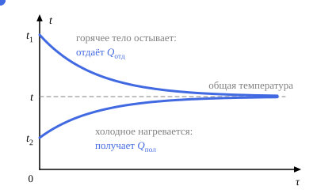

Нальём в ванну горячую воду, а потом добавим холодную. Через минуту в ванне одна общая температура — где-то между горячей и холодной. Какая именно? Это зависит от того, сколько было горячей и сколько холодной воды. В этом уроке учимся её находить.

## Сколько отдали, столько получили

В уроке 2.2 мы видели: когда горячее и холодное тела соприкасаются, энергия переходит от горячего к холодному, пока их температуры не сравняются. Энергия при этом не пропадает и не берётся из ниоткуда. Если тела обмениваются теплотой только друг с другом — сосуд не греется, воздух не уносит тепло, — то вся теплота, которую отдали горячие тела, досталась холодным:

$$
Q_{\text{отд}} = Q_{\text{пол}}.
$$

Это **уравнение теплового баланса** — закон сохранения энергии для теплопередачи. Прибор, в котором его проверяют, — **калориметр**: сосуд с двойными стенками, как термос (урок 5.1), чтобы теплота не уходила наружу.

Общая температура $t$ всегда лежит **между** начальными: горячее тело не остынет ниже неё, холодное не нагреется выше. Если по расчёту вышло иначе — где-то ошибка.

## План решения

1. Определи, какие тела отдают теплоту (остывают) и какие получают (нагреваются).
2. Для каждого тела запиши его $Q$ по формуле урока 5.2. Разность температур бери так, чтобы она была положительной: у горячего ${t_1 - t}$, у холодного ${t - t_2}$.
3. Приравняй сумму отданных теплот сумме полученных и найди неизвестное.

**Пример.** В ванну налили $2\ \text{кг}$ воды при $70\ ^\circ\text{C}$ и $1\ \text{кг}$ воды при $10\ ^\circ\text{C}$. Горячая вода отдаёт, холодная получает:

$$
c \cdot 2 \cdot (70 - t) = c \cdot 1 \cdot (t - 10).
$$

Теплоёмкость одна и та же, она сокращается: ${140 - 2t = t - 10}$, откуда ${t = 50\ ^\circ\text{C}}$. Это между $10$ и $70$, и ближе к $70$: горячей воды было больше.

Когда смешивают одно и то же вещество, ответ можно сразу писать как среднее, взвешенное по массам:

$$
t = \frac{m_1 t_1 + m_2 t_2}{m_1 + m_2}.
$$

<pp-task id="ks-heat-06"></pp-task>

## Разные вещества

Если вещества разные, теплоёмкости не сокращаются — у каждого тела своя. Горячий металл в холодной воде остывает намного сильнее, чем нагревается вода: у металла теплоёмкость маленькая, у воды большая (урок 5.2).

**Пример.** Медную гирю массой $1\ \text{кг}$ при $100\ ^\circ\text{C}$ опустили в $2\ \text{кг}$ воды при $15\ ^\circ\text{C}$. Медь отдаёт, вода получает:

$$
400 \cdot 1 \cdot (100 - t) = 4200 \cdot 2 \cdot (t - 15).
$$

${40\,000 - 400t = 8400t - 126\,000}$, откуда ${t = 166\,000/8800 \approx 18{,}9\ ^\circ\text{C}}$. Гиря остыла на $81$ градус, а вода нагрелась меньше чем на $4$ градуса.

<pp-task id="ks-heat-16"></pp-task>

Проверь себя: смешали 1 кг воды при 90 °C и 1 кг воды при 10 °C, а получилось не 50 °C, а 47 °C. Почему?

Теплота уходила не только холодной воде: нагревались сосуд и воздух. Горячая вода отдала больше, чем получила холодная, поэтому общая температура ниже расчётной. В задачах такие потери оговаривают словами «теплообменом с сосудом и воздухом пренебречь» — или дают теплоёмкость сосуда, и тогда он входит в баланс ещё одним телом.

## Частые ловушки

- **Берут среднее арифметическое температур.** Оно верно только для равных масс одного вещества.
- **Сокращают разные теплоёмкости.** Сокращается только одинаковая.
- **Путают знаки разностей.** У горячего тела ${t_1 - t}$, у холодного ${t - t_2}$, обе положительные.
- **Получают общую температуру вне промежутка от холодной до горячей.** Это верный признак ошибки.

## Коротко

- Без потерь ${Q_{\text{отд}} = Q_{\text{пол}}}$: сколько отдали горячие тела, столько получили холодные.
- Каждое тело — своя теплота со своими $c$ и $m$.
- Общая температура — между начальными.
- Одно вещество: ${t = (m_1 t_1 + m_2 t_2)/(m_1 + m_2)}$.

Дальше — урок 5.7: тепловой баланс, когда в воду бросают лёд.
