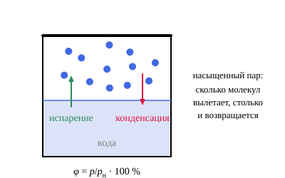

Почему в бане на зеркале появляются капли? Почему летним утром трава мокрая от росы, хотя дождя не было? Всё дело в насыщенном паре. Тема встречается в задачах 7, 9, 10, в качественной задаче 21 и иногда в задаче 24.

Испарение, кипение и влажность воздуха проходят в 8 классе. В 10 добавляется главное для ЕГЭ: почему насыщенный пар не подчиняется газовым законам и что происходит с влажностью при сжатии и нагреве. Пригодится тема «Уравнение состояния и изопроцессы».

## Шаг 1. Испарение и конденсация (8 класс)

Вода в открытом стакане постепенно исчезает — **испаряется**. Самые быстрые молекулы вылетают с поверхности. Улетают самые «горячие», поэтому оставшаяся жидкость охлаждается. Вот почему выходить из воды после купания прохладно.

Обратный процесс — **конденсация**: молекулы пара возвращаются в жидкость.

Испарение идёт быстрее, если температура выше, площадь поверхности больше, а над поверхностью дует ветер (уносит пар).

## Шаг 2. Насыщенный пар (8 класс)

Накрой стакан с водой крышкой. Сначала испаряется больше молекул, чем возвращается. Пара становится больше, и рано или поздно число вылетающих молекул сравняется с числом возвращающихся. Это **динамическое равновесие**, а пар в таком состоянии — **насыщенный**.

Пар, которого меньше, чем в насыщенном, называют **ненасыщенным**. Давление насыщенного пара $p_{\text{н}}$ — наибольшее, какое может быть у пара при данной температуре. Оно быстро растёт при нагревании; его значения берут из таблицы.

## Шаг 3. Кипение (8 класс)

Жидкость кипит, когда давление её насыщенного пара становится равным внешнему давлению. Тогда пузырьки пара могут расти внутри жидкости. При нормальном атмосферном давлении вода кипит при $100\ ^\circ\text{C}$. В горах давление меньше — вода кипит при более низкой температуре, и мясо варится дольше.

Во время кипения температура жидкости не меняется: вся энергия уходит на превращение жидкости в пар.

<pp-task id="ks-hum-01"></pp-task>

## Шаг 4. Относительная влажность (8 класс)

В воздухе всегда есть водяной пар. **Относительная влажность** показывает, насколько пар близок к насыщению:

$$
\varphi = \frac{\rho}{\rho_{\text{н}}} \cdot 100\,\% = \frac{p}{p_{\text{н}}} \cdot 100\,\%.
$$

- $\rho$ — плотность водяного пара в воздухе (сколько граммов пара в кубометре);
- $\rho_{\text{н}}$ — плотность насыщенного пара **при той же температуре** (из таблицы);
- $p$ и $p_{\text{н}}$ — соответствующие давления пара.

При $\varphi = 100\,\%$ пар насыщенный, и начинается конденсация.

<pp-task id="ks-hum-02"></pp-task>

## Шаг 5. Точка росы (8 класс)

**Точка росы** — температура, при охлаждении до которой пар в воздухе становится насыщенным. Пара в воздухе столько же, а насыщенному нужно меньше — и лишнее выпадает каплями.

Ночью воздух у травы остывает ниже точки росы — выпадает роса. Холодное зеркало в ванной холоднее точки росы — оно запотевает.

Найти точку росы просто: в таблице ищут температуру, при которой $\rho_{\text{н}}$ равна плотности пара в воздухе.

<pp-task id="ks-hum-03"></pp-task>

## Шаг 6. Насыщенный пар не подчиняется газовым законам (10 класс)

Главные свойства насыщенного пара:

- Его давление $p_{\text{н}}$ зависит **только от температуры**.
- Давление насыщенного пара **не зависит от объёма**. Если медленно сжать сосуд с насыщенным паром при постоянной температуре, давление не вырастет — часть пара просто сконденсируется.

Поэтому для насыщенного пара законы изопроцессов идеального газа **не работают**. А ненасыщенный пар ведёт себя почти как идеальный газ: его сжали изотермически в 2 раза — давление пара выросло в 2 раза, и влажность тоже.

<pp-task id="ks-hum-04"></pp-task>

## Шаг 7. Сжатие до насыщения (10 класс)

Ненасыщенный пар сжимают дальше и дальше. Его давление растёт по закону Бойля — Мариотта, пока не дойдёт до $p_{\text{н}}$. Дальше давление расти не может: пар насыщенный, и лишний пар конденсируется в капли.

Поэтому, если по расчёту влажность выходит больше $100\,\%$, на самом деле она равна $100\,\%$, а часть пара сконденсировалась.

<pp-task id="ks-hum-05"></pp-task>

## Шаг 8. Нагрев и охлаждение воздуха (10 класс)

- Воздух **нагрели** без добавления пара: $p$ почти не изменилось, а $p_{\text{н}}$ выросло — влажность **уменьшилась**.
- Воздух **охладили**: $p_{\text{н}}$ уменьшилось — влажность **выросла** (до $100\,\%$, дальше — конденсация).
- Пар (без жидкости) **изотермически сжали**: $p$ выросло, $p_{\text{н}}$ то же — влажность выросла. Но не выше $100\,\%$: дальше пар конденсируется.

Зимой в комнате сухо именно поэтому: холодный уличный воздух с небольшим количеством пара нагрели, и его относительная влажность сильно упала.

<pp-task id="ks-hum-06"></pp-task>

## Частые ловушки

- **Применяют $pV = \text{const}$ к насыщенному пару.** При сжатии его давление не растёт.
- **Берут $p_{\text{н}}$ при другой температуре.** Нужна температура воздуха в данный момент.
- **Влажность больше $100\,\%$.** Так не бывает: лишний пар конденсируется.
- **«Тёплый воздух влажнее».** Нагрев без добавления пара снижает относительную влажность.

## Как это выглядит на ЕГЭ

*В закрытом сосуде при постоянной температуре находится воздух с относительной влажностью $40\,\%$. Объём сосуда изотермически уменьшили в $3$ раза. Какой стала влажность?*

Пока пар ненасыщенный, он подчиняется закону Бойля — Мариотта: объём уменьшился в 3 раза — давление пара выросло в 3 раза. Влажность стала бы $3 \cdot 40\,\% = 120\,\%$.

Но больше $100\,\%$ не бывает. Значит, пар стал насыщенным раньше, и часть его сконденсировалась. Ответ: $100\,\%$.

## Коротко

- Насыщенный пар — в динамическом равновесии с жидкостью; $p_{\text{н}}$ зависит только от $T$.
- Кипение: $p_{\text{н}} = p_{\text{внеш}}$; температура при кипении постоянна.
- $\varphi = p/p_{\text{н}} \cdot 100\,\%$, где $p_{\text{н}}$ — при той же температуре.
- Точка росы: температура, при которой пар становится насыщенным.
- Нагрев снижает влажность, охлаждение повышает; $\varphi \le 100\,\%$.
