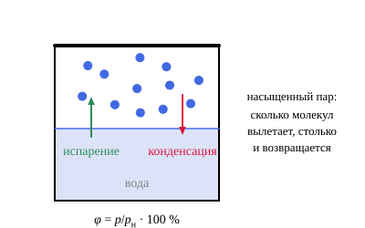

Открытая вода испаряется и рано или поздно кончается. А в закрытой банке вода может стоять годами, и её не становится меньше. Испарение же не прекращается — быстрые молекулы есть всегда (урок 4.1). Куда они деваются?

## Банка с крышкой

Нальём воду в банку и плотно закроем. Сначала пара над водой почти нет: молекулы вылетают, а возвращаться почти некому. Испаряется больше, чем конденсируется, и пара становится всё больше.

Но чем больше молекул пара, тем чаще они попадают обратно в воду. Конденсация усиливается, и наступает момент, когда за секунду из воды вылетает ровно столько молекул, сколько возвращается. Дальше количество пара и воды не меняется, хотя молекулы продолжают вылетать и возвращаться.

Такое равновесие называют **динамическим** («подвижным»): снаружи ничего не меняется, а внутри всё движется. Похоже на тепловое равновесие из урока 2.2: там тела обмениваются энергией поровну, здесь вода и пар — молекулами.

## Насыщенный и ненасыщенный пар

Пар, который находится в динамическом равновесии со своей жидкостью, называют **насыщенным**. Больше пара при этой температуре над водой не накопится: сколько бы ещё молекул ни вылетело, столько же вернётся.

Пар, которого меньше, чем в насыщенном, называют **ненасыщенным**. Над открытой лужей пар обычно ненасыщенный — его уносит ветер, — и лужа высыхает. В закрытой банке пар насыщенный, и вода не убывает.

## Давление насыщенного пара

Пар — это газ, и он давит на стенки, как любой газ (урок 2.1). Давление насыщенного пара обозначают $p_{\text{н}}$. Это **наибольшее давление, какое может быть у пара при данной температуре**: если пара станет больше, лишний сконденсируется.

$p_{\text{н}}$ зависит **только от температуры**. Не важно, большая банка или маленькая, много в ней воды или мало: при одной и той же температуре давление насыщенного пара одно и то же. Его измерили и записали в таблицы:

| $t$, °C | 0 | 20 | 40 | 80 | 100 |
|---|---|---|---|---|---|
| $p_{\text{н}}$, кПа | 0,61 | 2,34 | 7,38 | 47,4 | 101,3 |

При нагревании $p_{\text{н}}$ растёт очень быстро — гораздо быстрее, чем давление газа в закрытом сосуде. При нагревании от $20$ до $40\ ^\circ\text{C}$ абсолютная температура выросла всего на $7\,\%$, а давление насыщенного пара — больше чем втрое. Причина в том, что в горячей воде быстрых молекул намного больше. Вылетает больше молекул, и равновесие наступает, когда пара над водой гораздо больше. Молекулы пара к тому же быстрее и бьют по стенкам сильнее.

<pp-task id="ks-hum-08"></pp-task>

Проверь себя: банку с водой и насыщенным паром перенесли в тёплую комнату. Что будет с паром?

Вода нагреется, быстрых молекул станет больше, и вылетать будет больше, чем возвращаться: на время пар станет ненасыщенным. Испарится ещё немного воды, и наступит новое равновесие — пар снова насыщенный, но при новой температуре его давление и количество больше.

## Пар и воздух

В банке над водой обычно есть и воздух. Он почти ничего не меняет: молекулы воздуха и пара бьют по стенкам независимо (так складываются давления в смеси газов — урок 3.7). Давление пара в смеси — его собственная доля, и насыщенным пар становится при том же $p_{\text{н}}$, что и без воздуха. Воздух лишь замедляет установление равновесия: молекулам пара труднее отлететь от воды.

## Частые ловушки

- **Думают, что в равновесии молекулы перестают вылетать.** Они вылетают и возвращаются непрерывно, просто поровну.
- **Думают, что насыщенный пар — это когда пара очень много.** Насыщенный пар при $0\ ^\circ\text{C}$ давит всего на $0{,}61\ \text{кПа}$ — меньше одного процента атмосферного давления.
- **Думают, что давление насыщенного пара пропорционально температуре.** Оно растёт гораздо быстрее, и его берут из таблицы.

## Коротко

- В закрытом сосуде над жидкостью устанавливается динамическое равновесие: вылетает столько молекул, сколько возвращается.
- Пар в равновесии со своей жидкостью — насыщенный; пар, которого меньше, — ненасыщенный.
- Давление насыщенного пара $p_{\text{н}}$ — наибольшее при данной температуре, зависит только от температуры и быстро растёт при нагревании.

Дальше — урок 4.3: при какой температуре вода кипит.
