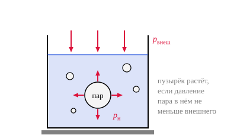

Поставим кастрюлю с водой на плиту. Сначала на дне появляются мелкие пузырьки, потом вода начинает шуметь, и наконец пузыри поднимаются со всего дна и лопаются на поверхности — вода кипит. Испарение идёт и раньше, но только с поверхности. Что меняется при кипении?

## Пузырёк в воде

На дне и стенках кастрюли всегда есть крошечные пузырьки воздуха. Вода вокруг испаряется внутрь пузырька, и в нём быстро получается насыщенный пар (урок 4.2): пузырёк — это маленькая закрытая «банка» с водой вокруг.

На пузырёк снаружи давит вода, а на воду — атмосфера. Изнутри давит пар. Пока давление насыщенного пара меньше внешнего, вода сжимает пузырёк, и он не растёт. Когда вода нагреется настолько, что $p_{\text{н}}$ сравняется с внешним давлением, пар удерживает пузырёк, вода вокруг испаряется внутрь него, и пузырёк растёт. Большой пузырь всплывает (урок 9.5 из механики) и лопается на поверхности.

**Кипение** — это испарение не только с поверхности, а по всему объёму жидкости, внутрь пузырьков. Жидкость кипит при той температуре, при которой давление её насыщенного пара равно внешнему давлению:

$$
p_{\text{н}}(t_{\text{кип}}) = p_{\text{внеш}}.
$$

Давлением воды над пузырьком в кастрюле обычно пренебрегают: при глубине в ладонь оно добавляет к атмосферному около процента (урок 9.2 из механики).

## Температура кипения зависит от давления

Посмотри на таблицу из урока 4.2: при $100\ ^\circ\text{C}$ давление насыщенного водяного пара $101{,}3\ \text{кПа}$ — это нормальное атмосферное давление. Поэтому вода у моря кипит при $100\ ^\circ\text{C}$. Так и выбрана точка $100\ ^\circ\text{C}$ шкалы Цельсия (урок 2.2): это кипящая вода при нормальном давлении.

Если внешнее давление меньше, $p_{\text{н}}$ дорастёт до него при более низкой температуре — вода закипит раньше. Если больше — позже.

**Пример.** На вершине Эвереста атмосферное давление около $34\ \text{кПа}$, примерно треть нормального. Насыщенный водяной пар имеет такое давление при $72\ ^\circ\text{C}$. Значит, там вода кипит примерно при $72\ ^\circ\text{C}$, и сварить в ней яйцо вкрутую почти невозможно: белок сворачивается медленно.

<pp-task id="ks-hum-01"></pp-task>

В скороварке наоборот: крышка закрыта плотно, пар не выходит, и давление над водой выше атмосферного. Вода кипит при более высокой температуре, и еда варится быстрее.

<pp-task id="ks-hum-09"></pp-task>

Проверь себя: можно ли вскипятить воду комнатной температуры, не нагревая её?

Можно, если сильно понизить давление над ней. При $20\ ^\circ\text{C}$ давление насыщенного пара $2{,}34\ \text{кПа}$. Если откачать воздух из сосуда так, чтобы давление стало ниже этого, вода закипит — и при этом будет остывать, потому что испаряются самые быстрые молекулы (урок 4.1).

## Пока кипит, температура не растёт

Пока вода кипит, её температура не меняется, как бы сильно ни горел огонь. Сильный огонь только ускоряет кипение: вода быстрее выкипает. Вся энергия, которую приносит огонь, уходит на то, чтобы превратить воду в пар: самые быстрые молекулы уносят её с собой. Сколько энергии на это нужно, узнаем в теме «Количество теплоты и фазовые переходы».

Поэтому суп не сварится быстрее, если после закипания прибавить огонь, — температура в кастрюле всё равно останется прежней.

## Частые ловушки

- **Думают, что вода всегда кипит при $100\ ^\circ\text{C}$.** Только при нормальном атмосферном давлении. В горах ниже, в скороварке выше.
- **Думают, что при кипении вода продолжает нагреваться.** Пока кипит, температура постоянна.
- **Путают кипение с испарением.** Испарение идёт с поверхности при любой температуре, кипение — по всему объёму и только когда $p_{\text{н}} = p_{\text{внеш}}$.

## Коротко

- Кипение — испарение внутрь пузырьков по всему объёму жидкости.
- Жидкость кипит, когда $p_{\text{н}} = p_{\text{внеш}}$.
- Меньше внешнее давление — ниже температура кипения; больше — выше.
- Пока жидкость кипит, её температура не меняется.

Дальше — урок 4.4: сколько пара в воздухе.
