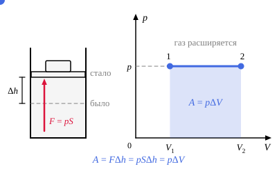

Потри ладони — они нагреются. Накачай шину насосом — насос станет тёплым. В обоих случаях ты совершил работу, и она превратилась во внутреннюю энергию. Тема нужна в задаче 8 и в задачах 9–10.

Что такое внутренняя энергия и как её изменить, рассказывают в 8 классе. Формулу для идеального газа и работу газа — в 10. Пригодятся темы «Работа и мощность», «Механическая энергия» и «Уравнение состояния и изопроцессы».

## Шаг 1. Внутренняя энергия (8 класс)

Каждая молекула движется и взаимодействует с соседями. **Внутренняя энергия** $U$ — сумма кинетической энергии теплового движения всех молекул и потенциальной энергии их взаимодействия.

Чем выше температура тела, тем быстрее движутся молекулы и тем больше внутренняя энергия. Она не связана с тем, как движется или где находится тело в целом: мяч, летящий быстрее, не становится от этого горячее.

## Шаг 2. Два способа изменить внутреннюю энергию (8 класс)

1. **Совершить работу.** Сжимаешь газ — он нагревается. Трёшь ладони — они нагреваются. Мяч упал на пол и остановился — его механическая энергия перешла во внутреннюю.
2. **Теплопередача.** Поставил кастрюлю на плиту — вода получила теплоту.

Результат одинаковый: по конечному состоянию тела нельзя сказать, как его нагрели.

Если вся механическая энергия перешла во внутреннюю энергию тела, то $\Delta U = cm\Delta t$ равно потерянной механической энергии.

<pp-task id="ks-ue-01"></pp-task>

## Шаг 3. Внутренняя энергия идеального газа (10 класс)

У идеального газа молекулы не взаимодействуют, поэтому его внутренняя энергия — это только кинетическая энергия молекул. В теме «Идеальный газ» мы нашли энергию одной молекулы: $\frac{3}{2}kT$. Умножим на число молекул $N = \nu N_A$. Для **одноатомного** идеального газа (гелий, неон, аргон):

$$
U = \frac{3}{2} \nu R T = \frac{3}{2} p V.
$$

- $\nu$ — количество вещества, моль;
- $T$ — абсолютная температура, К;
- $R = 8{,}31\ \text{Дж/(моль·К)}$.

Вторая форма получается из уравнения Менделеева — Клапейрона $pV = \nu RT$.

<pp-task id="ks-ue-02"></pp-task>

## Шаг 4. Изменение внутренней энергии газа (10 класс)

Главный вывод из шага 3: внутренняя энергия данной массы идеального газа зависит **только от температуры**. Нагрели — $U$ выросла. Если температура не изменилась (изотермический процесс), $\Delta U = 0$.

$$
\Delta U = \frac{3}{2} \nu R \Delta T.
$$

Разность температур в кельвинах и в градусах Цельсия одна и та же: нагрев «на $10\ ^\circ\text{C}$» — это и нагрев «на $10\ \text{К}$».

<pp-task id="ks-ue-03"></pp-task>

## Шаг 5. Работа газа (10 класс)

Газ в цилиндре под поршнем расширяется и толкает поршень. Сила давления $F = pS$, поршень сдвинулся на $\Delta h$ — работа $F\Delta h = pS\Delta h = p\Delta V$. Если давление постоянно:

$$
A_{\text{г}} = p \Delta V = p (V_2 - V_1).
$$

- $p$ — давление газа, Па;
- $\Delta V$ — изменение объёма, $\text{м}^3$.

<pp-task id="ks-ue-04"></pp-task>

## Шаг 6. Знак работы газа (10 класс)

- газ **расширяется** ($\Delta V > 0$) — работа газа положительна;
- газ **сжимают** ($\Delta V < 0$) — работа газа отрицательна, а работа внешних сил над газом положительна: $A_{\text{внеш}} = -A_{\text{г}}$;
- объём не меняется (изохорный процесс) — работа равна нулю.

Это то же, что знак работы в механике: газ давит на поршень наружу, и если поршень идёт внутрь, сила газа направлена против перемещения.

<pp-task id="ks-ue-05"></pp-task>

## Шаг 7. Работа как площадь (10 класс)

Если давление меняется, работа газа равна **площади под графиком** $p(V)$ — как работа переменной силы в механике. Для замкнутого цикла работа газа за цикл равна площади внутри цикла. Если цикл на графике $p$–$V$ обходится по часовой стрелке, работа газа за цикл положительна.

<pp-task id="ks-ue-06"></pp-task>

## Частые ловушки

- **Считают, что внутренняя энергия зависит от давления или объёма сами по себе.** Для идеального газа — только от температуры (при данной массе).
- **Применяют $\frac{3}{2}\nu RT$ к двухатомному газу.** Эта формула — для одноатомного. Если газ не одноатомный, на ЕГЭ это обычно оговаривают или формула не нужна.
- **Путают работу газа и работу над газом.** Они равны по модулю и противоположны по знаку.
- **Объём в литрах.** Переводи в $\text{м}^3$: $1\ \text{л} = 10^{-3}\ \text{м}^3$.

## Как это выглядит на ЕГЭ

*Одноатомный идеальный газ при постоянном давлении $100\ \text{кПа}$ расширился от $2$ до $5\ \text{л}$. Найди работу газа и изменение его внутренней энергии.*

Работа при постоянном давлении:

$$
A = p \Delta V = 10^5 \cdot 3 \cdot 10^{-3} = 300\ \text{Дж}.
$$

Внутреннюю энергию удобно выразить через $pV$: $U = \frac{3}{2} pV$. При постоянном давлении

$$
\Delta U = \frac{3}{2} p \Delta V = 1{,}5 \cdot 300 = 450\ \text{Дж}.
$$

Газ расширился при постоянном давлении — значит, температура выросла, и $\Delta U > 0$. Всё сходится.

## Коротко

- $U$ — энергия теплового движения и взаимодействия молекул.
- Изменить $U$ можно работой или теплопередачей.
- Одноатомный идеальный газ: $U = \frac{3}{2}\nu RT = \frac{3}{2}pV$; зависит только от $T$.
- $A_{\text{г}} = p\Delta V$ (при $p = \text{const}$), в общем случае — площадь под графиком $p(V)$.
- $A_{\text{внеш}} = -A_{\text{г}}$.
