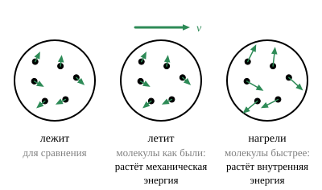

В уроке 5.1 мы договорились: нельзя сказать «в чае много теплоты» — теплота лишь переходит от тела к телу. Но что-то в горячем чае всё-таки есть, раз он может отдать теплоту ложке. Это внутренняя энергия. В этом уроке — что это такое и от чего она зависит.

## Энергия молекул

Тело состоит из молекул, и они всё время беспорядочно движутся (урок 1.2). У каждой молекулы есть кинетическая энергия, и в среднем она тем больше, чем выше температура (урок 2.4). А ещё молекулы притягивают и отталкивают друг друга (урок 1.3) — значит, у них есть и потенциальная энергия взаимодействия, как у растянутой пружины (урок 12.5 из механики).

**Внутренняя энергия** $U$ — это сумма кинетической энергии беспорядочного движения всех молекул тела и потенциальной энергии их взаимодействия. Измеряют её в джоулях.

Молекул в теле огромное число, и сосчитать внутреннюю энергию целиком для жидкости или кристалла трудно. Но в задачах почти всегда нужно не само $U$, а **на сколько оно изменилось** — а это мы считать умеем.

## Это не механическая энергия

Брось мяч изо всех сил — он не станет от этого горячее. У мяча выросла кинетическая энергия **как у целого тела**, а молекулы внутри движутся так же беспорядочно, как раньше. Подними мяч на пятый этаж — выросла его потенциальная энергия (урок 12.1 из механики), а внутренняя осталась прежней.

Механическая энергия зависит от того, как движется и где находится тело целиком. Внутренняя — от того, что происходит **внутри**: как быстро мечутся молекулы и как они расположены друг относительно друга. Это две разные энергии.

Но одна может переходить в другую. В уроке 12.7 из механики санки тормозили трением и останавливались, а их механическая энергия становилась внутренней: полозья и снег нагревались. Так же мяч, упав на пол, перестаёт прыгать: его механическая энергия перешла во внутреннюю энергию мяча и пола.

Проверь себя: стакан воды и ведро воды при одной и той же температуре. У чего больше внутренняя энергия?

У ведра. Молекулы в них движутся в среднем одинаково быстро — температура одна. Но в ведре молекул гораздо больше, а внутренняя энергия — сумма по всем молекулам.

## От чего она зависит

- **От температуры.** Нагрели тело — молекулы движутся быстрее, кинетическая энергия выросла, внутренняя энергия тоже.
- **От массы.** Чем больше молекул, тем больше сумма.
- **От состояния вещества.** В кристалле молекулы крепко связаны, в жидкости слабее, в газе почти свободны. Чтобы вырвать молекулы из связей, нужна энергия: это и есть теплота плавления и парообразования из урока 5.4.

Последний пункт удивляет: лёд при $0\ ^\circ\text{C}$ тает, получает теплоту, а его температура не меняется. Куда же уходит энергия? Кинетическая энергия молекул осталась прежней — растёт **потенциальная** энергия их взаимодействия: молекулы покидают свои места в кристалле. Поэтому у воды при $0\ ^\circ\text{C}$ внутренняя энергия больше, чем у льда той же массы при $0\ ^\circ\text{C}$ — на ${\lambda m}$. Каждый килограмм льда при плавлении получает $330\ \text{кДж}$, и на столько же растёт его внутренняя энергия.

<pp-task id="ks-ue-07"></pp-task>

## Теплота — не запас

Теперь можно сказать точно, что такое теплота из урока 5.1. Горячий чай обладает внутренней энергией. Когда он греет ложку, часть его внутренней энергии переходит к ложке. Эта переданная часть и называется количеством теплоты. Внутренняя энергия — запас, теплота — то, что перешло.

## Частые ловушки

- **«Быстро летящее тело горячее».** Скорость тела как целого — механическая энергия, на внутреннюю она не влияет.
- **«Температура не изменилась — значит, и внутренняя энергия та же».** При плавлении и кипении температура постоянна, а внутренняя энергия растёт.
- **«В теле много теплоты».** В теле — внутренняя энергия. Теплота — энергия, которая перешла.
- **Забывают про массу.** Ведро тёплой воды может иметь больше внутренней энергии, чем стакан кипятка.

## Коротко

- Внутренняя энергия $U$ — кинетическая энергия беспорядочного движения молекул плюс потенциальная энергия их взаимодействия.
- Она растёт с температурой и массой, а при плавлении и испарении — даже при постоянной температуре.
- Механическая энергия тела — другая энергия, но она может переходить во внутреннюю (трение, удар).
- Теплота — переданная часть внутренней энергии, а не запас тела.

Дальше — урок 6.2: как изменить внутреннюю энергию тела — двумя способами.
