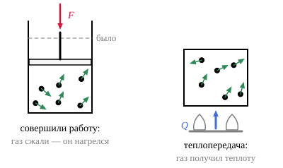

Как согреть замёрзшие руки? Можно подержать их над батареей. А можно сильно потереть ладони друг о друга. В обоих случаях руки нагреются, но способы совсем разные: в первом энергия приходит от горячей батареи, во втором — от твоих мышц. В этом уроке — два способа изменить внутреннюю энергию.

## Способ первый: работа

Вдвинь поршень в цилиндр с газом. Молекулы налетают на поршень, который движется им навстречу, и отскакивают от него быстрее, чем подлетали, — как мяч от ракетки, которой бьют по мячу. Молекулы ускоряются, газ нагревается. Сила руки совершила работу, и она пошла на увеличение внутренней энергии газа.

Так нагревается насос, когда накачиваешь шину. А если сжать воздух очень быстро, он нагревается так сильно, что в нём вспыхивает кусочек ваты. Этот опыт называют «воздушным огнивом», и на нём же работает дизельный двигатель: топливо в нём загорается само, от сжатого горячего воздуха, без свечи зажигания.

Работа нагревает не только газ:

- **трение** — трёшь ладони, тормозишь на санках (урок 12.7 из механики);
- **удар** — молоток бьёт по гвоздю, и шляпка гвоздя нагревается;
- **деформация** — проволока, которую много раз сгибают в одном месте, на сгибе становится горячей.

Бывает и наоборот. Если газ сам расширяется и толкает поршень, он **совершает работу** и **охлаждается**: его внутренняя энергия уменьшается. Поэтому баллончик с краской холодеет, когда из него выходит газ.

## Способ второй: теплопередача

Поставь кастрюлю на плиту — вода нагреется, хотя никто её не сжимает и не трёт. Энергия приходит от горячего тела к холодному сама — теплопроводностью, конвекцией или излучением (урок 5.1). Это и есть теплопередача, а переданная энергия — количество теплоты $Q$.

## Результат один

Глядя на тёплую воду, нельзя сказать, как её нагрели: на плите или долгим перемешиванием (так в XIX веке Джоуль и измерял, сколько работы нужно, чтобы нагреть воду на градус). Внутренняя энергия зависит только от **состояния** тела, а не от того, каким путём его в это состояние привели.

Проверь себя: когда накачиваешь шину, нагревается стенка насоса. Это работа или теплопередача?

Оба способа по очереди. Сначала поршень сжимает воздух — работа увеличивает внутреннюю энергию воздуха, и он нагревается. Потом горячий воздух отдаёт теплоту стенкам насоса — это уже теплопередача.

## Сколько энергии перешло

Если механическая энергия целиком перешла во внутреннюю энергию тела, а теплом тело ни с чем не обменивалось, то его нагрев считают как в уроке 5.2: внутренняя энергия выросла на ${cm\Delta t}$, и это равно потерянной механической энергии.

**Пример.** Молот массой $500\ \text{кг}$ падает с высоты $2\ \text{м}$ на стальную заготовку массой $40\ \text{кг}$. Половина энергии молота идёт на нагрев заготовки. Энергия молота ${mgh = 500 \cdot 10 \cdot 2 = 10\,000\ \text{Дж}}$, заготовке достаётся $5000\ \text{Дж}$. Нагрев за один удар:

$$
\Delta t = \frac{5000}{c\,m} = \frac{5000}{500 \cdot 40} = 0{,}25\ ^\circ\text{C}.
$$

Немного — но кузнец бьёт десятки раз подряд.

<pp-task id="ks-ue-01"></pp-task>

Масса в такой задаче сокращается, только если нагревается то самое тело, которое потеряло механическую энергию. Если энергия одного тела греет другое, массы у них разные.

<pp-task id="ks-ue-08"></pp-task>

## Частые ловушки

- **«Нагрели — значит, дали теплоту».** Нагреть можно и работой: трением, ударом, сжатием.
- **Путают, кто совершает работу.** Газ сжимают — работу совершают над газом, он нагревается. Газ расширяется сам — работу совершает газ, он охлаждается.
- **Сокращают массы разных тел.** Масса сокращается, только если энергия остаётся в том же теле.
- **Скорость в км/ч.** Для кинетической энергии переведи в м/с.

## Коротко

- Изменить внутреннюю энергию можно работой или теплопередачей.
- Над газом совершают работу — он нагревается; газ сам совершает работу — охлаждается.
- По состоянию тела нельзя сказать, каким способом его нагрели.
- Механическая энергия, целиком перешедшая во внутреннюю энергию тела: ${E_1 - E_2 = cm\Delta t}$.

Дальше — урок 6.3: внутреннюю энергию газа можно посчитать целиком — по одной формуле.
