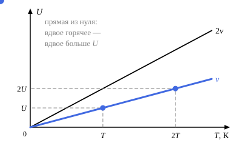

В уроке 6.1 мы сказали, что сосчитать внутреннюю энергию жидкости или кристалла трудно. А вот для идеального газа это легко, и почти всё нужное мы уже знаем. В этом уроке — одна формула и её две формы.

## Только кинетическая энергия

В модели идеального газа молекулы не взаимодействуют на расстоянии (урок 2.5) — значит, потенциальной энергии взаимодействия у них нет. Внутренняя энергия идеального газа — это только кинетическая энергия его молекул.

Средняя кинетическая энергия одной молекулы ${\overline{E}_{\text{к}} = \frac{3}{2}kT}$ (урок 2.4). Молекул $N = \nu N_A$ (урок 1.4). Сложим энергии всех молекул:

$$
U = N \cdot \frac{3}{2} k T = \frac{3}{2} \nu N_A k T.
$$

Произведение $N_A k$ — это газовая постоянная $R$ (урок 2.7). Получаем

$$
U = \frac{3}{2} \nu R T.
$$

- $\nu$ — количество вещества, моль;
- $T$ — абсолютная температура, К;
- $R = 8{,}31\ \text{Дж/(моль·К)}$.

## Только для одноатомного газа

Энергия $\frac{3}{2}kT$ из урока 2.4 — энергия **поступательного** движения молекулы, полёта её как целого. Если молекула — один атом (гелий, неон, аргон), у неё другой энергии и нет. А молекула из двух атомов, например кислорода, ещё и вращается, и её энергия больше. Поэтому формула ${U = \frac{3}{2}\nu RT}$ — для **одноатомного** идеального газа. В задачах ЕГЭ так и пишут: «одноатомный идеальный газ».

**Пример.** Внутренняя энергия $1\ \text{моль}$ гелия при $0\ ^\circ\text{C}$, то есть при $273\ \text{К}$:

$$
U = 1{,}5 \cdot 1 \cdot 8{,}31 \cdot 273 \approx 3400\ \text{Дж}.
$$

<pp-task id="ks-ue-09"></pp-task>

## Через давление и объём

По уравнению Менделеева — Клапейрона ${pV = \nu RT}$ (урок 3.2). Подставим — и внутреннюю энергию можно считать, вообще не зная ни количества вещества, ни температуры:

$$
U = \frac{3}{2} p V.
$$

Удобная деталь: $\text{кПа} \cdot \text{л} = 10^3\ \text{Па} \cdot 10^{-3}\ \text{м}^3 = 1\ \text{Дж}$. Неон в баллоне объёмом $10\ \text{л}$ при давлении $180\ \text{кПа}$:

$$
U = 1{,}5 \cdot 180 \cdot 10 = 2700\ \text{Дж}.
$$

<pp-task id="ks-ue-02"></pp-task>

## Зависит только от температуры

В формулу ${U = \frac{3}{2}\nu RT}$ входят только количество вещества и температура. Значит, **для данного газа внутренняя энергия зависит только от его абсолютной температуры** и пропорциональна ей. Нагрел газ от $350$ до $700\ \text{К}$ — внутренняя энергия выросла вдвое. А давление и объём сами по себе ничего не решают: можно сжать газ вдвое, но если температура осталась прежней, внутренняя энергия та же.

Сорт газа тоже не важен: у моля гелия и моля аргона при одной температуре внутренняя энергия одинаковая, хотя атом аргона в десять раз тяжелее. Так же, как в уроке 2.4: средняя энергия молекулы зависит только от температуры.

Проверь себя: у газа при 0 °C внутренняя энергия равна нулю?

Нет. Формула требует абсолютную температуру: $0\ ^\circ\text{C}$ — это $273\ \text{К}$, и молекулы вовсю движутся. Нулю внутренняя энергия идеального газа была бы равна только при абсолютном нуле.

## Частые ловушки

- **Подставляют градусы Цельсия.** В ${U = \frac{3}{2}\nu RT}$ — только кельвины.
- **Применяют ${\frac{3}{2}\nu RT}$ к двухатомному газу.** Формула — для одноатомного. Если газ не одноатомный, на ЕГЭ это оговаривают, или формула не нужна.
- **Забывают множитель $\frac{3}{2}$.** ${pV}$ — это ещё не внутренняя энергия.
- **Литры с паскалями.** Либо всё в СИ, либо килопаскали с литрами — тогда сразу джоули.

## Коротко

- Внутренняя энергия идеального газа — только кинетическая энергия молекул.
- Одноатомный газ: ${U = \frac{3}{2}\nu RT = \frac{3}{2}pV}$.
- При данном количестве газа $U$ зависит только от абсолютной температуры и пропорциональна ей.
- $\text{кПа} \cdot \text{л} = \text{Дж}$.

Дальше — урок 6.4: как меняется внутренняя энергия газа в изопроцессах.
