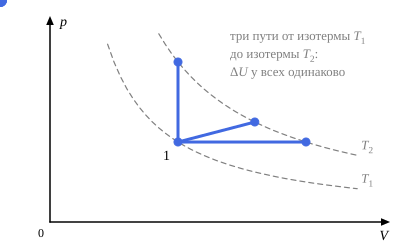

В задачах редко спрашивают, сколько внутренней энергии в газе. Обычно спрашивают, **на сколько она изменилась**: газ нагрели, сжали, выпустили из-под поршня. В этом уроке — как найти это изменение в любом процессе.

## Изменение через температуру

Внутренняя энергия ${U = \frac{3}{2}\nu RT}$. Количество газа не меняется, поэтому меняется она только вместе с температурой:

$$
\Delta U = U_2 - U_1 = \frac{3}{2} \nu R \Delta T.
$$

Разность температур в кельвинах и в градусах Цельсия одна и та же (урок 2.3): нагрев «на $40\ ^\circ\text{C}$» — это нагрев «на $40\ \text{К}$». Поэтому здесь, в отличие от самой $U$, можно подставлять и разность градусов Цельсия.

Знак получается сам: газ нагрели — ${\Delta U > 0}$, охладили — ${\Delta U < 0}$.

<pp-task id="ks-ue-03"></pp-task>

## Путь не важен

Внутренняя энергия газа зависит только от его температуры, то есть от **состояния** (урок 6.2). Поэтому её изменение зависит только от начального и конечного состояний. Из состояния 1 можно попасть на изотерму $T_2$ как угодно — нагреть при постоянном объёме, при постоянном давлении или как-то ещё, — и изменение внутренней энергии будет одно и то же: ${\frac{3}{2}\nu R(T_2 - T_1)}$.

## В изопроцессах

Часто температура не дана, а даны давление и объём. Тогда удобна вторая форма, ${U = \frac{3}{2}pV}$:

$$
\Delta U = \frac{3}{2}\,(p_2 V_2 - p_1 V_1).
$$

В изопроцессах (уроки 3.3–3.5) она упрощается:

- **изотермический** ($T = \text{const}$): $pV$ не меняется — ${\Delta U = 0}$, хотя давление и объём изменились;
- **изохорный** ($V = \text{const}$): ${\Delta U = \frac{3}{2}V\Delta p}$;
- **изобарный** ($p = \text{const}$): ${\Delta U = \frac{3}{2}p\Delta V}$.

**Пример.** Гелий при постоянном давлении $250\ \text{кПа}$ расширился с $2$ до $2{,}4\ \text{л}$. Помним, что $\text{кПа} \cdot \text{л} = \text{Дж}$ (урок 6.3):

$$
\Delta U = \frac{3}{2}\,p\,\Delta V = 1{,}5 \cdot 250 \cdot 0{,}4 = 150\ \text{Дж}.
$$

Энергия выросла: при изобарном расширении газ нагревается (урок 3.4).

<pp-task id="ks-ue-10"></pp-task>

Проверь себя: газ медленно сжали в 3 раза при постоянной температуре. Как изменилась его внутренняя энергия?

Никак: ${\Delta U = 0}$. Температура не изменилась, а внутренняя энергия идеального газа зависит только от неё. Давление выросло в 3 раза, объём уменьшился в 3 раза, произведение $pV$ то же.

## По графику

Если процесс дан на графике $p\text{–}V$, сними с него давление и объём в начале и в конце и сравни произведения $pV$ — как в уроке 3.6, где по ним сравнивали температуры.

**Пример.** В состоянии 1 газ занимает $5\ \text{л}$ при $100\ \text{кПа}$, в состоянии 2 — $4\ \text{л}$ при $170\ \text{кПа}$. Произведения: ${p_1V_1 = 500\ \text{Дж}}$, ${p_2V_2 = 680\ \text{Дж}}$. Объём уменьшился, а внутренняя энергия выросла:

$$
\Delta U = 1{,}5 \cdot (680 - 500) = 270\ \text{Дж}.
$$

А во сколько раз она изменилась, показывает отношение произведений: ${U_2/U_1 = p_2V_2/(p_1V_1)}$.

<pp-task id="ks-ue-11"></pp-task>

## Частые ловушки

- **Подставляют конечную температуру вместо разности.** В ${\Delta U = \frac{3}{2}\nu R\Delta T}$ — именно изменение $T_2 - T_1$.
- **Думают, что при сжатии внутренняя энергия растёт всегда.** При изотермическом сжатии ${\Delta U = 0}$.
- **Смотрят на одну величину.** Давление упало — ещё не значит, что энергия уменьшилась: смотри на произведение $pV$.
- **Забывают множитель $\frac{3}{2}$.** ${\Delta(pV)}$ — ещё не ${\Delta U}$.

## Коротко

- ${\Delta U = \frac{3}{2}\nu R\Delta T = \frac{3}{2}\Delta(pV)}$; нагрели — ${\Delta U > 0}$.
- ${\Delta U}$ зависит только от начального и конечного состояний.
- Изотермический: ${\Delta U = 0}$; изохорный: ${\frac{3}{2}V\Delta p}$; изобарный: ${\frac{3}{2}p\Delta V}$.
- ${U_2/U_1 = p_2V_2/(p_1V_1)}$.

Дальше — урок 6.5: газ толкает поршень и совершает работу.
