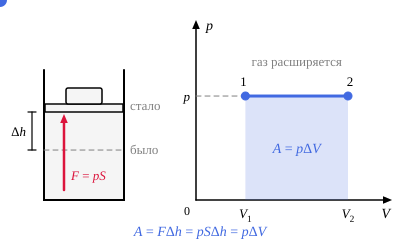
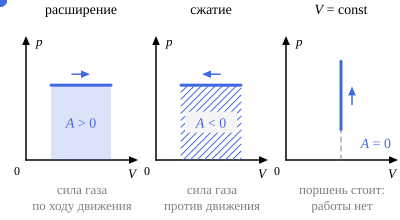

В паровой машине пар толкает поршень, в двигателе автомобиля — горячие газы после вспышки топлива. Газ, который расширяется, может поднять груз, сдвинуть поршень, раскрутить колесо — то есть совершить работу. В этом уроке посчитаем её.

## Сила давления на поршень

Газ под поршнем площадью $S$ давит на него с силой ${F = pS}$ (урок 9.1 из механики). Нагреем газ, оставив на поршне тот же груз: газ расширится (урок 3.4), а его давление останется прежним. Поршень поднимется на $\Delta h$, и сила давления газа совершит работу (урок 11.1 из механики):

$$
A = F\,\Delta h = pS\,\Delta h.
$$

Но $S\,\Delta h$ — это как раз на сколько вырос объём газа, $\Delta V$. Получаем **работу газа** при постоянном давлении:

$$
A = p\,\Delta V = p\,(V_2 - V_1).
$$

- $p$ — давление газа, Па;
- $\Delta V$ — изменение объёма, $\text{м}^3$.

Форма сосуда не важна: так считают работу газа, который при постоянном давлении расширяется в любом сосуде. И снова $\text{кПа} \cdot \text{л} = \text{Дж}$.

**Пример.** Газ под поршнем при постоянном давлении $140\ \text{кПа}$ расширился на $0{,}5\ \text{л}$. Работа газа ${A = 140 \cdot 0{,}5 = 70\ \text{Дж}}$. Или в СИ: ${1{,}4 \cdot 10^5 \cdot 5 \cdot 10^{-4} = 70\ \text{Дж}}$.

<pp-task id="ks-ue-04"></pp-task>

Давление газа под свободным поршнем находят из равновесия поршня, как в уроке 3.1: ${p = p_{\text{атм}} + \frac{mg}{S}}$. Пока поршень движется медленно, оно не меняется.

<pp-task id="ks-ue-12"></pp-task>

## Знак работы

Это знак работы из урока 11.4 механики. Газ всегда давит на поршень **наружу**.

- Газ **расширяется**: поршень идёт наружу — по направлению силы газа. Работа газа **положительна**.
- Газ **сжимают**: поршень идёт внутрь — против силы газа. Работа газа **отрицательна**: ${\Delta V < 0}$, и формула ${A = p\Delta V}$ сама даёт минус.
- **Объём не меняется**: поршень стоит, перемещения нет — работы нет, ${A = 0}$.

Над газом при этом работают внешние силы: груз, рука, атмосфера. Поршень один, перемещение одно, а силы газа и внешние силы на поршень равны и противоположны. Поэтому **работа внешних сил над газом** ${A' = -A}$. Газ сжимают — ${A' > 0}$: внешние силы совершают положительную работу, и газ нагревается, как в уроке 6.2.

<pp-task id="ks-ue-05"></pp-task>

Проверь себя: газ под поршнем охладили при постоянном давлении. Какой знак у работы газа и у работы внешних сил?

При изобарном охлаждении объём уменьшается (урок 3.4): поршень опускается. Работа газа отрицательна, работа внешних сил над газом положительна.

## Попробуй сам

Газ под поршнем с грузом, давление постоянно — как в уроке 3.4, только теперь модель считает энергию. Газ одноатомный, в начальной точке A он занимает $1\ \text{л}$ при $100\ \text{кПа}$ и $250\ \text{К}$. Под линией процесса закрашена работа газа: сплошной заливкой — положительная, штриховкой — отрицательная. Полосы внизу — работа газа $A$ и изменение внутренней энергии ${\Delta U}$ с точки A.

<pp-iso process="p" work>Модель: газ под поршнем с грузом. Ползунок меняет температуру; на графике давления от объёма закрашена работа газа, а полосы показывают работу газа и изменение его внутренней энергии.</pp-iso>

- Нагрей газ: прямоугольник под графиком растёт, работа положительна. Сравни полосы: при постоянном давлении ${\Delta U = \frac{3}{2}p\Delta V}$ (урок 6.4), то есть ровно в полтора раза больше работы.
- Охлади газ ниже начальной температуры: газ сжимается, работа отрицательна — штриховка.
- Выбери «объём $V$» и меняй температуру: внутренняя энергия меняется, а полоса работы стоит на месте — в этом процессе работы нет.
- Выбери «температура $T$» и расширь газ: работа есть, а ${\Delta U = 0}$. Откуда же газ взял энергию на работу? Это вопрос первого закона термодинамики — в следующей теме.

## Частые ловушки

- **Умножают давление на конечный объём.** Работа — давление на **изменение** объёма.
- **Объём в литрах с давлением в паскалях.** Либо всё в СИ, либо кПа на литры.
- **Путают работу газа и работу над газом.** Они равны по модулю и противоположны по знаку: ${A' = -A}$.
- **Забывают атмосферу.** Под свободным поршнем ${p = p_{\text{атм}} + mg/S}$, а не только ${mg/S}$.

## Коротко

- При постоянном давлении ${A = p\Delta V = p(V_2 - V_1)}$.
- Расширение — ${A > 0}$, сжатие — ${A < 0}$, ${V = \text{const}}$ — ${A = 0}$.
- Работа внешних сил над газом ${A' = -A}$.
- $\text{кПа} \cdot \text{л} = \text{Дж}$.

Дальше — урок 6.6: а если давление меняется?
