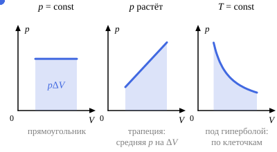

Формула ${A = p\Delta V}$ годится, только пока давление постоянно. А если газ расширяется и давление при этом падает, как при изотермическом процессе, или растёт? Какое давление подставлять — начальное, конечное? Такой же вопрос был в механике про переменную силу, и ответ тот же.

## Площадь под графиком

На графике $p\text{–}V$ работа при постоянном давлении ${p\,\Delta V}$ — это площадь прямоугольника под отрезком: высота $p$, ширина $\Delta V$. Если давление меняется, разрежем процесс на узкие полоски. На каждой давление почти постоянно, и работа на ней — площадь полоски. Сложим полоски:

**работа газа равна площади под графиком $p(V)$** — точно так же, как работа переменной силы была площадью под графиком $F(x)$ (урок 11.6 из механики).

- Давление постоянно — прямоугольник: ${A = p\Delta V}$.
- Давление меняется по прямой — трапеция: средняя сила на путь, то есть ${A = \frac{p_1 + p_2}{2}\,\Delta V}$.
- Температура постоянна — площадь под гиперболой. Формулы для неё в школьном курсе нет, но её можно оценить по клеточкам графика или сравнить с соседними прямоугольниками.

**Пример.** Газ расширяется от $1$ до $4\ \text{л}$, а его давление равномерно падает от $250$ до $130\ \text{кПа}$. Под графиком трапеция, средняя высота $190\ \text{кПа}$:

$$
A = \frac{250 + 130}{2} \cdot 3 = 570\ \text{Дж}.
$$

<pp-task id="ks-ue-06"></pp-task>

Знак — как в уроке 6.5: если газ при этом сжимается (точка на графике идёт влево), площадь берётся с минусом.

## Работа зависит от пути

Пусть газ переходит из состояния 1 в состояние 3 двумя путями. Можно сначала расширить его при большом давлении, а потом остудить при постоянном объёме. А можно наоборот: сначала остудить, потом расширить при малом давлении. Начало и конец одни и те же, а площади под графиками разные — **работа разная**.

С внутренней энергией не так: она зависит только от состояния (урок 6.4), и ${\Delta U}$ на обоих путях одинаково. Поэтому нельзя говорить «работа, запасённая в газе»: работа, как и теплота (урок 6.1), — не запас, а способ передать энергию, и сколько её будет, зависит от того, как идёт процесс.

<pp-task id="ks-ue-13"></pp-task>

Проверь себя: газ из одного и того же начального состояния расширяется до одного и того же объёма — один раз изобарно, другой раз изотермически. Где работа газа больше?

При изобарном расширении. Давление там всё время равно начальному, а при изотермическом оно падает (урок 3.3). Гипербола идёт ниже горизонтального отрезка, и площадь под ней меньше.

## Попробуй сам

Теперь газ в воде, его температура постоянна. Закрашенная площадь под гиперболой — работа газа.

<pp-iso process="T" work>Модель: газ под поршнем при постоянной температуре. Ползунок меняет объём; на графике давления от объёма закрашена работа газа под гиперболой, а полосы показывают работу газа и изменение его внутренней энергии.</pp-iso>

- Расширь газ: площадь под гиперболой растёт, а полоса ${\Delta U}$ остаётся нулевой — температура не меняется.
- Нажми «Заново», выбери «давление $p$» и нагрей газ до того же объёма. Прямоугольник выше гиперболы, и работа больше, чем при изотермическом расширении.
- Расширь газ, а потом сожми обратно до начала: площадь исчезнет, работа станет нулём. Сколько работы газ совершил, расширяясь, столько же совершили над ним, когда сжимали по той же гиперболе.

## Частые ловушки

- **Подставляют в ${p\Delta V}$ одно давление, когда оно меняется.** Работа — площадь под графиком.
- **Забывают половину в трапеции.** Средняя высота — ${(p_1 + p_2)/2}$, а не сумма давлений.
- **Считают, что работа зависит только от начала и конца.** Это ${\Delta U}$ зависит только от них, а работа — от пути.
- **Ищут площадь до оси давления.** Площадь — под графиком, до оси объёма.

## Коротко

- Работа газа — площадь под графиком $p(V)$, до оси объёма.
- Линейное изменение давления — трапеция: ${A = \frac{p_1 + p_2}{2}\Delta V}$.
- Сжатие — площадь с минусом.
- Работа зависит от пути, ${\Delta U}$ — нет.

Дальше — урок 6.7: газ проходит цикл и возвращается в начальное состояние. Какую работу он совершил?
