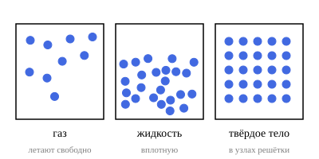

Открой флакон духов в углу комнаты — через минуту запах почувствуют все. Никто запах не переносил: молекулы сами разлетелись. С этой идеи начинается молекулярно-кинетическая теория (МКТ). Она нужна в задаче 7, в задаче 9 и в качественной задаче 21.

Что вещество состоит из движущихся частиц, рассказывают ещё в 7 классе. Как эти частицы считать — моли, молярная масса, масса молекулы — в 10. С этого начинается вся молекулярная физика, так что тема ни на что не опирается: можно начинать прямо отсюда.

## Шаг 1. Вещество состоит из частиц (7 класс)

Раздроби кусочек сахара, потом ещё и ещё — крупинки становятся всё мельче. Но делить бесконечно нельзя: вещество состоит из мельчайших частиц — **молекул** и **атомов**.

Они очень маленькие: размер молекулы около $10^{-10}\ \text{м}$, а в капле воды их больше, чем звёзд в нашей Галактике. Оценить размер можно простым опытом: капля масла растекается по воде пятном, толщина которого — примерно одна молекула. Делим объём капли на площадь пятна — получаем толщину.

<pp-task id="ks-mkt-01"></pp-task>

## Шаг 2. Частицы непрерывно движутся (7 класс)

Частицы вещества непрерывно и хаотично движутся. Это движение называют **тепловым**: чем выше температура, тем оно быстрее.

Доказательства:

- **Диффузия** — взаимное проникновение веществ из-за теплового движения. Запах духов, чайный пакетик в кипятке. В горячей воде диффузия идёт быстрее: молекулы движутся быстрее. В газах диффузия быстрая, в жидкостях медленнее, в твёрдых телах — очень медленная.
- **Броуновское движение** — беспорядочное движение мелких частиц (например, пыльцы) в жидкости. Частицы дёргаются, потому что их со всех сторон неравномерно толкают молекулы жидкости. Важно: в микроскоп видно движение **частиц пыльцы**, а не самих молекул.

## Шаг 3. Частицы взаимодействуют: газ, жидкость, кристалл (7 класс)

Частицы притягиваются и отталкиваются: на малых расстояниях отталкиваются, на чуть больших — притягиваются. Поэтому твёрдое тело трудно и сжать, и разорвать.

От того, как далеко частицы друг от друга и как сильно они взаимодействуют, зависит состояние вещества:

- **Газ**: молекулы далеко друг от друга, почти не взаимодействуют, летают свободно. Газ занимает весь сосуд.
- **Жидкость**: молекулы вплотную, колеблются и время от времени перескакивают на новое место. Жидкость сохраняет объём, но течёт.
- **Кристалл**: частицы колеблются около узлов кристаллической решётки. Твёрдое тело сохраняет и объём, и форму.

## Шаг 4. Количество вещества (10 класс)

Молекул в любом теле невероятно много, поэтому их считают «пачками». Одна пачка — **моль**: столько частиц, сколько атомов в $12\ \text{г}$ углерода. Число частиц в одном моле — **постоянная Авогадро**:

$$
N_A = 6 \cdot 10^{23}\ \text{моль}^{-1}.
$$

**Количество вещества** $\nu$ показывает, сколько молей в теле:

$$
\nu = \frac{N}{N_A},
$$

где $N$ — число частиц.

<pp-task id="ks-mkt-02"></pp-task>

## Шаг 5. Молярная масса (10 класс)

Считать молекулы поштучно нельзя, а взвесить тело — легко. Масса одного моля называется **молярной массой** $M$, кг/моль. Тогда

$$
\nu = \frac{m}{M}.
$$

Молярную массу берут из таблицы Менделеева: относительная атомная (молекулярная) масса, умноженная на $10^{-3}$ кг/моль. Например, водород $\text{H}_2$: $M = 2 \cdot 10^{-3}\ \text{кг/моль}$; кислород $\text{O}_2$: $32 \cdot 10^{-3}$; вода $\text{H}_2\text{O}$: $18 \cdot 10^{-3}$; гелий He: $4 \cdot 10^{-3}$.

Кислород и водород в воздухе — **двухатомные** молекулы, поэтому $M(\text{O}_2) = 32$ г/моль, а не $16$.

<pp-task id="ks-mkt-03"></pp-task>

## Шаг 6. Число молекул в теле (10 класс)

Соединим два предыдущих шага: $\nu = N/N_A = m/M$. Отсюда число молекул в теле массой $m$:

$$
N = \nu N_A = \frac{m}{M} N_A.
$$

Здесь граммы можно не переводить в килограммы, если и $m$, и $M$ взяты в граммах: в отношении $m/M$ они сокращаются.

<pp-task id="ks-mkt-04"></pp-task>

## Шаг 7. Масса одной молекулы (10 класс)

В одном моле $N_A$ молекул, а весит он $M$. Значит, одна молекула весит

$$
m_0 = \frac{M}{N_A}.
$$

Здесь $M$ — обязательно в кг/моль, иначе масса молекулы выйдет в граммах.

<pp-task id="ks-mkt-05"></pp-task>

## Шаг 8. Концентрация молекул (10 класс)

**Концентрация** $n$ — число частиц в единице объёма:

$$
n = \frac{N}{V}, \qquad [n] = \text{м}^{-3}.
$$

Объём — в кубических метрах: $1\ \text{л} = 10^{-3}\ \text{м}^3$. Концентрация понадобится в следующей теме: от неё зависит давление газа.

<pp-task id="ks-mkt-06"></pp-task>

## Частые ловушки

- **Молярную массу берут в граммах на моль.** В СИ — кг/моль: для кислорода $0{,}032$, а не $32$.
- **Забывают, что кислород и водород двухатомные.** $M(\text{O}_2) = 32$ г/моль, а не $16$.
- **Думают, что в броуновском движении видны молекулы.** Видны частицы, которые толкают молекулы.
- **Путают $\nu$ (количество вещества) и $\nu$ (частоту).** Буква одна, смысл разный — смотри по контексту.

## Как это выглядит на ЕГЭ

*Сколько молекул содержится в $36\ \text{г}$ воды? $N_A = 6 \cdot 10^{23}\ \text{моль}^{-1}$.*

Молярная масса воды $M = 18\ \text{г/моль}$. Количество вещества:

$$
\nu = \frac{m}{M} = \frac{36}{18} = 2\ \text{моль}.
$$

Число молекул:

$$
N = \nu N_A = 2 \cdot 6 \cdot 10^{23} = 1{,}2 \cdot 10^{24}.
$$

Здесь граммы можно не переводить: в отношении $m/M$ они сокращаются.

## Коротко

- Вещество из частиц; частицы движутся хаотично; частицы взаимодействуют.
- Диффузия и броуновское движение подтверждают тепловое движение.
- $\nu = N/N_A = m/M$, $N_A = 6 \cdot 10^{23}\ \text{моль}^{-1}$.
- $m_0 = M/N_A$, $n = N/V$.
- Молярная масса в СИ — в кг/моль.
