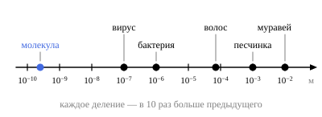
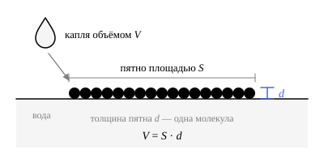

Брось кусочек сахара в горячий чай и размешай. Через минуту сахара не видно — но чай сладкий в каждом глотке. Значит, сахар никуда не делся: он распался на частицы, такие мелкие, что их не разглядеть ни глазом, ни в обычный микроскоп. Что это за частицы и насколько они малы — в этом уроке.

## Делить без конца нельзя

Раздроби кусочек сахара, потом каждую крупинку ещё и ещё. Крупинки становятся всё мельче, но каждая по-прежнему сахар — сладкая и белая. Можно ли так делить бесконечно? Нет. Рано или поздно дойдём до частицы, которую уже не разделить так, чтобы остался сахар.

Эту частицу называют **молекулой**. Молекула — мельчайшая частица вещества, у которой ещё сохраняются его свойства. Все молекулы одного вещества одинаковы: молекула воды из моря такая же, как из чайника.

Молекулы, в свою очередь, состоят из **атомов**. Молекула воды $\text{H}_2\text{O}$ — это два атома водорода и один атом кислорода. Разных атомов немного, около сотни, — они собраны в таблице Менделеева. А молекул из них можно сложить миллионы разных, как слов из букв.

## Насколько они малы

Размер молекулы — около $10^{-10}\ \text{м}$. Степени десяти мы разбирали в уроке 1.1 из механики: $10^{-10}$ — это единицу десять раз поделили на $10$, то есть $0{,}000\,000\,000\,1\ \text{м}$.

Чтобы почувствовать, насколько это мало, посчитаем, сколько молекул уложится поперёк волоса.

**Пример.** Толщина волоса около $0{,}1\ \text{мм} = 10^{-4}\ \text{м}$. Число молекул поперёк волоса:

$$
N = \frac{10^{-4}}{10^{-10}} = 10^{-4-(-10)} = 10^{6}.
$$

Миллион молекул — поперёк одного волоса.

Здесь пригодилось правило, парное к тому, что было в уроке 1.1 из механики: **при делении степеней десяти показатели вычитаются**. $10^{-4} : 10^{-10} = 10^{-4+10} = 10^{6}$. Проверь здравым смыслом: молекула намного меньше волоса, значит, их должно уложиться очень много — так и вышло.

<pp-task id="ks-mkt-07"></pp-task>

## Как измерить молекулу

Линейкой молекулу не измерить. Но есть хитрый опыт. Капля масла, упавшая на воду, растекается тонким пятном. Растекается она до тех пор, пока пятно не станет толщиной в одну молекулу — тоньше уже некуда.

Пятно — очень тонкий «блин». Объём блина — площадь, умноженная на толщину: $V = S d$. Объём капли $V$ знаем, площадь пятна $S$ измерим. Тогда толщина пятна, то есть размер молекулы:

$$
d = \frac{V}{S}.
$$

**Пример.** Капля объёмом $1\ \text{мм}^3$ растеклась пятном площадью $0{,}4\ \text{м}^2$. Переводим объём в СИ: $1\ \text{мм} = 10^{-3}\ \text{м}$, поэтому $1\ \text{мм}^3 = (10^{-3}\ \text{м})^3 = 10^{-9}\ \text{м}^3$ (урок 1.1 из механики: кубическая единица — это куб). Тогда

$$
d = \frac{10^{-9}}{0{,}4} = 2{,}5 \cdot 10^{-9}\ \text{м} = 2{,}5\ \text{нм}.
$$

Это больше, чем $10^{-10}\ \text{м}$: молекулы масла длинные, они в десятки раз крупнее молекулы воды. Но порядок тот же — миллиардные доли метра.

<pp-task id="ks-mkt-01"></pp-task>

## Между молекулами есть промежутки

Если вещество — это частицы, то между ними может быть пустое место. Опыты говорят: есть.

- **Газ легко сжать.** Закрой пальцем выход шприца и надави на поршень — воздух сожмётся в несколько раз. Молекулы при этом не сжимаются: сокращаются промежутки между ними.
- **Тела при нагревании расширяются.** Между рельсами оставляют зазоры, а провода летом провисают сильнее. Сами молекулы не растут — растут расстояния между ними.
- **Вода и спирт.** Смешай $50\ \text{мл}$ воды и $50\ \text{мл}$ спирта — получится меньше $100\ \text{мл}$. Молекулы одного вещества частично заняли промежутки между молекулами другого. Так горох, смешанный с пшеном, занимает меньше места, чем по отдельности: пшено проваливается между горошинами.

Проверь себя: почему воздух в шприце сжать легко, а воду — почти невозможно?

В газе промежутки между молекулами намного больше самих молекул, и их есть куда сокращать. В воде молекулы почти вплотную друг к другу, и сжимать нечего. Подробнее об этом — в уроке 1.3.

## Частые ловушки

- **Думают, что при нагревании растут сами молекулы.** Растут расстояния между ними.
- **Путают молекулу и атом.** Атомы — «буквы», молекулы — «слова»: молекула воды состоит из трёх атомов.
- **Не переводят кубические единицы.** $1\ \text{мм}^3 = 10^{-9}\ \text{м}^3$, а не $10^{-3}$.
- **При делении степеней складывают показатели.** При делении — вычитают: $10^{-4} : 10^{-10} = 10^{6}$.

## Коротко

- Вещество состоит из молекул, молекулы — из атомов.
- Размер молекулы около $10^{-10}\ \text{м}$.
- Масляное пятно на воде — один слой молекул: $d = V/S$.
- Между молекулами есть промежутки: газ сжимается, тела при нагревании расширяются.

Дальше — урок 1.2: молекулы не стоят на месте.
