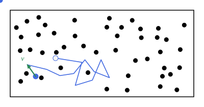

Открой флакон духов в углу комнаты. Через минуту-другую запах почувствуют у двери. Ветра нет, никто ничего не переносил. Значит, молекулы духов добрались туда сами. В этом уроке — как и почему.

## Диффузия

Брось в стакан воды чайный пакетик и не трогай. Сначала вокруг него появится коричневое облачко, потом оно расползётся, и через какое-то время чай окрасит всю воду. Никто не мешал, а вещества перемешались.

**Диффузия** — взаимное проникновение соприкасающихся веществ друг в друга из-за беспорядочного движения их молекул. Молекулы чая, двигаясь, пробираются между молекулами воды, а молекулы воды — между молекулами чая.

Диффузия идёт везде, но с разной скоростью:

- **в газах** — быстро: запах разносится за минуты;
- **в жидкостях** — медленнее: капля чернил в воде расплывается часами;
- **в твёрдых телах** — очень медленно: если плотно прижать пластинки золота и свинца, за несколько лет атомы золота проникнут в свинец примерно на миллиметр.

## Почему запах идёт минуты, а не мгновенно

Молекулы воздуха при комнатной температуре летают со скоростью около $500\ \text{м/с}$ — быстрее звука. Если бы молекула летела по прямой, класс длиной $10\ \text{м}$ она пересекла бы, как тело в равномерном движении (урок 1.2 из механики), за

$$
t = \frac{s}{v} = \frac{10}{500} = 0{,}02\ \text{с}.
$$

Почему же запах идёт минуты?

Потому что лететь по прямой ей не дают. Молекул вокруг очень много, и каждая молекула духов миллиарды раз в секунду сталкивается с молекулами воздуха. После каждого удара она летит в новую сторону. Её путь — запутанная ломаная, и вперёд она продвигается намного медленнее, чем летит.

<pp-task id="ks-mkt-08"></pp-task>

## Чем горячее, тем быстрее

Опусти один чайный пакетик в холодную воду, другой — в горячую. В горячей вода окрасится намного быстрее. Значит, в горячей воде молекулы движутся быстрее.

Беспорядочное движение молекул называют **тепловым**: оно связано с температурой. Чем выше температура, тем быстрее движутся молекулы. Остановиться совсем они не могут — и в лютый мороз, и во льду они движутся, только медленнее.

## Броуновское движение

В 1827 году ботаник Роберт Броун рассматривал в микроскоп капельку воды с мельчайшими частицами из пыльцы растений. Частицы всё время беспорядочно дёргались, хотя вода была спокойна. И не переставали, сколько Броун ни смотрел.

Объяснили это намного позже. Частицу со всех сторон ударяют молекулы воды. Ударов очень много, но они случайны: в какой-то миг слева ударило больше молекул, чем справа, — частицу толкнуло вправо. В следующий миг — наоборот. Удары не уравновешивают друг друга, и частица дёргается.

**Броуновское движение** — беспорядочное движение мелких частиц, взвешенных в жидкости или газе, под ударами молекул. Его видно и в воздухе: так пляшут частички дыма.

Важно: в микроскоп видно движение **частиц**, а не молекул. Молекулы слишком малы, их не видно. Мы видим их работу — как по качающимся верхушкам деревьев видим ветер.

Учёный Жан Перрен отмечал, где находится частица, через каждые $30$ секунд, и соединял отметки прямыми. Получалась ломаная, как справа на рисунке. Настоящий путь частицы ещё запутаннее: между отметками она тоже дёргается.

Проверь себя: почему лодка на воде не дёргается от ударов молекул, а мелкая частица дёргается?

Лодку ударяют невообразимо много молекул со всех сторон сразу. Случайные перевесы с одной стороны ничтожны по сравнению с её массой, и удары в среднем уравновешиваются. У крошечной частицы ударов мало, и перевес с одной стороны заметно её сдвигает. Поэтому броуновское движение видно только у очень мелких частиц.

## Попробуй сам

В модели крупная частица (синяя) плавает среди молекул. Её положение отмечается каждые полсекунды, и отметки соединяются прямыми, как у Перрена. Нажми «Пуск».

<pp-brownian t="20">Модель: крупная частица среди молекул. Молекулы ударяют её с разных сторон, и она беспорядочно дёргается; её положения через каждые полсекунды соединены прямыми.</pp-brownian>

Посмотри, что выходит:

- частица дёргается то туда, то сюда — посмотри, какие молекулы её толкают;
- переключи молекулы на «не видны» — теперь ты видишь то же, что Броун в микроскоп: частица дёргается без видимой причины;
- подними температуру и запусти заново: молекулы летают быстрее, частицу толкает сильнее, отметки ложатся дальше друг от друга.

## Частые ловушки

- **Думают, что в броуновском движении видны молекулы.** Видны частицы, которые толкают молекулы.
- **Считают, что диффузия бывает только в газах.** В жидкостях и твёрдых телах тоже, только медленнее.
- **Думают, что при низкой температуре молекулы останавливаются.** Они движутся медленнее, но не останавливаются.
- **Считают, что запах распространяется со скоростью молекул.** Молекулы летят зигзагом из-за столкновений, поэтому запах идёт намного медленнее.

## Коротко

- Молекулы непрерывно и беспорядочно движутся — это тепловое движение.
- Чем выше температура, тем быстрее движутся молекулы.
- Диффузия — взаимное проникновение веществ; в газах быстрее всего, в твёрдых телах медленнее всего.
- Броуновское движение — беспорядочное движение мелких частиц под ударами молекул; видны частицы, а не молекулы.

Дальше — урок 1.3: если молекулы движутся, почему камень не рассыпается.
