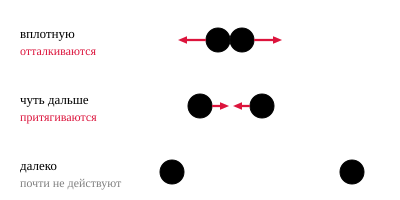
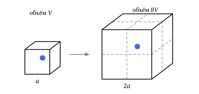

Молекулы непрерывно движутся, а между ними есть промежутки. Почему же тогда камень не рассыпается в пыль, а капля воды держится каплей? Что-то удерживает молекулы вместе. В этом уроке — что.

## Молекулы притягиваются

Попробуй разорвать толстую нить или сломать палку. Нужно усилие — частицы тела держатся друг за друга. Значит, между молекулами действуют **силы притяжения**.

Опыт: два свинцовых цилиндра со свежими гладкими срезами прижимают друг к другу и слегка поворачивают. Они слипаются так прочно, что выдерживают подвешенную гирю. Так же сливаются две капли воды, едва коснувшись друг друга. А в уроке 6.3 из механики мы видели, что там, где поверхности прижаты совсем плотно, молекулы притягиваются — это одна из причин трения.

Почему же не срастаются осколки разбитой чашки, если их приложить друг к другу? Притяжение действует только на очень малых расстояниях — сравнимых с размером самих молекул. Осколки соприкасаются лишь в немногих точках, а в остальных местах между ними огромные, по меркам молекул, зазоры.

## Молекулы отталкиваются

Твёрдое тело или жидкость сжать очень трудно. Если бы молекулы только притягивались, они слиплись бы в комок. Значит, при сближении вплотную между ними возникают **силы отталкивания**.

Получается так:

- **вплотную** молекулы отталкиваются;
- **чуть дальше** — притягиваются;
- **далеко** — почти не действуют друг на друга.

Где-то между «вплотную» и «чуть дальше» есть расстояние, на котором притяжение и отталкивание уравновешены. Там молекулы твёрдого тела и находятся.

Отсюда берётся сила упругости из урока 6.1 из механики. Растянули пружину — молекулы немного разошлись, и притяжение тянет их назад. Сжали — сблизились, и отталкивание толкает их обратно.

## Газ, жидкость, кристалл

Одно и то же вещество бывает газом, жидкостью и твёрдым телом: пар, вода, лёд. Молекулы во всех трёх одинаковые — молекулы $\text{H}_2\text{O}$. Различаются расположение молекул и то, как они движутся.

- **Газ.** Молекулы далеко друг от друга — намного дальше, чем их размер. Притяжение почти не действует, молекулы летают свободно, пока не столкнутся. Поэтому газ занимает весь сосуд и легко сжимается.
- **Жидкость.** Молекулы вплотную, но без строгого порядка. Каждая колеблется среди соседей и время от времени перескакивает на новое место. Поэтому жидкость сохраняет объём, но течёт и принимает форму сосуда.
- **Кристалл** (твёрдое тело). Частицы стоят в строгом порядке — в узлах **кристаллической решётки** — и только колеблются около своих мест. Поэтому твёрдое тело сохраняет и объём, и форму.

## Как далеко друг от друга молекулы

Представь, что каждая молекула занимает свой маленький кубик, а сама сидит в его середине. Ребро кубика — это расстояние до соседних молекул.

Если вещество расширилось и на каждую молекулу приходится в $8$ раз больше места, во сколько раз выросло расстояние между ними? Не в $8$! Кубик с ребром $2a$ складывается из $2 \cdot 2 \cdot 2 = 8$ кубиков с ребром $a$. Значит, объём в $8$ раз больше, а ребро — всего в $2$ раза.

Правило: **объём растёт в $k \cdot k \cdot k$ раз, когда расстояние растёт в $k$ раз.** Чтобы найти, во сколько раз выросло расстояние, ищи число, которое трижды умноженное само на себя даёт рост объёма.

Проверь себя: на каждую молекулу стало приходиться в 125 раз больше места. Во сколько раз выросло расстояние между молекулами?

$5 \cdot 5 \cdot 5 = 125$, поэтому расстояние выросло в $5$ раз.

<pp-task id="ks-mkt-09"></pp-task>

## Частые ловушки

- **Думают, что молекулы льда, воды и пара разные.** Молекулы одинаковые; различаются расположение и движение.
- **Считают, что молекулы газа вообще не взаимодействуют.** Почти не взаимодействуют, пока далеко; при столкновении отталкиваются.
- **Думают, что молекулы только притягиваются.** Вплотную они отталкиваются — поэтому жидкость и твёрдое тело трудно сжать.
- **Рост объёма путают с ростом расстояния.** Объём в $8$ раз больше — расстояние в $2$ раза.

## Коротко

- Молекулы притягиваются и отталкиваются: вплотную отталкиваются, чуть дальше притягиваются, далеко почти не действуют.
- Газ: молекулы далеко, летают свободно, занимает весь сосуд.
- Жидкость: вплотную, перескакивают с места на место, сохраняет объём и течёт.
- Кристалл: частицы колеблются около узлов решётки, сохраняет объём и форму.
- Объём на молекулу растёт в $k \cdot k \cdot k$ раз, когда расстояние растёт в $k$ раз.

Дальше — урок 1.4. Начинается 10 класс: как сосчитать молекулы, если их невообразимо много.
