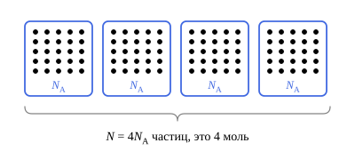

В стакане воды около $7 \cdot 10^{24}$ молекул — семь миллионов миллиардов миллиардов. Считать их поштучно невозможно, да и записывать такие числа неудобно. Как в физике считают молекулы — в этом уроке.

## Счёт пачками

Яйца продают десятками, бумагу — пачками по $500$ листов. Никто не говорит «купил $1500$ листов» — говорят «три пачки». Так проще: пачка — удобная единица счёта.

Для молекул нужна огромная пачка. Её называют **моль**. Договорились так: в одном моле столько частиц, сколько атомов в $12\ \text{г}$ углерода. Это число называют **постоянной Авогадро**:

$$
N_A = 6{,}02 \cdot 10^{23}\ \text{моль}^{-1}.
$$

В задачах ЕГЭ берут $N_A = 6 \cdot 10^{23}\ \text{моль}^{-1}$. Единица $\text{моль}^{-1}$ читается «на моль»: $6 \cdot 10^{23}$ частиц на каждый моль.

Моль — это число частиц, а не масса. Моль атомов углерода, моль молекул воды, моль молекул воздуха — в каждом $N_A$ частиц.

## Количество вещества

**Количество вещества** $\nu$ («ню») — сколько молей в теле. Чтобы узнать, сколько пачек, делим число частиц $N$ на число частиц в одной пачке:

$$
\nu = \frac{N}{N_A}.
$$

Единица количества вещества — **моль**. Это одна из основных единиц СИ, как метр, килограмм и секунда.

**Пример.** В сосуде $2{,}4 \cdot 10^{24}$ молекул. Сколько это молей? Чтобы удобно делить, приведём числа к одной степени десяти: $2{,}4 \cdot 10^{24} = 24 \cdot 10^{23}$. Тогда

$$
\nu = \frac{24 \cdot 10^{23}}{6 \cdot 10^{23}} = 4\ \text{моль}.
$$

Степени $10^{23}$ сократились. Если не сокращаются — помни правило из урока 1.1: при делении показатели вычитаются.

<pp-task id="ks-mkt-02"></pp-task>

## Обратно: сколько частиц

Знаем, сколько молей, — найдём, сколько частиц. В каждом моле $N_A$ частиц, а молей $\nu$:

$$
N = \nu N_A.
$$

**Пример.** В $10\ \text{моль}$ газа $N = 10 \cdot 6 \cdot 10^{23} = 6 \cdot 10^{24}$ молекул.

Ответы с такими числами на ЕГЭ просят записать «в единицах $10^{23}$» или подобных. Тогда в бланк пишут только множитель перед степенью: $6 \cdot 10^{24} = 60 \cdot 10^{23}$, в единицах $10^{23}$ — это $60$.

<pp-task id="ks-mkt-10"></pp-task>

Проверь себя: где больше частиц — в одном моле железа или в одном моле воды?

Поровну: в любом моле $N_A$ частиц. Моль — это число частиц, а не масса и не объём. Масса у этих двух молей разная — об этом следующий урок.

## Частые ловушки

- **Путают $\nu$ — количество вещества и $\nu$ — частоту.** Буква одна, смысл разный; смотри по контексту.
- **Считают моль единицей массы.** Моль — число частиц: $N_A$ штук.
- **Переворачивают дробь.** $\nu = N/N_A$: число частиц делим на число частиц в моле. Если вышло $\nu$ меньше единицы при $N \gg N_A$ — дробь перевёрнута.
- **Ошибаются с запятой в ответе «в единицах $10^{23}$».** $2{,}4 \cdot 10^{24} = 24 \cdot 10^{23}$, а не $2{,}4 \cdot 10^{23}$.

## Коротко

- Моль — пачка из $N_A = 6 \cdot 10^{23}$ частиц: столько атомов в $12\ \text{г}$ углерода.
- Количество вещества $\nu = \dfrac{N}{N_A}$, в молях.
- Обратно $N = \nu N_A$.

Дальше — урок 1.5: сколько весит один моль.
