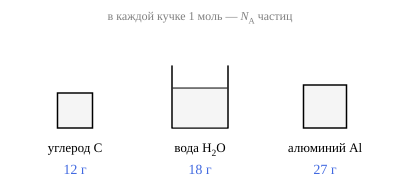

Сосчитать молекулы поштучно нельзя. А взвесить тело можно за секунду. Если знать, сколько весит один моль, то по массе тела легко узнать, сколько в нём молей. В этом уроке — как найти массу одного моля любого вещества.

## Масса одного моля

В одном моле железа и в одном моле воды частиц поровну — по $N_A$. Но молекулы у них разные по массе, поэтому и моли весят по-разному.

**Молярная масса** $M$ — масса одного моля вещества. Единица в СИ — килограмм на моль, $\text{кг/моль}$. В задачах её часто дают в граммах на моль: $1\ \text{г/моль} = 10^{-3}\ \text{кг/моль}$.

## Молярная масса из таблицы Менделеева

В таблице Менделеева у каждого элемента указана **относительная атомная масса** — во сколько раз атом тяжелее, если за единицу взять двенадцатую часть атома углерода. Её округляют до целых:

| Элемент | Относительная атомная масса |
|---|---|
| водород H | $1$ |
| гелий He | $4$ |
| углерод C | $12$ |
| азот N | $14$ |
| кислород O | $16$ |
| алюминий Al | $27$ |

Для молекулы складывают массы её атомов — получается **относительная молекулярная масса** $M_r$. Моль определён через $12\ \text{г}$ углерода, у которого относительная масса $12$, — поэтому для любого вещества

$$
M = M_r \cdot 10^{-3}\ \text{кг/моль},
$$

то есть один моль весит $M_r$ граммов.

**Пример.** Вода $\text{H}_2\text{O}$: два атома водорода и один кислорода, $M_r = 2 \cdot 1 + 16 = 18$. Молярная масса воды $M = 18\ \text{г/моль} = 18 \cdot 10^{-3}\ \text{кг/моль}$.

Внимание: водород, азот и кислород в воздухе — не отдельные атомы, а **двухатомные молекулы** $\text{H}_2$, $\text{N}_2$, $\text{O}_2$. Для азота $M = 2 \cdot 14 = 28\ \text{г/моль}$, а не $14$. А гелий и другие инертные газы — одиночные атомы, поэтому моль гелия весит просто $4\ \text{г}$.

## Количество вещества по массе

Если один моль весит $M$, то в теле массой $m$ молей

$$
\nu = \frac{m}{M}.
$$

**Пример.** Сколько молей в $90\ \text{г}$ воды?

$$
\nu = \frac{90}{18} = 5\ \text{моль}.
$$

Здесь и масса, и молярная масса в граммах — граммы сокращаются. В СИ получится то же самое: $0{,}09 / 0{,}018 = 5$. Главное — не смешивать: масса в граммах, а молярная масса в кг/моль дадут ответ в тысячу раз больше.

<pp-task id="ks-mkt-03"></pp-task>

## Масса по количеству вещества

Обратно: масса $\nu$ молей —

$$
m = \nu M.
$$

**Пример.** Масса $4\ \text{моль}$ азота $\text{N}_2$: $m = 4 \cdot 28 = 112\ \text{г}$.

<pp-task id="ks-mkt-11"></pp-task>

Проверь себя: что тяжелее — один моль гелия или один моль водорода?

Моль гелия He — $4\ \text{г}$, моль водорода $\text{H}_2$ — $2 \cdot 1 = 2\ \text{г}$. Гелий вдвое тяжелее, хотя атомов гелия в нём столько же, сколько молекул водорода.

## Частые ловушки

- **Молярную массу берут в граммах на моль там, где нужна СИ.** В СИ — кг/моль: у воды $0{,}018$, а не $18$.
- **Забывают, что водород, азот и кислород двухатомные.** $M(\text{N}_2) = 28\ \text{г/моль}$, а не $14$.
- **Смешивают граммы и килограммы в $m/M$.** Обе величины — в граммах или обе в СИ.
- **Путают $\nu$ и $m$.** Количество вещества — в молях, масса — в килограммах.

## Коротко

- Молярная масса $M$ — масса одного моля, кг/моль.
- $M = M_r \cdot 10^{-3}\ \text{кг/моль}$, $M_r$ — сумма относительных атомных масс из таблицы Менделеева.
- $\text{H}_2$, $\text{N}_2$, $\text{O}_2$ — двухатомные; инертные газы — одноатомные.
- $\nu = \dfrac{m}{M}$, $m = \nu M$.

Дальше — урок 1.6: сколько молекул в теле и сколько весит одна молекула.
