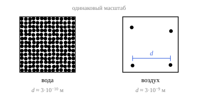

Два одинаковых баллона, в одном газа больше, чем в другом. Где молекулы теснее? Число молекул само по себе ответа не даёт: важно, сколько их приходится на единицу объёма. Эту величину называют концентрацией. От неё в следующей теме будет зависеть давление газа.

## Концентрация

**Концентрация** $n$ — число частиц в единице объёма:

$$
n = \frac{N}{V}, \qquad [n] = \text{м}^{-3}.
$$

Единица $\text{м}^{-3}$ читается «на кубический метр»: сколько молекул в каждом кубометре.

**Пример.** В сосуде объёмом $0{,}25\ \text{м}^3$ находится $9 \cdot 10^{24}$ молекул:

$$
n = \frac{9 \cdot 10^{24}}{0{,}25} = 36 \cdot 10^{24} = 3{,}6 \cdot 10^{25}\ \text{м}^{-3}.
$$

Если в задаче дано количество вещества, сначала находим число молекул: $N = \nu N_A$ (урок 1.4).

## Объём — в кубических метрах

Объёмы в задачах дают в литрах и кубических сантиметрах. Перевод — как в уроке 1.1 из механики, кубическая единица — это куб:

- $1\ \text{л} = 1\ \text{дм}^3 = (10^{-1}\ \text{м})^3 = 10^{-3}\ \text{м}^3$;
- $1\ \text{см}^3 = (10^{-2}\ \text{м})^3 = 10^{-6}\ \text{м}^3$.

Литр и кубический сантиметр различаются в тысячу раз: $1\ \text{л} = 1000\ \text{см}^3$. Перепутаешь — концентрация выйдет в тысячу раз меньше.

<pp-task id="ks-mkt-06"></pp-task>

<pp-task id="ks-mkt-13"></pp-task>

## Концентрация через плотность

Иногда дано не число молекул, а плотность вещества $\rho = m/V$ (её мы использовали в уроке 9.2 из механики). Число молекул $N = \dfrac{m}{M} N_A$, поделим его на объём:

$$
n = \frac{N}{V} = \frac{m}{V} \cdot \frac{N_A}{M} = \frac{\rho N_A}{M}.
$$

**Пример.** Вода: $\rho = 1000\ \text{кг/м}^3$, $M = 18 \cdot 10^{-3}\ \text{кг/моль}$.

$$
n = \frac{1000 \cdot 6 \cdot 10^{23}}{18 \cdot 10^{-3}}
$$

$$
n \approx 3{,}3 \cdot 10^{28}\ \text{м}^{-3}.
$$

А в воздухе при обычных условиях $n \approx 2{,}7 \cdot 10^{25}\ \text{м}^{-3}$ — примерно в $1200$ раз меньше.

## Как далеко друг от друга молекулы

Вспомним кубики из урока 1.3: каждая молекула занимает свой кубик с ребром $d$ — это расстояние до соседей. В одном кубометре $n$ молекул, поэтому объём кубика $d^3 = 1/n$, а

$$
d = \frac{1}{\sqrt[3]{n}}.
$$

- Вода: $\sqrt[3]{3{,}3 \cdot 10^{28}} = \sqrt[3]{33 \cdot 10^{27}} \approx 3{,}2 \cdot 10^{9}$, $d \approx 3 \cdot 10^{-10}\ \text{м}$. Это и есть размер молекулы воды: в жидкости молекулы вплотную.
- Воздух: $\sqrt[3]{2{,}7 \cdot 10^{25}} = \sqrt[3]{27 \cdot 10^{24}} = 3 \cdot 10^{8}$, $d \approx 3 \cdot 10^{-9}\ \text{м}$ — около десяти размеров молекулы.

Так числа подтверждают картинку из урока 1.3: в газе молекулы далеко друг от друга, и поэтому газ легко сжать.

Проверь себя: тот же газ перекачали из баллона в баллон вдвое большего объёма. Как изменилась концентрация?

Число молекул то же, объём вдвое больше: $n = N/V$ уменьшилась вдвое.

## Частые ловушки

- **Оставляют объём в литрах.** $1\ \text{л} = 10^{-3}\ \text{м}^3$.
- **Переводят кубические сантиметры как литры.** $1\ \text{см}^3 = 10^{-6}\ \text{м}^3$, а не $10^{-3}$.
- **Путают концентрацию $n$ и количество вещества $\nu$.** $n$ — молекул на кубометр, $\nu$ — молей во всём теле.
- **Забывают умножить на $N_A$.** Если дано $\nu$, то $n = \nu N_A / V$, а не $\nu / V$.

## Коротко

- Концентрация $n = \dfrac{N}{V}$, м⁻³.
- $1\ \text{л} = 10^{-3}\ \text{м}^3$, $1\ \text{см}^3 = 10^{-6}\ \text{м}^3$.
- Через плотность $n = \dfrac{\rho N_A}{M}$.
- Расстояние между молекулами $d = 1/\sqrt[3]{n}$: в жидкости — размер молекулы, в газе — во много раз больше.

Это последний урок темы. Дальше — тема «Идеальный газ — давление и температура»: как удары молекул о стенки создают давление.
