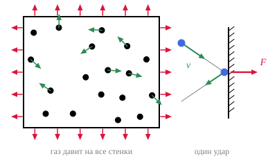

Накачай велосипедную шину — она станет твёрдой. Почему воздух внутри давит на стенки? Его молекулы миллиарды раз в секунду бьют по резине. Эта тема объясняет, откуда берутся давление и температура газа. Она нужна в задачах 7, 9 и 10.

Что давление газа создают удары молекул, объясняют в 7 классе, что такое температура — в 8. Формулы, которые связывают давление и температуру с движением молекул, — в 10. Пригодятся тема «Основы МКТ» (моль, масса молекулы, концентрация) и импульс из механики.

## Шаг 1. Откуда давление газа (7 класс)

Каждая молекула, ударившись о стенку, передаёт ей небольшой импульс. Ударов очень много — в сумме получается постоянная сила на каждый квадратный метр. Это и есть давление газа.

Отсюда сразу видно, от чего давление зависит:

- молекул в сосуде больше (газ сжали или накачали ещё) — ударов больше, давление больше;
- молекулы движутся быстрее (газ нагрели) — удары сильнее и чаще, давление больше.

Газ давит на стенки одинаково во все стороны — молекулы летают хаотично, без любимого направления.

## Шаг 2. Температура (8 класс)

Прикоснись к горячей кружке — молекулы её стенки колеблются энергичнее, чем молекулы твоей руки, и передают энергию. Чем быстрее движутся частицы тела, тем выше его температура.

Если два тела привести в контакт, энергия переходит от горячего к холодному, пока температуры не сравняются. Это **тепловое равновесие**. На нём работает термометр: он принимает температуру тела, которое измеряет.

## Шаг 3. Модель идеального газа (10 класс)

Реальные молекулы сложные. Чтобы считать просто, физики придумали модель — **идеальный газ**:

- молекулы — точки, их собственный объём не учитывают;
- молекулы не взаимодействуют на расстоянии;
- столкновения с другими молекулами и стенками абсолютно упругие.

Воздух при комнатной температуре и обычном давлении ведёт себя почти как идеальный газ. Модель плохо работает при очень высоком давлении и низкой температуре, когда газ близок к сжижению.

## Шаг 4. Абсолютная температура (10 класс)

В физике используют **абсолютную температуру** (шкала Кельвина):

$$
T = t + 273.
$$

$T$ — в кельвинах (К), $t$ — в градусах Цельсия. Ноль по Кельвину — абсолютный ноль, $-273\ ^\circ\text{C}$: ниже не бывает, при нём тепловое движение прекратилось бы. Изменение температуры на $1\ \text{К}$ равно изменению на $1\ ^\circ\text{C}$.

Во всех формулах МКТ — только кельвины.

<pp-task id="ks-gas-01"></pp-task>

## Шаг 5. Температура и энергия молекул (10 класс)

Теперь точно: **температура** — мера средней кинетической энергии теплового движения молекул.

$$
\overline{E}_{\text{к}} = \frac{3}{2} k T,
$$

где $k = 1{,}38 \cdot 10^{-23}\ \text{Дж/К}$ — постоянная Больцмана, а $\overline{E}_{\text{к}}$ — средняя кинетическая энергия поступательного движения одной молекулы. Она зависит **только от температуры** — не от сорта газа.

<pp-task id="ks-gas-02"></pp-task>

## Шаг 6. Основное уравнение МКТ (10 класс)

Шаг 1 можно записать формулой. Если сложить импульсы, которые молекулы передают стенке, получится **основное уравнение МКТ**:

$$
p = \frac{1}{3} m_0 n \overline{v^2} = \frac{2}{3} n \overline{E}_{\text{к}}.
$$

- $m_0$ — масса молекулы, кг;
- $n$ — концентрация молекул, $\text{м}^{-3}$;
- $\overline{v^2}$ — средний квадрат скорости молекул;
- $\overline{E}_{\text{к}}$ — средняя кинетическая энергия поступательного движения молекулы, Дж.

Смысл тот же, что в 7 классе: давление больше, если молекул больше (больше $n$) и если они бьют сильнее (больше энергия).

<pp-task id="ks-gas-03"></pp-task>

## Шаг 7. Давление через температуру: $p = nkT$ (10 класс)

Подставим энергию из шага 5 в основное уравнение:

$$
p = \frac{2}{3} n \cdot \frac{3}{2} k T = n k T.
$$

Это очень удобная формула. При одинаковых давлении и температуре концентрация молекул у всех газов одинакова.

<pp-task id="ks-gas-04"></pp-task>

## Шаг 8. Средняя квадратичная скорость (10 класс)

Из $\dfrac{m_0 \overline{v^2}}{2} = \dfrac{3}{2} k T$:

$$
v_{\text{кв}} = \sqrt{\frac{3 k T}{m_0}} = \sqrt{\frac{3 R T}{M}},
$$

$R = 8{,}31\ \text{Дж/(моль·К)}$ — универсальная газовая постоянная.

Скорость пропорциональна $\sqrt T$, а не $T$: температура выросла в 4 раза — скорость выросла в 2.

<pp-task id="ks-gas-05"></pp-task>

## Шаг 9. Разные газы при одной температуре (10 класс)

При одной температуре средняя энергия молекул у всех газов одинакова. А скорости — разные: лёгкие молекулы движутся быстрее, $v_{\text{кв}} \propto 1/\sqrt{M}$.

Например, при одной температуре молекулы водорода в 4 раза быстрее молекул кислорода: масса меньше в 16 раз, а $\sqrt{16} = 4$.

<pp-task id="ks-gas-06"></pp-task>

## Частые ловушки

- **Подставляют температуру в градусах Цельсия.** Во всех формулах МКТ — только кельвины.
- **«Температура выросла вдвое» с $20$ до $40\ ^\circ\text{C}$.** В кельвинах это $293 \to 313$ — рост на $7\,\%$, а не вдвое.
- **Думают, что у тяжёлых молекул больше средняя кинетическая энергия.** При одной температуре энергия одинакова, отличаются скорости.
- **Скорость пропорциональна $T$.** Нет, $\sqrt T$: температура выросла в 4 раза — скорость в 2.

## Как это выглядит на ЕГЭ

*Абсолютную температуру газа увеличили в $4$ раза. Во сколько раз изменилась средняя квадратичная скорость его молекул?*

$v_{\text{кв}} = \sqrt{3kT/m_0}$, то есть скорость пропорциональна $\sqrt T$. Температура выросла в 4 раза — скорость выросла в $\sqrt 4 = 2$ раза.

А средняя кинетическая энергия, $\frac{3}{2}kT$, выросла в 4 раза — как и температура.

## Коротко

- Давление газа — удары молекул о стенки.
- Идеальный газ: молекулы-точки, не взаимодействуют, удары упругие.
- $T = t + 273$; $\overline E_{\text{к}} = \frac{3}{2}kT$.
- $p = \frac{1}{3} m_0 n \overline{v^2} = \frac{2}{3} n \overline E_{\text{к}}$.
- $p = nkT$.
- $v_{\text{кв}} = \sqrt{3RT/M}$, растёт как $\sqrt T$; лёгкие молекулы быстрее.
