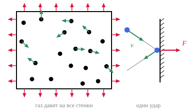
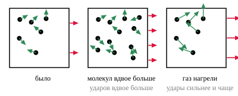

Накачай велосипедную шину — она станет твёрдой. Надуй воздушный шарик — он раздуется во все стороны. Воздух внутри давит на резину, хотя его не видно и он почти ничего не весит. В уроке 1.7 мы обещали объяснить, откуда берётся это давление. Объясняем.

## Удар за ударом

Вспомни урок 1.2: молекулы газа непрерывно летают во все стороны. В уроке 1.3 мы видели, что в газе они далеко друг от друга и летят по прямой, пока на что-нибудь не наткнутся. Часто они натыкаются на стенку сосуда.

Молекула ударяется о стенку и отскакивает. Как мяч, отскочивший от стены (урок 10.5 из механики), она при этом толкает стенку. Один такой толчок ничтожно мал: молекула очень лёгкая.

Но молекул очень много. О каждый квадратный сантиметр стенки бьются миллиарды миллиардов молекул в секунду. Толчки сливаются в одну ровную силу. Её делят на площадь стенки и получают **давление газа** — как в уроке 9.1 из механики:

$$
p = \frac{F}{S}.
$$

**Пример.** В накачанной велосипедной шине давление около $350\ \text{кПа}$. С какой силой воздух давит изнутри на каждый квадратный сантиметр шины? $S = 1\ \text{см}^2 = 10^{-4}\ \text{м}^2$, поэтому

$$
F = pS = 350\,000 \cdot 10^{-4} = 35\ \text{Н}.
$$

Как будто на каждом квадратном сантиметре стоит гиря массой $3{,}5\ \text{кг}$. Поэтому шина такая твёрдая.

<pp-task id="ks-gas-07"></pp-task>

## Во все стороны одинаково

У молекул нет любимого направления: они летают как попало. Поэтому о верхнюю стенку они бьются так же часто и так же сильно, как о нижнюю и боковые. **Газ давит на все стенки одинаково.** Вот почему шарик раздувается круглым, а не вытягивается.

Этим газ отличается от груды песка, которая давит только вниз, на дно. Газ передаёт давление во все стороны — как в законе Паскаля (урок 9.3 из механики).

## От чего зависит давление

Раз давление — это удары, оно больше, когда ударов больше или когда они сильнее.

- **Молекул больше.** Накачали в шину ещё воздуха или сжали газ поршнем — в каждом кубическом сантиметре стало больше молекул. Ударов о стенку больше — давление больше.
- **Молекулы быстрее.** Газ нагрели — молекулы летают быстрее (урок 1.2). Каждая бьёт сильнее и долетает до стенки чаще. Давление больше.

Поэтому баллончик с краской нельзя нагревать: давление внутри вырастет так, что баллончик может лопнуть. А шина, накачанная в тёплом гараже, на морозе становится мягче.

Проверь себя: почему мяч, накачанный дома, на зимней улице становится мягче, хотя из него ничего не вытекло?

Молекул в мяче столько же. Но на морозе они движутся медленнее: бьют по стенкам слабее и реже. Давление внутри уменьшилось, и мяч стал мягче. Внесёшь его в тепло — снова станет упругим.

## Попробуй сам

В модели молекулы летают в сосуде и отскакивают от стенок. Правая стенка — датчик: каждый удар о неё отмечается красной вспышкой, и модель складывает толчки в давление. Оно показано полоской внизу, в единицах $p_0$ — это давление при $100$ молекулах и обычной комнатной температуре. Нажми «Пуск».

<pp-gas n="100" t="300">Модель: молекулы газа в сосуде ударяются о стенки. Удары о правую стенку отмечены вспышками и складываются в давление на неё. Можно менять число молекул и температуру.</pp-gas>

Посмотри, что выходит:

- удары сыплются вразнобой, а полоска давления быстро успокаивается — толчки складываются в ровную силу;
- сдвинь число молекул вдвое больше и запусти — ударов вдвое больше, и давление вдвое больше прошлого (пунктир);
- верни число молекул и подними температуру — молекулы летают быстрее, и давление тоже растёт. Температуру модель показывает в кельвинах — что это за шкала, разберём в уроке 2.3; градусы Цельсия написаны в скобках.

## Частые ловушки

- **Думают, что газ давит своим весом, как жидкость.** Газ в сосуде весит ничтожно мало. Давление создают удары молекул, поэтому газ давит и на крышку, и на дно одинаково.
- **Думают, что газ давит только вниз.** Молекулы летают во все стороны — газ давит на все стенки одинаково.
- **Считают, что при нагревании молекулы становятся больше, поэтому и давят сильнее.** Молекулы те же, они просто движутся быстрее.

## Коротко

- Давление газа — результат ударов его молекул о стенки.
- Газ давит на все стенки одинаково.
- Давление больше, если молекул в единице объёма больше и если они движутся быстрее (газ горячее).
- $p = \dfrac{F}{S}$, отсюда сила давления $F = pS$.

Дальше — урок 2.2: что такое температура.
