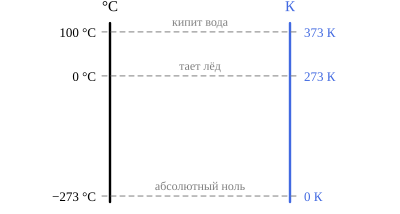

Нагреть тело можно до тысяч и миллионов градусов. А охладить? Чем холоднее, тем медленнее движутся молекулы. Значит, должна быть температура, при которой медленнее уже некуда. Она есть, и от неё физики отсчитывают температуру.

## Абсолютный ноль

Опыты и расчёты показывают: самая низкая возможная температура — около $-273\ ^\circ\text{C}$ (точнее, $-273{,}15\ ^\circ\text{C}$). Её называют **абсолютным нулём**. Ниже не бывает. При абсолютном нуле тепловое движение молекул прекратилось бы. Достичь его нельзя, но учёные подбирались к нему ближе чем на миллионную долю градуса.

## Шкала Кельвина

Шкала Цельсия начинается с тающего льда — ничем не особенной точки. Физикам удобнее начинать с абсолютного нуля. Так устроена **шкала Кельвина**, или **абсолютная шкала**. Температуру по ней называют **абсолютной** и обозначают большой буквой $T$, а температуру по Цельсию — маленькой $t$:

$$
T = t + 273.
$$

Единица — **кельвин** (К), без слова «градус». Кельвин равен градусу Цельсия: нагрели на $1\ ^\circ\text{C}$ — значит, нагрели на $1\ \text{К}$. Шкалы просто сдвинуты на $273$. Отрицательных кельвинов не бывает.

**Пример.** Комнатная температура $20\ ^\circ\text{C}$ — это $T = 20 + 273 = 293\ \text{К}$. Жидкий азот кипит при $-196\ ^\circ\text{C}$, то есть при $-196 + 273 = 77\ \text{К}$. Обратно: $t = T - 273$.

<pp-task id="ks-gas-01"></pp-task>

## Во всех формулах МКТ — кельвины

Во всех формулах этой темы стоит абсолютная температура. Причина простая: величины, о которых пойдёт речь, — давление газа, энергия молекул — пропорциональны именно $T$. Они обращаются в ноль при абсолютном нуле, а не при $0\ ^\circ\text{C}$, когда молекулы ещё вовсю движутся.

Особенно важно это, когда спрашивают «во сколько раз». Воду нагрели от $10\ ^\circ\text{C}$ до $30\ ^\circ\text{C}$. «Температура выросла втрое»? Нет: в кельвинах это $283 \to 303\ \text{К}$, рост всего на $7\ \%$. Отношение температур считают только в кельвинах.

А «на сколько» можно считать в любой шкале: нагрели на $20\ ^\circ\text{C}$ — значит, на $20\ \text{К}$.

<pp-task id="ks-gas-09"></pp-task>

Проверь себя: газ охладили на 15 °C. На сколько кельвинов изменилась его абсолютная температура?

На $15\ \text{К}$: кельвин и градус Цельсия одинаковые, шкалы только сдвинуты. Прибавлять $273$ к разности не нужно — сдвиг сокращается.

## Частые ловушки

- **Подставляют в формулы градусы Цельсия.** В формулах МКТ — только кельвины.
- **Считают отношение температур в градусах Цельсия.** «Во сколько раз» — только в кельвинах.
- **Прибавляют $273$ к разности температур.** Изменение на $15\ ^\circ\text{C}$ — это изменение на $15\ \text{К}$.
- **Пишут «градусы Кельвина».** Правильно — просто кельвины: $293\ \text{К}$.

## Коротко

- Абсолютный ноль — $-273\ ^\circ\text{C}$, ниже не бывает.
- $T = t + 273$, $t = T - 273$; $1\ \text{К}$ — то же, что $1\ ^\circ\text{C}$.
- Во всех формулах МКТ и в отношениях температур — только кельвины.

Дальше — урок 2.4: какая величина пропорциональна абсолютной температуре.
