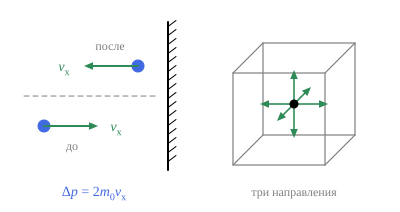

В уроке 2.1 мы поняли, почему газ давит: молекулы бьют по стенкам. Теперь посчитаем, с каким давлением. Для этого понадобятся импульс из механики и одно упрощение.

## Модель идеального газа

Настоящие молекулы сложные: у них есть размер, форма, они притягиваются друг к другу. Учитывать всё это сразу трудно. Физики поступают так же, как в механике с материальной точкой: придумывают упрощённую модель — **идеальный газ**.

- Молекулы — точки: их собственный объём не учитывают.
- Молекулы не взаимодействуют на расстоянии: не притягиваются и не отталкиваются, пока не столкнутся.
- Столкновения молекул друг с другом и со стенками абсолютно упругие: энергия не теряется.

Для газа это хорошее приближение. В уроках 1.3 и 1.7 мы видели: в газе молекулы далеко друг от друга, на расстоянии около десяти своих размеров, и почти не действуют друг на друга. Воздух при комнатной температуре и обычном давлении ведёт себя почти как идеальный газ. Модель плохо работает при очень высоком давлении и низкой температуре, когда молекулы сближаются и газ вот-вот станет жидкостью.

Модель из урока 2.1 устроена именно так: её молекулы — точки, которые друг друга не замечают.

## Один удар

Молекула массой $m_0$ летит к стенке со скоростью, проекция которой на ось, перпендикулярную стенке, равна $v_x$. Удар упругий: молекула отскакивает с той же $v_x$ в обратную сторону. Как у мяча в уроке 10.5 из механики, её импульс меняется на

$$
\Delta p = 2 m_0 v_x.
$$

Такой же импульс, только в обратную сторону, получает стенка (третий закон Ньютона).

## Все удары вместе

Теперь сложим удары за секунду. От чего зависит их сумма?

- Каждый удар передаёт импульс $2m_0v_x$ — пропорционально $m_0 v_x$.
- Число ударов в секунду пропорционально концентрации $n$ (урок 1.7) и тоже $v_x$: быстрые молекулы чаще долетают до стенки.

Получается: давление пропорционально $n \cdot m_0 v_x \cdot v_x = n m_0 v_x^2$. Аккуратный подсчёт (половина молекул летит к стенке, половина от неё — двойка из $2m_0v_x$ сокращается) даёт точно

$$
p = m_0 n \overline{v_x^2},
$$

где черта означает среднее по всем молекулам.

Осталась одна деталь. Молекулы летают во все стороны одинаково, ни одно направление не лучше других. Квадрат скорости складывается из трёх частей: $v^2 = v_x^2 + v_y^2 + v_z^2$, и в среднем все три части равны. Поэтому $\overline{v_x^2} = \dfrac{1}{3} \overline{v^2}$. Подставим — и получим **основное уравнение МКТ**:

$$
p = \frac{1}{3} m_0 n \overline{v^2}.
$$

- $m_0$ — масса молекулы, кг;
- $n$ — концентрация молекул, $\text{м}^{-3}$;
- $\overline{v^2}$ — **средний квадрат скорости** молекул, $\text{м}^2/\text{с}^2$: квадрат скорости каждой молекулы, усреднённый по всем.

<pp-task id="ks-gas-11"></pp-task>

## Через энергию молекул

Внутри формулы прячется средняя кинетическая энергия молекулы из урока 2.4: $\overline{E}_{\text{к}} = \dfrac{m_0 \overline{v^2}}{2}$. Перепишем:

$$
p = \frac{2}{3} n \cdot \frac{m_0 \overline{v^2}}{2},
$$

$$
p = \frac{2}{3} n \overline{E}_{\text{к}}.
$$

Это то же уравнение, другая запись. Смысл тот же, что в 7 классе: давление больше, если молекул в единице объёма больше (больше $n$) и если они бьют сильнее (больше энергия).

**Пример.** В баллоне концентрация молекул $2 \cdot 10^{26}\ \text{м}^{-3}$, средняя кинетическая энергия молекулы $4{,}5 \cdot 10^{-21}\ \text{Дж}$.

$$
p = \frac{2}{3} \cdot 2 \cdot 10^{26} \cdot 4{,}5 \cdot 10^{-21},
$$

$$
p = \frac{2}{3} \cdot 9 \cdot 10^{5} = 6 \cdot 10^5\ \text{Па}.
$$

Это $600\ \text{кПа}$ — в несколько раз больше, чем давит воздух вокруг нас.

<pp-task id="ks-gas-03"></pp-task>

Проверь себя: в двух сосудах одинаковая концентрация молекул, но в первом средняя кинетическая энергия молекул в 5 раз больше. В каком сосуде давление больше и во сколько раз?

$p = \frac{2}{3} n \overline{E}_{\text{к}}$: при одинаковой $n$ давление пропорционально энергии. В первом сосуде давление в $5$ раз больше.

## Частые ловушки

- **Путают множители.** В формуле через скорость стоит одна треть, через энергию — две трети.
- **Подставляют массу газа вместо массы молекулы.** В формуле $m_0$ — масса одной молекулы, $m_0 = M/N_A$ (урок 1.6).
- **Оставляют ответ в паскалях, когда просят килопаскали.** $1\ \text{кПа} = 1000\ \text{Па}$.
- **Считают, что идеальный газ — это «хороший» газ.** Это модель, упрощение. Реальные газы похожи на неё, пока они разрежены.

## Коротко

- Идеальный газ: молекулы-точки, не взаимодействуют на расстоянии, удары упругие.
- Удар о стенку: $\Delta p = 2m_0v_x$.
- Основное уравнение МКТ: $p = \dfrac{1}{3} m_0 n \overline{v^2} = \dfrac{2}{3} n \overline{E}_{\text{к}}$.

Дальше — урок 2.6: подставим в это уравнение температуру.
