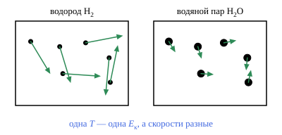

В уроке 1.2 мы сказали, что молекулы воздуха летают со скоростью около $500\ \text{м/с}$. Откуда взялось это число? Теперь у нас есть всё, чтобы его посчитать.

## Средняя квадратичная скорость

В уроке 2.4 средняя кинетическая энергия молекулы — это $\dfrac{m_0 \overline{v^2}}{2}$, и она равна $\dfrac{3}{2}kT$:

$$
\frac{m_0 \overline{v^2}}{2} = \frac{3}{2} k T \quad\Rightarrow\quad \overline{v^2} = \frac{3kT}{m_0}.
$$

Средний квадрат скорости — это не скорость, а скорость в квадрате. Извлечём корень и получим **среднюю квадратичную скорость**:

$$
v_{\text{кв}} = \sqrt{\overline{v^2}} = \sqrt{\frac{3kT}{m_0}}.
$$

Это типичная скорость теплового движения молекул. Она близка к средней скорости, но немного больше её: быстрые молекулы в квадрате весят больше.

## Через молярную массу

Массу молекулы обычно не дают, а молярную массу легко взять из таблицы Менделеева (урок 1.5). Подставим $m_0 = M/N_A$ (урок 1.6):

$$
v_{\text{кв}} = \sqrt{\frac{3kN_A T}{M}} = \sqrt{\frac{3RT}{M}}.
$$

Здесь $R = k N_A = 1{,}38 \cdot 10^{-23} \cdot 6{,}02 \cdot 10^{23} \approx 8{,}31\ \text{Дж/(моль·К)}$ — **универсальная газовая постоянная**. $M$ — в кг/моль.

**Пример.** Азот — основная часть воздуха, $M = 28 \cdot 10^{-3}\ \text{кг/моль}$. При $17\ ^\circ\text{C}$, то есть $T = 290\ \text{К}$:

$$
v_{\text{кв}} = \sqrt{\frac{3 \cdot 8{,}31 \cdot 290}{28 \cdot 10^{-3}}} \approx \sqrt{258\,000} \approx 510\ \text{м/с}.
$$

Вот они, те самые $500\ \text{м/с}$ из урока 1.2.

## Скорость растёт как корень из температуры

В формуле под корнем стоит $T$. Значит, скорость пропорциональна не $T$, а $\sqrt{T}$. Нагреем газ так, чтобы абсолютная температура выросла в $9$ раз, — средняя энергия вырастет в $9$ раз, а скорость только в $\sqrt 9 = 3$ раза.

Для отношений удобно писать

$$
\frac{v_2}{v_1} = \sqrt{\frac{T_2}{T_1}}.
$$

Температуры — конечно, в кельвинах (урок 2.3).

<pp-task id="ks-gas-05"></pp-task>

## Разные газы при одной температуре

При одной температуре средняя кинетическая энергия молекул у всех газов одинакова (урок 2.4). А скорости — разные: под корнем $M$ стоит в знаменателе, $v_{\text{кв}} \propto 1/\sqrt{M}$. **Лёгкие молекулы движутся быстрее.** Одинаковую энергию лёгкая молекула набирает большой скоростью, тяжёлая — массой.

**Пример.** Водород $\text{H}_2$ ($M = 2\ \text{г/моль}$) и водяной пар $\text{H}_2\text{O}$ ($M = 18\ \text{г/моль}$) при одной температуре:

$$
\frac{v_{\text{H}_2}}{v_{\text{H}_2\text{O}}} = \sqrt{\frac{M_{\text{H}_2\text{O}}}{M_{\text{H}_2}}} = \sqrt{\frac{18}{2}} = \sqrt 9 = 3.
$$

Молекулы водорода втрое быстрее. Молярные массы здесь можно брать в г/моль: в отношении единицы сокращаются.

Поэтому лёгкие газы медленно утекают из атмосферы: самые быстрые молекулы водорода и гелия иногда разгоняются так, что улетают от Земли совсем.

<pp-task id="ks-gas-06"></pp-task>

Проверь себя: во сколько раз средняя квадратичная скорость молекул водорода H₂ (2 г/моль) больше, чем у гелия He (4 г/моль), при одной температуре?

$\sqrt{4/2} = \sqrt 2 \approx 1{,}4$. Гелий тяжелее водорода вдвое, а скорость меньше не вдвое, а в $\sqrt 2$ раз.

## Частые ловушки

- **Считают, что скорость пропорциональна температуре.** Пропорциональна $\sqrt T$: температура в $9$ раз — скорость в $3$ раза.
- **Думают, что при одной температуре скорости молекул всех газов одинаковы.** Одинаковы энергии, а скорости больше у лёгких молекул.
- **Берут $M$ в г/моль в формуле $\sqrt{3RT/M}$.** Скорость выйдет в $\sqrt{1000} \approx 32$ раза больше. В отношениях скоростей г/моль можно, в самой формуле — только кг/моль.
- **Подставляют отношение температур в градусах Цельсия.** Только кельвины.

## Коротко

- $v_{\text{кв}} = \sqrt{\dfrac{3kT}{m_0}} = \sqrt{\dfrac{3RT}{M}}$, $R = 8{,}31\ \text{Дж/(моль·К)}$.
- Скорость пропорциональна $\sqrt T$: $\dfrac{v_2}{v_1} = \sqrt{\dfrac{T_2}{T_1}}$.
- При одной температуре энергии равны, а $v_{\text{кв}} \propto \dfrac{1}{\sqrt M}$: лёгкие молекулы быстрее.

Это последний урок темы. Дальше — тема «Уравнение состояния и изопроцессы»: соединим $p = nkT$ с количеством вещества и посмотрим, как газ меняется, когда одна из величин остаётся постоянной.
